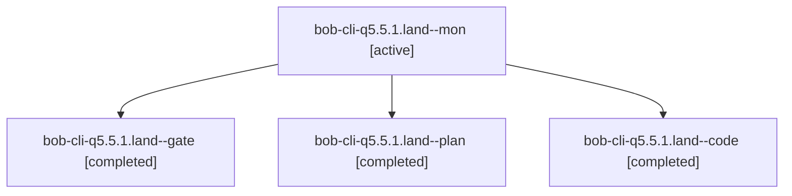

# Session: bob-cli-q5.5.1.land

[Agent Hoods](../README.md) / [bbugyi200](../users/bbugyi200/README.md) / [athena](../users/bbugyi200/machines/athena/README.md) / [bob-cli-q5](../users/bbugyi200/machines/athena/hoods/bob-cli-q5/README.md) / bob-cli-q5.5.1.land

Owner: `bbugyi200.athena` · Hood: `bob-cli-q5` · Members: 4 · Bead: [bob-cli-q5.5.1](https://github.com/bobs-org/bob-cli--beads/blob/main/pages/bob-cli-q5/bob-cli-q5.5.1.md)

## Lineage



The diagram is an optional enhancement; the ordered table below contains the same lineage in accessible text.

| Role | Agent | State | Model / provider | Timing | Commits | Prompt | Chat |
|---|---|---|---|---|---:|---|---|
| <a id="member-mon"></a>mon | bob-cli-q5.5.1.land--mon | active | gpt-6-luna / codex | 2026-11-27T04:10:14.911577+00:00 | 0 | — | — |
| <a id="member-gate"></a>gate | bob-cli-q5.5.1.land--gate | completed | opus / claude | 2026-11-27T03:47:27.003870+00:00 → 2026-11-27T03:47:35.718524+00:00 | 0 | — | [Chat](../agents/bbugyi200.athena.bob-cli-q5.5.1.land--gate/chat.md) |
| <a id="member-plan"></a>plan | bob-cli-q5.5.1.land--plan | completed | opus / claude | 2026-11-27T03:10:01.331254+00:00 → 2026-11-27T04:13:57.327417+00:00 | [1](../agents/bbugyi200.athena.bob-cli-q5.5.1.land--plan/README.md#commits) | [Prompt](../agents/bbugyi200.athena.bob-cli-q5.5.1.land--plan/prompt.md) | [Chat](../agents/bbugyi200.athena.bob-cli-q5.5.1.land--plan/chat.md) |
| <a id="member-code"></a>code | bob-cli-q5.5.1.land--code | completed | gpt-6-luna / codex | 2026-11-27T03:48:09.093217+00:00 → 2026-11-27T04:13:57.327417+00:00 | [1](../agents/bbugyi200.athena.bob-cli-q5.5.1.land--code/README.md#commits) | — | [Chat](../agents/bbugyi200.athena.bob-cli-q5.5.1.land--code/chat.md) |

## Commits

| Role | Repo | Commit | Subject | Committed |
|---|---|---|---|---|
| plan | bob-cli | [`dfb5e75`](https://github.com/bobs-org/bob-cli/commit/dfb5e7550051ce797bcb7d2de665900c0eaf2fde) | docs(snooze): describe the landed snooze-marks mirror and cross-link Today marks and plan | 2026-11-26 22:46:13 EST |
| code | bob-cli | [`d9f5774`](https://github.com/bobs-org/bob-cli/commit/d9f57741c248db678bcf43b56eade3b16a2e88f4) | docs: describe snooze clock labels and glyph contract | 2026-11-26 23:11:29 EST |

## Variables

| Role | Variable | Value |
|---|---|---|
| plan | `artifacts` | \[{kind: file, label: Snooze-marks e2e report on pre-epic bob-plugins feaa5b42 (Reading tomato baseline), path: /home/bryan/.sase/artifacts/agents/gh\_bobs-org\_\_bob-cli/20261126153908/base-report-c5920… |

#### artifacts

**Role:** `plan`

```yaml
- kind: file
  label: Snooze-marks e2e report on pre-epic bob-plugins feaa5b42 (Reading tomato baseline)
  path: /home/bryan/.sase/artifacts/agents/gh_bobs-org__bob-cli/20261126153908/base-report-c59201e5dd92.json
  ref: file:explicit:9c81ddbaa8df1a6b70768210
  source_path: /home/bryan/.cache/q551-land/base-report.json
```

Values are truncated for display; see each member's agent meta.json for the full values.

## Neighbors

| Agent | Relation | State |
|---|---|---|
| [bob-cli-q5.5](bbugyi200.athena.bob-cli-q5.5.md) (session · 3) | ancestor | active 1, completed 2 |
| [bob-cli-q5.5.1.1](../agents/bbugyi200.athena.bob-cli-q5.5.1.1/README.md) | bob-cli-q5.5.1 hood | completed |
| [bob-cli-q5.5.1.2](../agents/bbugyi200.athena.bob-cli-q5.5.1.2/README.md) | bob-cli-q5.5.1 hood | completed |
| [bob-cli-q5.5.1.3](../agents/bbugyi200.athena.bob-cli-q5.5.1.3/README.md) | bob-cli-q5.5.1 hood | completed |
| [bob-cli-q5.5.1.4](../agents/bbugyi200.athena.bob-cli-q5.5.1.4/README.md) | bob-cli-q5.5.1 hood | completed |
| [bob-cli-q5.5.1.5](bbugyi200.athena.bob-cli-q5.5.1.5.md) (session · 3) | bob-cli-q5.5.1 hood | completed 3 |
| [bob-cli-q5.5.1.6](../agents/bbugyi200.athena.bob-cli-q5.5.1.6/README.md) | bob-cli-q5.5.1 hood | completed |
| [bob-cli-q5.1](bbugyi200.athena.bob-cli-q5.1.md) (session · 3) | bob-cli-q5 hood | active 1, completed 2 |
| [bob-cli-q5.1.1.1](../agents/bbugyi200.athena.bob-cli-q5.1.1.1/README.md) | bob-cli-q5 hood | completed |
| [bob-cli-q5.1.1.2](../agents/bbugyi200.athena.bob-cli-q5.1.1.2/README.md) | bob-cli-q5 hood | completed |
| [bob-cli-q5.1.1.3](bbugyi200.athena.bob-cli-q5.1.1.3.md) (session · 11) | bob-cli-q5 hood | completed 7, failed 4 |
| [bob-cli-q5.1.1.4](../agents/bbugyi200.athena.bob-cli-q5.1.1.4/README.md) | bob-cli-q5 hood | completed |
| [bob-cli-q5.1.1.5](../agents/bbugyi200.athena.bob-cli-q5.1.1.5/README.md) | bob-cli-q5 hood | completed |
| [bob-cli-q5.1.1.land](bbugyi200.athena.bob-cli-q5.1.1.land.md) (session · 3) | bob-cli-q5 hood | completed 3 |
| [bob-cli-q5.2](bbugyi200.athena.bob-cli-q5.2.md) (session · 3) | bob-cli-q5 hood | active 1, completed 2 |
| [bob-cli-q5.2.1.1](bbugyi200.athena.bob-cli-q5.2.1.1.md) (session · 5) | bob-cli-q5 hood | completed 3, failed 2 |
| [bob-cli-q5.2.1.2](bbugyi200.athena.bob-cli-q5.2.1.2.md) (session · 5) | bob-cli-q5 hood | completed 4, failed 1 |
| [bob-cli-q5.2.1.2](../agents/bbugyi200.athena.bob-cli-q5.2.1.2/README.md) | bob-cli-q5 hood | failed |
| [bob-cli-q5.2.1.3](../agents/bbugyi200.athena.bob-cli-q5.2.1.3/README.md) | bob-cli-q5 hood | completed |
| [bob-cli-q5.2.1.4](../agents/bbugyi200.athena.bob-cli-q5.2.1.4/README.md) | bob-cli-q5 hood | completed |
| [bob-cli-q5.2.1.land](bbugyi200.athena.bob-cli-q5.2.1.land.md) (session · 3) | bob-cli-q5 hood | completed 3 |
| [bob-cli-q5.3](bbugyi200.athena.bob-cli-q5.3.md) (session · 3) | bob-cli-q5 hood | active 1, completed 2 |
| [bob-cli-q5.3.1.1](../agents/bbugyi200.athena.bob-cli-q5.3.1.1/README.md) | bob-cli-q5 hood | completed |
| [bob-cli-q5.3.1.2](../agents/bbugyi200.athena.bob-cli-q5.3.1.2/README.md) | bob-cli-q5 hood | completed |
| [bob-cli-q5.3.1.3](bbugyi200.athena.bob-cli-q5.3.1.3.md) (session · 7) | bob-cli-q5 hood | completed 6, failed 1 |
| [bob-cli-q5.3.1.land](bbugyi200.athena.bob-cli-q5.3.1.land.md) (session · 3) | bob-cli-q5 hood | completed 3 |
| [bob-cli-q5.4](bbugyi200.athena.bob-cli-q5.4.md) (session · 3) | bob-cli-q5 hood | active 1, completed 2 |
| [bob-cli-q5.4.1.1](bbugyi200.athena.bob-cli-q5.4.1.1.md) (session · 3) | bob-cli-q5 hood | completed 2, failed 1 |
| [bob-cli-q5.4.1.2](../agents/bbugyi200.athena.bob-cli-q5.4.1.2/README.md) | bob-cli-q5 hood | completed |
| [bob-cli-q5.4.1.3](../agents/bbugyi200.athena.bob-cli-q5.4.1.3/README.md) | bob-cli-q5 hood | completed |
| [bob-cli-q5.4.1.4](bbugyi200.athena.bob-cli-q5.4.1.4.md) (session · 13) | bob-cli-q5 hood | completed 10, failed 3 |
| [bob-cli-q5.4.1.5](../agents/bbugyi200.athena.bob-cli-q5.4.1.5/README.md) | bob-cli-q5 hood | completed |
| [bob-cli-q5.4.1.land](bbugyi200.athena.bob-cli-q5.4.1.land.md) (session · 7) | bob-cli-q5 hood | active 1, completed 5, failed 1 |
| [bob-cli-q5.6](../agents/bbugyi200.athena.bob-cli-q5.6/README.md) | bob-cli-q5 hood | waiting |
| [bob-cli-q5.7](bbugyi200.athena.bob-cli-q5.7.md) (session · 3) | bob-cli-q5 hood | active 1, completed 2 |
| [bob-cli-q5.7.1.1](../agents/bbugyi200.athena.bob-cli-q5.7.1.1/README.md) | bob-cli-q5 hood | completed |
| [bob-cli-q5.7.1.2](bbugyi200.athena.bob-cli-q5.7.1.2.md) (session · 3) | bob-cli-q5 hood | completed 2, failed 1 |
| [bob-cli-q5.7.1.3](bbugyi200.athena.bob-cli-q5.7.1.3.md) (session · 3) | bob-cli-q5 hood | completed 3 |
| [bob-cli-q5.7.1.land](bbugyi200.athena.bob-cli-q5.7.1.land.md) (session · 11) | bob-cli-q5 hood | completed 9, failed 2 |
| [bob-cli-q5.8](bbugyi200.athena.bob-cli-q5.8.md) (session · 3) | bob-cli-q5 hood | active 1, completed 2 |
| [bob-cli-q5.8.1.1](bbugyi200.athena.bob-cli-q5.8.1.1.md) (session · 8) | bob-cli-q5 hood | completed 4, failed 4 |
| [bob-cli-q5.8.1.2](../agents/bbugyi200.athena.bob-cli-q5.8.1.2/README.md) | bob-cli-q5 hood | completed |
| [bob-cli-q5.8.1.3](bbugyi200.athena.bob-cli-q5.8.1.3.md) (session · 5) | bob-cli-q5 hood | completed 3, failed 2 |
| [bob-cli-q5.8.1.4](bbugyi200.athena.bob-cli-q5.8.1.4.md) (session · 15) | bob-cli-q5 hood | completed 12, failed 3 |
| [bob-cli-q5.8.1.5](../agents/bbugyi200.athena.bob-cli-q5.8.1.5/README.md) | bob-cli-q5 hood | completed |
| [bob-cli-q5.8.1.6.1](bbugyi200.athena.bob-cli-q5.8.1.6.1.md) (session · 13) | bob-cli-q5 hood | completed 10, failed 3 |
| [bob-cli-q5.8.1.6.2](../agents/bbugyi200.athena.bob-cli-q5.8.1.6.2/README.md) | bob-cli-q5 hood | completed |
| [bob-cli-q5.8.1.6.3](../agents/bbugyi200.athena.bob-cli-q5.8.1.6.3/README.md) | bob-cli-q5 hood | waiting |
| [bob-cli-q5.8.1.6.4](../agents/bbugyi200.athena.bob-cli-q5.8.1.6.4/README.md) | bob-cli-q5 hood | waiting |
| [bob-cli-q5.8.1.6.5](../agents/bbugyi200.athena.bob-cli-q5.8.1.6.5/README.md) | bob-cli-q5 hood | waiting |
| [bob-cli-q5.8.1.6.land](../agents/bbugyi200.athena.bob-cli-q5.8.1.6.land/README.md) | bob-cli-q5 hood | waiting |
| [bob-cli-q5.8.1.land](bbugyi200.athena.bob-cli-q5.8.1.land.md) (session · 3) | bob-cli-q5 hood | active 1, completed 2 |
| [bob-cli-q5.9](../agents/bbugyi200.athena.bob-cli-q5.9/README.md) | bob-cli-q5 hood | waiting |
| [bob-cli-q5.land](../agents/bbugyi200.athena.bob-cli-q5.land/README.md) | bob-cli-q5 hood | waiting |
