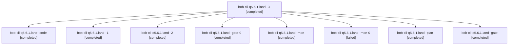

# Session: bob-cli-q5.6.1.land

[Agent Hoods](../README.md) / [bbugyi200](../users/bbugyi200/README.md) / [athena](../users/bbugyi200/machines/athena/README.md) / [bob-cli-q5](../users/bbugyi200/machines/athena/hoods/bob-cli-q5/README.md) / bob-cli-q5.6.1.land

Owner: `bbugyi200.athena` · Hood: `bob-cli-q5` · Members: 9 · Bead: [bob-cli-q5.6.1](https://github.com/bobs-org/bob-cli--beads/blob/main/pages/bob-cli-q5/bob-cli-q5.6.1.md)

## Lineage

The diagram is an optional enhancement; the ordered table below contains the same lineage in accessible text.

| Role | Agent | State | Model / provider | Timing | Commits | Prompt | Chat |
|---|---|---|---|---|---:|---|---|
| 3 | bob-cli-q5.6.1.land--3 | completed | gpt-6-luna / codex | 2026-11-27T14:12:12.500999+00:00 → 2026-11-27T14:18:24.999731+00:00 | 0 | [Prompt](../agents/bbugyi200.athena.bob-cli-q5.6.1.land--3/prompt.md) | [Chat](../agents/bbugyi200.athena.bob-cli-q5.6.1.land--3/chat.md) |
| code | bob-cli-q5.6.1.land--code | completed | gpt-6-luna / codex | 2026-11-27T12:09:08.677332+00:00 → 2026-11-27T13:25:02.102360+00:00 | 0 | — | [Chat](../agents/bbugyi200.athena.bob-cli-q5.6.1.land--code/chat.md) |
| 1 | bob-cli-q5.6.1.land--1 | completed | gpt-6-luna / codex | 2026-11-27T13:26:28.896716+00:00 → 2026-11-27T13:59:51.348366+00:00 | [1](../agents/bbugyi200.athena.bob-cli-q5.6.1.land--1/README.md#commits) | [Prompt](../agents/bbugyi200.athena.bob-cli-q5.6.1.land--1/prompt.md) | [Chat](../agents/bbugyi200.athena.bob-cli-q5.6.1.land--1/chat.md) |
| 2 | bob-cli-q5.6.1.land--2 | completed | gpt-6-luna / codex | 2026-11-27T14:01:32.823437+00:00 → 2026-11-27T14:07:25.217436+00:00 | 0 | [Prompt](../agents/bbugyi200.athena.bob-cli-q5.6.1.land--2/prompt.md) | [Chat](../agents/bbugyi200.athena.bob-cli-q5.6.1.land--2/chat.md) |
| gate-0 | bob-cli-q5.6.1.land--gate-0 | completed | gpt-6-luna / codex | 2026-11-27T14:00:20.569358+00:00 → 2026-11-27T14:00:54.931641+00:00 | 0 | — | [Chat](../agents/bbugyi200.athena.bob-cli-q5.6.1.land--gate-0/chat.md) |
| mon | bob-cli-q5.6.1.land--mon | completed | gpt-6-luna / codex | 2026-11-27T13:22:41.168433+00:00 → 2026-11-27T13:26:28.948582+00:00 | 0 | — | [Chat](../agents/bbugyi200.athena.bob-cli-q5.6.1.land--mon/chat.md) |
| mon-0 | bob-cli-q5.6.1.land--mon-0 | failed | gpt-6-luna / codex | 2026-11-27T14:06:36.448170+00:00 → 2026-11-27T14:12:12.592171+00:00 | 0 | — | [Chat](../agents/bbugyi200.athena.bob-cli-q5.6.1.land--mon-0/chat.md) |
| plan | bob-cli-q5.6.1.land--plan | completed | opus / claude | 2026-11-27T11:34:34.872034+00:00 → 2026-11-27T13:25:02.102360+00:00 | 0 | [Prompt](../agents/bbugyi200.athena.bob-cli-q5.6.1.land--plan/prompt.md) | [Chat](../agents/bbugyi200.athena.bob-cli-q5.6.1.land--plan/chat.md) |
| gate | bob-cli-q5.6.1.land--gate | completed | opus / claude | 2026-11-27T12:08:01.118146+00:00 → 2026-11-27T12:08:08.541094+00:00 | 0 | — | [Chat](../agents/bbugyi200.athena.bob-cli-q5.6.1.land--gate/chat.md) |

## Commits

| Role | Repo | Commit | Subject | Committed |
|---|---|---|---|---|
| 1 | bob-cli | [`064fc51`](https://github.com/bobs-org/bob-cli/commit/064fc51ef361bb0628aa2d9f16bb10f9ef74f7d9) | docs(snooze): document Snooze Card gestures and undo | 2026-11-27 08:57:14 EST |

## Neighbors

| Agent | Relation | State |
|---|---|---|
| [bob-cli-q5.6](bbugyi200.athena.bob-cli-q5.6.md) (session · 3) | ancestor | active 1, completed 2 |
| [bob-cli-q5.6.1.1](../agents/bbugyi200.athena.bob-cli-q5.6.1.1/README.md) | bob-cli-q5.6.1 hood | completed |
| [bob-cli-q5.6.1.2](../agents/bbugyi200.athena.bob-cli-q5.6.1.2/README.md) | bob-cli-q5.6.1 hood | completed |
| [bob-cli-q5.6.1.3](../agents/bbugyi200.athena.bob-cli-q5.6.1.3/README.md) | bob-cli-q5.6.1 hood | completed |
| [bob-cli-q5.6.1.4](../agents/bbugyi200.athena.bob-cli-q5.6.1.4/README.md) | bob-cli-q5.6.1 hood | completed |
| [bob-cli-q5.1](bbugyi200.athena.bob-cli-q5.1.md) (session · 3) | bob-cli-q5 hood | active 1, completed 2 |
| [bob-cli-q5.1.1.1](../agents/bbugyi200.athena.bob-cli-q5.1.1.1/README.md) | bob-cli-q5 hood | completed |
| [bob-cli-q5.1.1.2](../agents/bbugyi200.athena.bob-cli-q5.1.1.2/README.md) | bob-cli-q5 hood | completed |
| [bob-cli-q5.1.1.3](bbugyi200.athena.bob-cli-q5.1.1.3.md) (session · 11) | bob-cli-q5 hood | completed 7, failed 4 |
| [bob-cli-q5.1.1.4](../agents/bbugyi200.athena.bob-cli-q5.1.1.4/README.md) | bob-cli-q5 hood | completed |
| [bob-cli-q5.1.1.5](../agents/bbugyi200.athena.bob-cli-q5.1.1.5/README.md) | bob-cli-q5 hood | completed |
| [bob-cli-q5.1.1.land](bbugyi200.athena.bob-cli-q5.1.1.land.md) (session · 3) | bob-cli-q5 hood | completed 3 |
| [bob-cli-q5.2](bbugyi200.athena.bob-cli-q5.2.md) (session · 3) | bob-cli-q5 hood | active 1, completed 2 |
| [bob-cli-q5.2.1.1](bbugyi200.athena.bob-cli-q5.2.1.1.md) (session · 5) | bob-cli-q5 hood | completed 3, failed 2 |
| [bob-cli-q5.2.1.2](bbugyi200.athena.bob-cli-q5.2.1.2.md) (session · 5) | bob-cli-q5 hood | completed 4, failed 1 |
| [bob-cli-q5.2.1.2](../agents/bbugyi200.athena.bob-cli-q5.2.1.2/README.md) | bob-cli-q5 hood | failed |
| [bob-cli-q5.2.1.3](../agents/bbugyi200.athena.bob-cli-q5.2.1.3/README.md) | bob-cli-q5 hood | completed |
| [bob-cli-q5.2.1.4](../agents/bbugyi200.athena.bob-cli-q5.2.1.4/README.md) | bob-cli-q5 hood | completed |
| [bob-cli-q5.2.1.land](bbugyi200.athena.bob-cli-q5.2.1.land.md) (session · 3) | bob-cli-q5 hood | completed 3 |
| [bob-cli-q5.3](bbugyi200.athena.bob-cli-q5.3.md) (session · 3) | bob-cli-q5 hood | active 1, completed 2 |
| [bob-cli-q5.3.1.1](../agents/bbugyi200.athena.bob-cli-q5.3.1.1/README.md) | bob-cli-q5 hood | completed |
| [bob-cli-q5.3.1.2](../agents/bbugyi200.athena.bob-cli-q5.3.1.2/README.md) | bob-cli-q5 hood | completed |
| [bob-cli-q5.3.1.3](bbugyi200.athena.bob-cli-q5.3.1.3.md) (session · 7) | bob-cli-q5 hood | completed 6, failed 1 |
| [bob-cli-q5.3.1.land](bbugyi200.athena.bob-cli-q5.3.1.land.md) (session · 3) | bob-cli-q5 hood | completed 3 |
| [bob-cli-q5.4](bbugyi200.athena.bob-cli-q5.4.md) (session · 3) | bob-cli-q5 hood | active 1, completed 2 |
| [bob-cli-q5.4.1.1](bbugyi200.athena.bob-cli-q5.4.1.1.md) (session · 3) | bob-cli-q5 hood | completed 2, failed 1 |
| [bob-cli-q5.4.1.2](../agents/bbugyi200.athena.bob-cli-q5.4.1.2/README.md) | bob-cli-q5 hood | completed |
| [bob-cli-q5.4.1.3](../agents/bbugyi200.athena.bob-cli-q5.4.1.3/README.md) | bob-cli-q5 hood | completed |
| [bob-cli-q5.4.1.4](bbugyi200.athena.bob-cli-q5.4.1.4.md) (session · 13) | bob-cli-q5 hood | completed 10, failed 3 |
| [bob-cli-q5.4.1.5](../agents/bbugyi200.athena.bob-cli-q5.4.1.5/README.md) | bob-cli-q5 hood | completed |
| [bob-cli-q5.4.1.land](bbugyi200.athena.bob-cli-q5.4.1.land.md) (session · 7) | bob-cli-q5 hood | active 1, completed 5, failed 1 |
| [bob-cli-q5.5](bbugyi200.athena.bob-cli-q5.5.md) (session · 3) | bob-cli-q5 hood | active 1, completed 2 |
| [bob-cli-q5.5.1.1](../agents/bbugyi200.athena.bob-cli-q5.5.1.1/README.md) | bob-cli-q5 hood | completed |
| [bob-cli-q5.5.1.2](../agents/bbugyi200.athena.bob-cli-q5.5.1.2/README.md) | bob-cli-q5 hood | completed |
| [bob-cli-q5.5.1.3](../agents/bbugyi200.athena.bob-cli-q5.5.1.3/README.md) | bob-cli-q5 hood | completed |
| [bob-cli-q5.5.1.4](../agents/bbugyi200.athena.bob-cli-q5.5.1.4/README.md) | bob-cli-q5 hood | completed |
| [bob-cli-q5.5.1.5](bbugyi200.athena.bob-cli-q5.5.1.5.md) (session · 3) | bob-cli-q5 hood | completed 3 |
| [bob-cli-q5.5.1.6](../agents/bbugyi200.athena.bob-cli-q5.5.1.6/README.md) | bob-cli-q5 hood | completed |
| [bob-cli-q5.5.1.land](bbugyi200.athena.bob-cli-q5.5.1.land.md) (session · 23) | bob-cli-q5 hood | completed 13, failed 10 |
| [bob-cli-q5.7](bbugyi200.athena.bob-cli-q5.7.md) (session · 3) | bob-cli-q5 hood | active 1, completed 2 |
| [bob-cli-q5.7.1.1](../agents/bbugyi200.athena.bob-cli-q5.7.1.1/README.md) | bob-cli-q5 hood | completed |
| [bob-cli-q5.7.1.2](bbugyi200.athena.bob-cli-q5.7.1.2.md) (session · 3) | bob-cli-q5 hood | completed 2, failed 1 |
| [bob-cli-q5.7.1.3](bbugyi200.athena.bob-cli-q5.7.1.3.md) (session · 3) | bob-cli-q5 hood | completed 3 |
| [bob-cli-q5.7.1.land](bbugyi200.athena.bob-cli-q5.7.1.land.md) (session · 11) | bob-cli-q5 hood | completed 9, failed 2 |
| [bob-cli-q5.8](bbugyi200.athena.bob-cli-q5.8.md) (session · 3) | bob-cli-q5 hood | active 1, completed 2 |
| [bob-cli-q5.8.1.1](bbugyi200.athena.bob-cli-q5.8.1.1.md) (session · 8) | bob-cli-q5 hood | completed 4, failed 4 |
| [bob-cli-q5.8.1.2](../agents/bbugyi200.athena.bob-cli-q5.8.1.2/README.md) | bob-cli-q5 hood | completed |
| [bob-cli-q5.8.1.3](bbugyi200.athena.bob-cli-q5.8.1.3.md) (session · 5) | bob-cli-q5 hood | completed 3, failed 2 |
| [bob-cli-q5.8.1.4](bbugyi200.athena.bob-cli-q5.8.1.4.md) (session · 15) | bob-cli-q5 hood | completed 12, failed 3 |
| [bob-cli-q5.8.1.5](../agents/bbugyi200.athena.bob-cli-q5.8.1.5/README.md) | bob-cli-q5 hood | completed |
| [bob-cli-q5.8.1.6.1](bbugyi200.athena.bob-cli-q5.8.1.6.1.md) (session · 13) | bob-cli-q5 hood | completed 10, failed 3 |
| [bob-cli-q5.8.1.6.2](../agents/bbugyi200.athena.bob-cli-q5.8.1.6.2/README.md) | bob-cli-q5 hood | completed |
| [bob-cli-q5.8.1.6.3](bbugyi200.athena.bob-cli-q5.8.1.6.3.md) (session · 7) | bob-cli-q5 hood | completed 5, failed 2 |
| [bob-cli-q5.8.1.6.4](bbugyi200.athena.bob-cli-q5.8.1.6.4.md) (session · 5) | bob-cli-q5 hood | completed 4, failed 1 |
| [bob-cli-q5.8.1.6.5](bbugyi200.athena.bob-cli-q5.8.1.6.5.md) (session · 10) | bob-cli-q5 hood | active 2, completed 8 |
| … and 20 more in the [hood roster](../users/bbugyi200/machines/athena/hoods/bob-cli-q5/README.md) | bob-cli-q5 hood | — |
