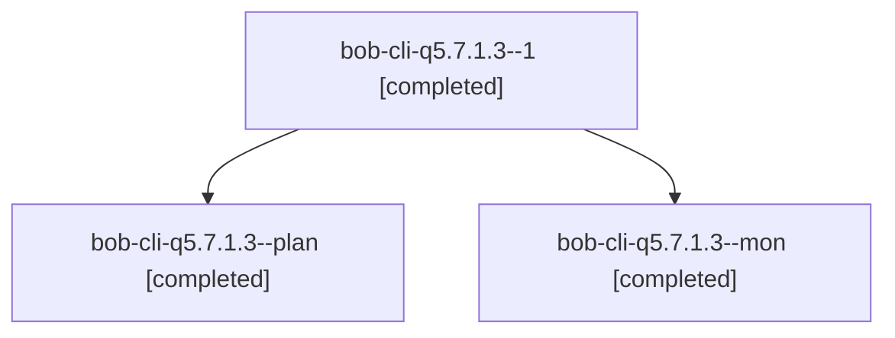

# Session: bob-cli-q5.7.1.3

[Agent Hoods](../README.md) / [bbugyi200](../users/bbugyi200/README.md) / [athena](../users/bbugyi200/machines/athena/README.md) / [bob-cli-q5](../users/bbugyi200/machines/athena/hoods/bob-cli-q5/README.md) / bob-cli-q5.7.1.3

Owner: `bbugyi200.athena` · Hood: `bob-cli-q5` · Members: 3 · Bead: [bob-cli-q5.7.1.3](https://github.com/bobs-org/bob-cli--beads/blob/main/pages/bob-cli-q5/bob-cli-q5.7.1.3.md)

## Lineage

The diagram is an optional enhancement; the ordered table below contains the same lineage in accessible text.

| Role | Agent | State | Model / provider | Timing | Commits | Prompt | Chat |
|---|---|---|---|---|---:|---|---|
| 1 | bob-cli-q5.7.1.3--1 | completed | gpt-6-luna / codex | 2026-11-26T15:43:16.971708+00:00 → 2026-11-26T15:47:01.099034+00:00 | 0 | [Prompt](../agents/bbugyi200.athena.bob-cli-q5.7.1.3--1/prompt.md) | [Chat](../agents/bbugyi200.athena.bob-cli-q5.7.1.3--1/chat.md) |
| plan | bob-cli-q5.7.1.3--plan | completed | gpt-6-luna / codex | 2026-11-26T14:28:52.743321+00:00 → 2026-11-26T15:09:48.003761+00:00 | 0 | [Prompt](../agents/bbugyi200.athena.bob-cli-q5.7.1.3--plan/prompt.md) | [Chat](../agents/bbugyi200.athena.bob-cli-q5.7.1.3--plan/chat.md) |
| mon | bob-cli-q5.7.1.3--mon | completed | gpt-6-luna / codex | 2026-11-26T15:08:23.829336+00:00 → 2026-11-26T15:43:17.511772+00:00 | 0 | — | [Chat](../agents/bbugyi200.athena.bob-cli-q5.7.1.3--mon/chat.md) |

## Neighbors

| Agent | Relation | State |
|---|---|---|
| [bob-cli-q5.7](bbugyi200.athena.bob-cli-q5.7.md) (session · 3) | ancestor | active 1, completed 2 |
| [bob-cli-q5.7.1.1](../agents/bbugyi200.athena.bob-cli-q5.7.1.1/README.md) | bob-cli-q5.7.1 hood | completed |
| [bob-cli-q5.7.1.2](bbugyi200.athena.bob-cli-q5.7.1.2.md) (session · 3) | bob-cli-q5.7.1 hood | completed 2, failed 1 |
| [bob-cli-q5.7.1.land](bbugyi200.athena.bob-cli-q5.7.1.land.md) (session · 11) | bob-cli-q5.7.1 hood | completed 9, failed 2 |
| [bob-cli-q5.1](bbugyi200.athena.bob-cli-q5.1.md) (session · 3) | bob-cli-q5 hood | active 1, completed 2 |
| [bob-cli-q5.1.1.1](../agents/bbugyi200.athena.bob-cli-q5.1.1.1/README.md) | bob-cli-q5 hood | completed |
| [bob-cli-q5.1.1.2](../agents/bbugyi200.athena.bob-cli-q5.1.1.2/README.md) | bob-cli-q5 hood | completed |
| [bob-cli-q5.1.1.3](bbugyi200.athena.bob-cli-q5.1.1.3.md) (session · 11) | bob-cli-q5 hood | completed 7, failed 4 |
| [bob-cli-q5.1.1.4](../agents/bbugyi200.athena.bob-cli-q5.1.1.4/README.md) | bob-cli-q5 hood | completed |
| [bob-cli-q5.1.1.5](../agents/bbugyi200.athena.bob-cli-q5.1.1.5/README.md) | bob-cli-q5 hood | completed |
| [bob-cli-q5.1.1.land](bbugyi200.athena.bob-cli-q5.1.1.land.md) (session · 3) | bob-cli-q5 hood | completed 3 |
| [bob-cli-q5.2](bbugyi200.athena.bob-cli-q5.2.md) (session · 3) | bob-cli-q5 hood | active 1, completed 2 |
| [bob-cli-q5.2.1.1](bbugyi200.athena.bob-cli-q5.2.1.1.md) (session · 5) | bob-cli-q5 hood | completed 3, failed 2 |
| [bob-cli-q5.2.1.2](bbugyi200.athena.bob-cli-q5.2.1.2.md) (session · 5) | bob-cli-q5 hood | completed 4, failed 1 |
| [bob-cli-q5.2.1.2](../agents/bbugyi200.athena.bob-cli-q5.2.1.2/README.md) | bob-cli-q5 hood | failed |
| [bob-cli-q5.2.1.3](../agents/bbugyi200.athena.bob-cli-q5.2.1.3/README.md) | bob-cli-q5 hood | completed |
| [bob-cli-q5.2.1.4](../agents/bbugyi200.athena.bob-cli-q5.2.1.4/README.md) | bob-cli-q5 hood | completed |
| [bob-cli-q5.2.1.land](bbugyi200.athena.bob-cli-q5.2.1.land.md) (session · 3) | bob-cli-q5 hood | completed 3 |
| [bob-cli-q5.3](bbugyi200.athena.bob-cli-q5.3.md) (session · 3) | bob-cli-q5 hood | active 1, completed 2 |
| [bob-cli-q5.3.1.1](../agents/bbugyi200.athena.bob-cli-q5.3.1.1/README.md) | bob-cli-q5 hood | completed |
| [bob-cli-q5.3.1.2](../agents/bbugyi200.athena.bob-cli-q5.3.1.2/README.md) | bob-cli-q5 hood | completed |
| [bob-cli-q5.3.1.3](bbugyi200.athena.bob-cli-q5.3.1.3.md) (session · 7) | bob-cli-q5 hood | completed 6, failed 1 |
| [bob-cli-q5.3.1.land](bbugyi200.athena.bob-cli-q5.3.1.land.md) (session · 3) | bob-cli-q5 hood | completed 3 |
| [bob-cli-q5.4](bbugyi200.athena.bob-cli-q5.4.md) (session · 3) | bob-cli-q5 hood | active 1, completed 2 |
| [bob-cli-q5.4.1.1](bbugyi200.athena.bob-cli-q5.4.1.1.md) (session · 3) | bob-cli-q5 hood | completed 2, failed 1 |
| [bob-cli-q5.4.1.2](../agents/bbugyi200.athena.bob-cli-q5.4.1.2/README.md) | bob-cli-q5 hood | completed |
| [bob-cli-q5.4.1.3](../agents/bbugyi200.athena.bob-cli-q5.4.1.3/README.md) | bob-cli-q5 hood | completed |
| [bob-cli-q5.4.1.4](bbugyi200.athena.bob-cli-q5.4.1.4.md) (session · 13) | bob-cli-q5 hood | completed 10, failed 3 |
| [bob-cli-q5.4.1.5](../agents/bbugyi200.athena.bob-cli-q5.4.1.5/README.md) | bob-cli-q5 hood | completed |
| [bob-cli-q5.4.1.land](bbugyi200.athena.bob-cli-q5.4.1.land.md) (session · 7) | bob-cli-q5 hood | active 1, completed 5, failed 1 |
| [bob-cli-q5.5](bbugyi200.athena.bob-cli-q5.5.md) (session · 3) | bob-cli-q5 hood | active 1, completed 2 |
| [bob-cli-q5.5.1.1](../agents/bbugyi200.athena.bob-cli-q5.5.1.1/README.md) | bob-cli-q5 hood | completed |
| [bob-cli-q5.5.1.2](../agents/bbugyi200.athena.bob-cli-q5.5.1.2/README.md) | bob-cli-q5 hood | completed |
| [bob-cli-q5.5.1.3](../agents/bbugyi200.athena.bob-cli-q5.5.1.3/README.md) | bob-cli-q5 hood | completed |
| [bob-cli-q5.5.1.4](../agents/bbugyi200.athena.bob-cli-q5.5.1.4/README.md) | bob-cli-q5 hood | completed |
| [bob-cli-q5.5.1.5](bbugyi200.athena.bob-cli-q5.5.1.5.md) (session · 3) | bob-cli-q5 hood | completed 3 |
| [bob-cli-q5.5.1.6](../agents/bbugyi200.athena.bob-cli-q5.5.1.6/README.md) | bob-cli-q5 hood | completed |
| [bob-cli-q5.5.1.land](bbugyi200.athena.bob-cli-q5.5.1.land.md) (session · 23) | bob-cli-q5 hood | completed 13, failed 10 |
| [bob-cli-q5.6](bbugyi200.athena.bob-cli-q5.6.md) (session · 3) | bob-cli-q5 hood | active 1, completed 2 |
| [bob-cli-q5.6.1.1](../agents/bbugyi200.athena.bob-cli-q5.6.1.1/README.md) | bob-cli-q5 hood | completed |
| [bob-cli-q5.6.1.2](../agents/bbugyi200.athena.bob-cli-q5.6.1.2/README.md) | bob-cli-q5 hood | completed |
| [bob-cli-q5.6.1.3](../agents/bbugyi200.athena.bob-cli-q5.6.1.3/README.md) | bob-cli-q5 hood | completed |
| [bob-cli-q5.6.1.4](../agents/bbugyi200.athena.bob-cli-q5.6.1.4/README.md) | bob-cli-q5 hood | completed |
| [bob-cli-q5.6.1.land](bbugyi200.athena.bob-cli-q5.6.1.land.md) (session · 9) | bob-cli-q5 hood | completed 8, failed 1 |
| [bob-cli-q5.8](bbugyi200.athena.bob-cli-q5.8.md) (session · 3) | bob-cli-q5 hood | active 1, completed 2 |
| [bob-cli-q5.8.1.1](bbugyi200.athena.bob-cli-q5.8.1.1.md) (session · 8) | bob-cli-q5 hood | completed 4, failed 4 |
| [bob-cli-q5.8.1.2](../agents/bbugyi200.athena.bob-cli-q5.8.1.2/README.md) | bob-cli-q5 hood | completed |
| [bob-cli-q5.8.1.3](bbugyi200.athena.bob-cli-q5.8.1.3.md) (session · 5) | bob-cli-q5 hood | completed 3, failed 2 |
| [bob-cli-q5.8.1.4](bbugyi200.athena.bob-cli-q5.8.1.4.md) (session · 15) | bob-cli-q5 hood | completed 12, failed 3 |
| [bob-cli-q5.8.1.5](../agents/bbugyi200.athena.bob-cli-q5.8.1.5/README.md) | bob-cli-q5 hood | completed |
| [bob-cli-q5.8.1.6.1](bbugyi200.athena.bob-cli-q5.8.1.6.1.md) (session · 13) | bob-cli-q5 hood | completed 10, failed 3 |
| [bob-cli-q5.8.1.6.2](../agents/bbugyi200.athena.bob-cli-q5.8.1.6.2/README.md) | bob-cli-q5 hood | completed |
| [bob-cli-q5.8.1.6.3](bbugyi200.athena.bob-cli-q5.8.1.6.3.md) (session · 7) | bob-cli-q5 hood | completed 5, failed 2 |
| [bob-cli-q5.8.1.6.4](bbugyi200.athena.bob-cli-q5.8.1.6.4.md) (session · 5) | bob-cli-q5 hood | completed 4, failed 1 |
| … and 10 more in the [hood roster](../users/bbugyi200/machines/athena/hoods/bob-cli-q5/README.md) | bob-cli-q5 hood | — |
