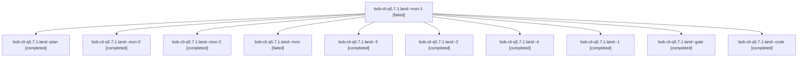

# Session: bob-cli-q5.7.1.land

[Agent Hoods](../README.md) / [bbugyi200](../users/bbugyi200/README.md) / [athena](../users/bbugyi200/machines/athena/README.md) / [bob-cli-q5](../users/bbugyi200/machines/athena/hoods/bob-cli-q5/README.md) / bob-cli-q5.7.1.land

Owner: `bbugyi200.athena` · Hood: `bob-cli-q5` · Members: 11 · Bead: [bob-cli-q5.7.1](https://github.com/bobs-org/bob-cli--beads/blob/main/pages/bob-cli-q5/bob-cli-q5.7.1.md)

## Lineage

The diagram is an optional enhancement; the ordered table below contains the same lineage in accessible text.

| Role | Agent | State | Model / provider | Timing | Commits | Prompt | Chat |
|---|---|---|---|---|---:|---|---|
| mon-1 | bob-cli-q5.7.1.land--mon-1 | failed | muse-spark-1.3-contributor / muse | 2026-11-26T16:42:13.019155+00:00 → 2026-11-26T16:49:46.644747+00:00 | 0 | — | [Chat](../agents/bbugyi200.athena.bob-cli-q5.7.1.land--mon-1/chat.md) |
| plan | bob-cli-q5.7.1.land--plan | completed | gpt-6-astra / codex | 2026-11-26T15:47:41.136846+00:00 → 2026-11-26T16:21:30.554886+00:00 | 0 | [Prompt](../agents/bbugyi200.athena.bob-cli-q5.7.1.land--plan/prompt.md) | [Chat](../agents/bbugyi200.athena.bob-cli-q5.7.1.land--plan/chat.md) |
| mon-0 | bob-cli-q5.7.1.land--mon-0 | completed | muse-spark-1.3-contributor / muse | 2026-11-26T16:27:47.638347+00:00 → 2026-11-26T16:41:13.886128+00:00 | 0 | — | [Chat](../agents/bbugyi200.athena.bob-cli-q5.7.1.land--mon-0/chat.md) |
| mon-2 | bob-cli-q5.7.1.land--mon-2 | completed | muse-spark-1.3-contributor / muse | 2026-11-26T16:53:21.105398+00:00 → 2026-11-26T17:42:09.104034+00:00 | 0 | — | [Chat](../agents/bbugyi200.athena.bob-cli-q5.7.1.land--mon-2/chat.md) |
| mon | bob-cli-q5.7.1.land--mon | failed | muse-spark-1.3-contributor / muse | 2026-11-26T16:19:31.491891+00:00 → 2026-11-26T16:22:59.148206+00:00 | 0 | — | [Chat](../agents/bbugyi200.athena.bob-cli-q5.7.1.land--mon/chat.md) |
| 3 | bob-cli-q5.7.1.land--3 | completed | muse-spark-1.3-contributor / muse | 2026-11-26T16:49:46.535388+00:00 → 2026-11-26T17:07:37.578903+00:00 | 0 | [Prompt](../agents/bbugyi200.athena.bob-cli-q5.7.1.land--3/prompt.md) | [Chat](../agents/bbugyi200.athena.bob-cli-q5.7.1.land--3/chat.md) |
| 2 | bob-cli-q5.7.1.land--2 | completed | muse-spark-1.3-contributor / muse | 2026-11-26T16:41:13.558425+00:00 → 2026-11-26T16:42:54.687629+00:00 | 0 | [Prompt](../agents/bbugyi200.athena.bob-cli-q5.7.1.land--2/prompt.md) | [Chat](../agents/bbugyi200.athena.bob-cli-q5.7.1.land--2/chat.md) |
| 4 | bob-cli-q5.7.1.land--4 | completed | muse-spark-1.3-contributor / muse | 2026-11-26T17:42:08.847652+00:00 → 2026-11-26T17:46:54.770169+00:00 | 0 | [Prompt](../agents/bbugyi200.athena.bob-cli-q5.7.1.land--4/prompt.md) | [Chat](../agents/bbugyi200.athena.bob-cli-q5.7.1.land--4/chat.md) |
| 1 | bob-cli-q5.7.1.land--1 | completed | muse-spark-1.3-contributor / muse | 2026-11-26T16:22:58.831310+00:00 → 2026-11-26T16:40:06.139986+00:00 | 0 | [Prompt](../agents/bbugyi200.athena.bob-cli-q5.7.1.land--1/prompt.md) | [Chat](../agents/bbugyi200.athena.bob-cli-q5.7.1.land--1/chat.md) |
| gate | bob-cli-q5.7.1.land--gate | completed | gpt-6-astra / codex | 2026-11-26T15:57:44.873209+00:00 → 2026-11-26T15:57:53.640359+00:00 | 0 | — | [Chat](../agents/bbugyi200.athena.bob-cli-q5.7.1.land--gate/chat.md) |
| code | bob-cli-q5.7.1.land--code | completed | muse-spark-1.3-contributor / muse | 2026-11-26T15:58:27.258972+00:00 → 2026-11-26T16:21:30.554886+00:00 | 0 | — | [Chat](../agents/bbugyi200.athena.bob-cli-q5.7.1.land--code/chat.md) |

## Neighbors

| Agent | Relation | State |
|---|---|---|
| [bob-cli-q5.7](bbugyi200.athena.bob-cli-q5.7.md) (session · 3) | ancestor | active 1, completed 2 |
| [bob-cli-q5.7.1.1](../agents/bbugyi200.athena.bob-cli-q5.7.1.1/README.md) | bob-cli-q5.7.1 hood | completed |
| [bob-cli-q5.7.1.2](bbugyi200.athena.bob-cli-q5.7.1.2.md) (session · 3) | bob-cli-q5.7.1 hood | completed 2, failed 1 |
| [bob-cli-q5.7.1.3](bbugyi200.athena.bob-cli-q5.7.1.3.md) (session · 3) | bob-cli-q5.7.1 hood | completed 3 |
| [bob-cli-q5.1](bbugyi200.athena.bob-cli-q5.1.md) (session · 3) | bob-cli-q5 hood | active 1, completed 2 |
| [bob-cli-q5.1.1.1](../agents/bbugyi200.athena.bob-cli-q5.1.1.1/README.md) | bob-cli-q5 hood | completed |
| [bob-cli-q5.1.1.2](../agents/bbugyi200.athena.bob-cli-q5.1.1.2/README.md) | bob-cli-q5 hood | completed |
| [bob-cli-q5.1.1.3](bbugyi200.athena.bob-cli-q5.1.1.3.md) (session · 11) | bob-cli-q5 hood | completed 7, failed 4 |
| [bob-cli-q5.1.1.4](../agents/bbugyi200.athena.bob-cli-q5.1.1.4/README.md) | bob-cli-q5 hood | completed |
| [bob-cli-q5.1.1.5](../agents/bbugyi200.athena.bob-cli-q5.1.1.5/README.md) | bob-cli-q5 hood | completed |
| [bob-cli-q5.1.1.land](bbugyi200.athena.bob-cli-q5.1.1.land.md) (session · 3) | bob-cli-q5 hood | completed 3 |
| [bob-cli-q5.2](bbugyi200.athena.bob-cli-q5.2.md) (session · 3) | bob-cli-q5 hood | active 1, completed 2 |
| [bob-cli-q5.2.1.1](bbugyi200.athena.bob-cli-q5.2.1.1.md) (session · 5) | bob-cli-q5 hood | completed 3, failed 2 |
| [bob-cli-q5.2.1.2](bbugyi200.athena.bob-cli-q5.2.1.2.md) (session · 5) | bob-cli-q5 hood | completed 4, failed 1 |
| [bob-cli-q5.2.1.2](../agents/bbugyi200.athena.bob-cli-q5.2.1.2/README.md) | bob-cli-q5 hood | failed |
| [bob-cli-q5.2.1.3](../agents/bbugyi200.athena.bob-cli-q5.2.1.3/README.md) | bob-cli-q5 hood | completed |
| [bob-cli-q5.2.1.4](../agents/bbugyi200.athena.bob-cli-q5.2.1.4/README.md) | bob-cli-q5 hood | completed |
| [bob-cli-q5.2.1.land](bbugyi200.athena.bob-cli-q5.2.1.land.md) (session · 3) | bob-cli-q5 hood | completed 3 |
| [bob-cli-q5.3](bbugyi200.athena.bob-cli-q5.3.md) (session · 3) | bob-cli-q5 hood | active 1, completed 2 |
| [bob-cli-q5.3.1.1](../agents/bbugyi200.athena.bob-cli-q5.3.1.1/README.md) | bob-cli-q5 hood | completed |
| [bob-cli-q5.3.1.2](../agents/bbugyi200.athena.bob-cli-q5.3.1.2/README.md) | bob-cli-q5 hood | completed |
| [bob-cli-q5.3.1.3](bbugyi200.athena.bob-cli-q5.3.1.3.md) (session · 7) | bob-cli-q5 hood | completed 6, failed 1 |
| [bob-cli-q5.3.1.land](bbugyi200.athena.bob-cli-q5.3.1.land.md) (session · 3) | bob-cli-q5 hood | completed 3 |
| [bob-cli-q5.4](bbugyi200.athena.bob-cli-q5.4.md) (session · 3) | bob-cli-q5 hood | active 1, completed 2 |
| [bob-cli-q5.4.1.1](bbugyi200.athena.bob-cli-q5.4.1.1.md) (session · 3) | bob-cli-q5 hood | completed 2, failed 1 |
| [bob-cli-q5.4.1.2](../agents/bbugyi200.athena.bob-cli-q5.4.1.2/README.md) | bob-cli-q5 hood | completed |
| [bob-cli-q5.4.1.3](../agents/bbugyi200.athena.bob-cli-q5.4.1.3/README.md) | bob-cli-q5 hood | completed |
| [bob-cli-q5.4.1.4](bbugyi200.athena.bob-cli-q5.4.1.4.md) (session · 13) | bob-cli-q5 hood | completed 10, failed 3 |
| [bob-cli-q5.4.1.5](../agents/bbugyi200.athena.bob-cli-q5.4.1.5/README.md) | bob-cli-q5 hood | completed |
| [bob-cli-q5.4.1.land](bbugyi200.athena.bob-cli-q5.4.1.land.md) (session · 7) | bob-cli-q5 hood | active 1, completed 5, failed 1 |
| [bob-cli-q5.5](bbugyi200.athena.bob-cli-q5.5.md) (session · 3) | bob-cli-q5 hood | active 1, completed 2 |
| [bob-cli-q5.5.1.1](../agents/bbugyi200.athena.bob-cli-q5.5.1.1/README.md) | bob-cli-q5 hood | completed |
| [bob-cli-q5.5.1.2](../agents/bbugyi200.athena.bob-cli-q5.5.1.2/README.md) | bob-cli-q5 hood | completed |
| [bob-cli-q5.5.1.3](../agents/bbugyi200.athena.bob-cli-q5.5.1.3/README.md) | bob-cli-q5 hood | completed |
| [bob-cli-q5.5.1.4](../agents/bbugyi200.athena.bob-cli-q5.5.1.4/README.md) | bob-cli-q5 hood | completed |
| [bob-cli-q5.5.1.5](bbugyi200.athena.bob-cli-q5.5.1.5.md) (session · 3) | bob-cli-q5 hood | completed 3 |
| [bob-cli-q5.5.1.6](../agents/bbugyi200.athena.bob-cli-q5.5.1.6/README.md) | bob-cli-q5 hood | completed |
| [bob-cli-q5.5.1.land](bbugyi200.athena.bob-cli-q5.5.1.land.md) (session · 3) | bob-cli-q5 hood | active 2, completed 1 |
| [bob-cli-q5.6](../agents/bbugyi200.athena.bob-cli-q5.6/README.md) | bob-cli-q5 hood | waiting |
| [bob-cli-q5.8](bbugyi200.athena.bob-cli-q5.8.md) (session · 3) | bob-cli-q5 hood | active 1, completed 2 |
| [bob-cli-q5.8.1.1](bbugyi200.athena.bob-cli-q5.8.1.1.md) (session · 8) | bob-cli-q5 hood | completed 4, failed 4 |
| [bob-cli-q5.8.1.2](../agents/bbugyi200.athena.bob-cli-q5.8.1.2/README.md) | bob-cli-q5 hood | completed |
| [bob-cli-q5.8.1.3](bbugyi200.athena.bob-cli-q5.8.1.3.md) (session · 5) | bob-cli-q5 hood | completed 3, failed 2 |
| [bob-cli-q5.8.1.4](bbugyi200.athena.bob-cli-q5.8.1.4.md) (session · 15) | bob-cli-q5 hood | completed 12, failed 3 |
| [bob-cli-q5.8.1.5](../agents/bbugyi200.athena.bob-cli-q5.8.1.5/README.md) | bob-cli-q5 hood | completed |
| [bob-cli-q5.8.1.6.1](bbugyi200.athena.bob-cli-q5.8.1.6.1.md) (session · 13) | bob-cli-q5 hood | completed 10, failed 3 |
| [bob-cli-q5.8.1.6.2](../agents/bbugyi200.athena.bob-cli-q5.8.1.6.2/README.md) | bob-cli-q5 hood | completed |
| [bob-cli-q5.8.1.6.3](../agents/bbugyi200.athena.bob-cli-q5.8.1.6.3/README.md) | bob-cli-q5 hood | waiting |
| [bob-cli-q5.8.1.6.4](../agents/bbugyi200.athena.bob-cli-q5.8.1.6.4/README.md) | bob-cli-q5 hood | waiting |
| [bob-cli-q5.8.1.6.5](../agents/bbugyi200.athena.bob-cli-q5.8.1.6.5/README.md) | bob-cli-q5 hood | waiting |
| [bob-cli-q5.8.1.6.land](../agents/bbugyi200.athena.bob-cli-q5.8.1.6.land/README.md) | bob-cli-q5 hood | waiting |
| [bob-cli-q5.8.1.land](bbugyi200.athena.bob-cli-q5.8.1.land.md) (session · 3) | bob-cli-q5 hood | active 1, completed 2 |
| [bob-cli-q5.9](../agents/bbugyi200.athena.bob-cli-q5.9/README.md) | bob-cli-q5 hood | waiting |
| [bob-cli-q5.land](../agents/bbugyi200.athena.bob-cli-q5.land/README.md) | bob-cli-q5 hood | waiting |
