# Session: bob-cli-q5.8.1.4

[Agent Hoods](../README.md) / [bbugyi200](../users/bbugyi200/README.md) / [athena](../users/bbugyi200/machines/athena/README.md) / [bob-cli-q5](../users/bbugyi200/machines/athena/hoods/bob-cli-q5/README.md) / bob-cli-q5.8.1.4

Owner: `bbugyi200.athena` · Hood: `bob-cli-q5` · Members: 15 · Bead: [bob-cli-q5.8.1.4](https://github.com/bobs-org/bob-cli--beads/blob/main/pages/bob-cli-q5/bob-cli-q5.8.1.4.md)

## Lineage

```mermaid
flowchart TD
  n0["bob-cli-q5.8.1.4--mon-0 [completed]"]
  n1["bob-cli-q5.8.1.4--7 [completed]"]
  n0 --> n1
  n2["bob-cli-q5.8.1.4--4 [completed]"]
  n0 --> n2
  n3["bob-cli-q5.8.1.4--6 [completed]"]
  n0 --> n3
  n4["bob-cli-q5.8.1.4--mon [failed]"]
  n0 --> n4
  n5["bob-cli-q5.8.1.4--5 [completed]"]
  n0 --> n5
  n6["bob-cli-q5.8.1.4--mon-3 [failed]"]
  n0 --> n6
  n7["bob-cli-q5.8.1.4--mon-2 [completed]"]
  n0 --> n7
  n8["bob-cli-q5.8.1.4--1 [completed]"]
  n0 --> n8
  n9["bob-cli-q5.8.1.4--2 [completed]"]
  n0 --> n9
  n10["bob-cli-q5.8.1.4--plan [completed]"]
  n0 --> n10
  n11["bob-cli-q5.8.1.4--mon-1 [failed]"]
  n0 --> n11
  n12["bob-cli-q5.8.1.4--3 [completed]"]
  n0 --> n12
  n13["bob-cli-q5.8.1.4--mon-5 [completed]"]
  n0 --> n13
  n14["bob-cli-q5.8.1.4--mon-4 [completed]"]
  n0 --> n14
```

The diagram is an optional enhancement; the ordered table below contains the same lineage in accessible text.

| Role | Agent | State | Model / provider | Timing | Commits | Prompt | Chat |
|---|---|---|---|---|---:|---|---|
| mon-0 | bob-cli-q5.8.1.4--mon-0 | completed | gpt-6-luna / codex | 2026-11-26T22:19:12.307006+00:00 → 2026-11-26T22:29:17.534836+00:00 | 0 | — | [Chat](../agents/bbugyi200.athena.bob-cli-q5.8.1.4--mon-0/chat.md) |
| 7 | bob-cli-q5.8.1.4--7 | completed | gpt-6-luna / codex | 2026-11-27T00:15:19.203365+00:00 → 2026-11-27T00:17:05.036111+00:00 | 0 | [Prompt](../agents/bbugyi200.athena.bob-cli-q5.8.1.4--7/prompt.md) | [Chat](../agents/bbugyi200.athena.bob-cli-q5.8.1.4--7/chat.md) |
| 4 | bob-cli-q5.8.1.4--4 | completed | gpt-6-luna / codex | 2026-11-26T23:05:44.350669+00:00 → 2026-11-26T23:08:28.497576+00:00 | 0 | [Prompt](../agents/bbugyi200.athena.bob-cli-q5.8.1.4--4/prompt.md) | [Chat](../agents/bbugyi200.athena.bob-cli-q5.8.1.4--4/chat.md) |
| 6 | bob-cli-q5.8.1.4--6 | completed | gpt-6-luna / codex | 2026-11-26T23:43:43.331234+00:00 → 2026-11-26T23:47:32.840608+00:00 | 0 | [Prompt](../agents/bbugyi200.athena.bob-cli-q5.8.1.4--6/prompt.md) | [Chat](../agents/bbugyi200.athena.bob-cli-q5.8.1.4--6/chat.md) |
| mon | bob-cli-q5.8.1.4--mon | failed | gpt-6-luna / codex | 2026-11-26T21:44:13.534421+00:00 → 2026-11-26T22:06:59.127223+00:00 | 0 | — | [Chat](../agents/bbugyi200.athena.bob-cli-q5.8.1.4--mon/chat.md) |
| 5 | bob-cli-q5.8.1.4--5 | completed | gpt-6-luna / codex | 2026-11-26T23:27:52.405839+00:00 → 2026-11-26T23:35:04.792955+00:00 | 0 | [Prompt](../agents/bbugyi200.athena.bob-cli-q5.8.1.4--5/prompt.md) | [Chat](../agents/bbugyi200.athena.bob-cli-q5.8.1.4--5/chat.md) |
| mon-3 | bob-cli-q5.8.1.4--mon-3 | failed | gpt-6-luna / codex | 2026-11-26T23:07:21.869326+00:00 → 2026-11-26T23:27:52.814108+00:00 | 0 | — | [Chat](../agents/bbugyi200.athena.bob-cli-q5.8.1.4--mon-3/chat.md) |
| mon-2 | bob-cli-q5.8.1.4--mon-2 | completed | gpt-6-luna / codex | 2026-11-26T22:56:47.640207+00:00 → 2026-11-26T23:05:44.807189+00:00 | 0 | — | [Chat](../agents/bbugyi200.athena.bob-cli-q5.8.1.4--mon-2/chat.md) |
| 1 | bob-cli-q5.8.1.4--1 | completed | gpt-6-luna / codex | 2026-11-26T22:07:58.706378+00:00 → 2026-11-26T22:21:42.935777+00:00 | 0 | [Prompt](../agents/bbugyi200.athena.bob-cli-q5.8.1.4--1/prompt.md) | [Chat](../agents/bbugyi200.athena.bob-cli-q5.8.1.4--1/chat.md) |
| 2 | bob-cli-q5.8.1.4--2 | completed | gpt-6-luna / codex | 2026-11-26T22:29:17.061795+00:00 → 2026-11-26T22:31:33.051634+00:00 | 0 | [Prompt](../agents/bbugyi200.athena.bob-cli-q5.8.1.4--2/prompt.md) | [Chat](../agents/bbugyi200.athena.bob-cli-q5.8.1.4--2/chat.md) |
| plan | bob-cli-q5.8.1.4--plan | completed | gpt-6-luna / codex | 2026-11-26T21:03:59.140659+00:00 → 2026-11-26T21:46:27.820443+00:00 | 0 | [Prompt](../agents/bbugyi200.athena.bob-cli-q5.8.1.4--plan/prompt.md) | [Chat](../agents/bbugyi200.athena.bob-cli-q5.8.1.4--plan/chat.md) |
| mon-1 | bob-cli-q5.8.1.4--mon-1 | failed | gpt-6-luna / codex | 2026-11-26T22:30:56.173008+00:00 → 2026-11-26T22:51:31.091906+00:00 | 0 | — | [Chat](../agents/bbugyi200.athena.bob-cli-q5.8.1.4--mon-1/chat.md) |
| 3 | bob-cli-q5.8.1.4--3 | completed | gpt-6-luna / codex | 2026-11-26T22:51:30.732624+00:00 → 2026-11-26T22:57:45.469513+00:00 | 0 | [Prompt](../agents/bbugyi200.athena.bob-cli-q5.8.1.4--3/prompt.md) | [Chat](../agents/bbugyi200.athena.bob-cli-q5.8.1.4--3/chat.md) |
| mon-5 | bob-cli-q5.8.1.4--mon-5 | completed | gpt-6-luna / codex | 2026-11-26T23:46:58.548317+00:00 → 2026-11-27T00:15:19.284045+00:00 | 0 | — | [Chat](../agents/bbugyi200.athena.bob-cli-q5.8.1.4--mon-5/chat.md) |
| mon-4 | bob-cli-q5.8.1.4--mon-4 | completed | gpt-6-luna / codex | 2026-11-26T23:32:56.810358+00:00 → 2026-11-26T23:43:43.652710+00:00 | 0 | — | [Chat](../agents/bbugyi200.athena.bob-cli-q5.8.1.4--mon-4/chat.md) |

## Neighbors

| Agent | Relation | State |
|---|---|---|
| [bob-cli-q5.8](bbugyi200.athena.bob-cli-q5.8.md) (session · 3) | ancestor | active 1, completed 2 |
| [bob-cli-q5.8.1.1](bbugyi200.athena.bob-cli-q5.8.1.1.md) (session · 8) | bob-cli-q5.8.1 hood | completed 4, failed 4 |
| [bob-cli-q5.8.1.2](../agents/bbugyi200.athena.bob-cli-q5.8.1.2/README.md) | bob-cli-q5.8.1 hood | completed |
| [bob-cli-q5.8.1.3](bbugyi200.athena.bob-cli-q5.8.1.3.md) (session · 5) | bob-cli-q5.8.1 hood | completed 3, failed 2 |
| [bob-cli-q5.8.1.5](../agents/bbugyi200.athena.bob-cli-q5.8.1.5/README.md) | bob-cli-q5.8.1 hood | completed |
| [bob-cli-q5.8.1.6.1](bbugyi200.athena.bob-cli-q5.8.1.6.1.md) (session · 13) | bob-cli-q5.8.1 hood | completed 10, failed 3 |
| [bob-cli-q5.8.1.6.2](../agents/bbugyi200.athena.bob-cli-q5.8.1.6.2/README.md) | bob-cli-q5.8.1 hood | completed |
| [bob-cli-q5.8.1.6.3](bbugyi200.athena.bob-cli-q5.8.1.6.3.md) (session · 4) | bob-cli-q5.8.1 hood | active 1, completed 2, failed 1 |
| [bob-cli-q5.8.1.6.4](../agents/bbugyi200.athena.bob-cli-q5.8.1.6.4/README.md) | bob-cli-q5.8.1 hood | waiting |
| [bob-cli-q5.8.1.6.5](../agents/bbugyi200.athena.bob-cli-q5.8.1.6.5/README.md) | bob-cli-q5.8.1 hood | waiting |
| [bob-cli-q5.8.1.6.land](../agents/bbugyi200.athena.bob-cli-q5.8.1.6.land/README.md) | bob-cli-q5.8.1 hood | waiting |
| [bob-cli-q5.8.1.land](bbugyi200.athena.bob-cli-q5.8.1.land.md) (session · 3) | bob-cli-q5.8.1 hood | active 1, completed 2 |
| [bob-cli-q5.1](bbugyi200.athena.bob-cli-q5.1.md) (session · 3) | bob-cli-q5 hood | active 1, completed 2 |
| [bob-cli-q5.1.1.1](../agents/bbugyi200.athena.bob-cli-q5.1.1.1/README.md) | bob-cli-q5 hood | completed |
| [bob-cli-q5.1.1.2](../agents/bbugyi200.athena.bob-cli-q5.1.1.2/README.md) | bob-cli-q5 hood | completed |
| [bob-cli-q5.1.1.3](bbugyi200.athena.bob-cli-q5.1.1.3.md) (session · 11) | bob-cli-q5 hood | completed 7, failed 4 |
| [bob-cli-q5.1.1.4](../agents/bbugyi200.athena.bob-cli-q5.1.1.4/README.md) | bob-cli-q5 hood | completed |
| [bob-cli-q5.1.1.5](../agents/bbugyi200.athena.bob-cli-q5.1.1.5/README.md) | bob-cli-q5 hood | completed |
| [bob-cli-q5.1.1.land](bbugyi200.athena.bob-cli-q5.1.1.land.md) (session · 3) | bob-cli-q5 hood | completed 3 |
| [bob-cli-q5.2](bbugyi200.athena.bob-cli-q5.2.md) (session · 3) | bob-cli-q5 hood | active 1, completed 2 |
| [bob-cli-q5.2.1.1](bbugyi200.athena.bob-cli-q5.2.1.1.md) (session · 5) | bob-cli-q5 hood | completed 3, failed 2 |
| [bob-cli-q5.2.1.2](bbugyi200.athena.bob-cli-q5.2.1.2.md) (session · 5) | bob-cli-q5 hood | completed 4, failed 1 |
| [bob-cli-q5.2.1.2](../agents/bbugyi200.athena.bob-cli-q5.2.1.2/README.md) | bob-cli-q5 hood | failed |
| [bob-cli-q5.2.1.3](../agents/bbugyi200.athena.bob-cli-q5.2.1.3/README.md) | bob-cli-q5 hood | completed |
| [bob-cli-q5.2.1.4](../agents/bbugyi200.athena.bob-cli-q5.2.1.4/README.md) | bob-cli-q5 hood | completed |
| [bob-cli-q5.2.1.land](bbugyi200.athena.bob-cli-q5.2.1.land.md) (session · 3) | bob-cli-q5 hood | completed 3 |
| [bob-cli-q5.3](bbugyi200.athena.bob-cli-q5.3.md) (session · 3) | bob-cli-q5 hood | active 1, completed 2 |
| [bob-cli-q5.3.1.1](../agents/bbugyi200.athena.bob-cli-q5.3.1.1/README.md) | bob-cli-q5 hood | completed |
| [bob-cli-q5.3.1.2](../agents/bbugyi200.athena.bob-cli-q5.3.1.2/README.md) | bob-cli-q5 hood | completed |
| [bob-cli-q5.3.1.3](bbugyi200.athena.bob-cli-q5.3.1.3.md) (session · 7) | bob-cli-q5 hood | completed 6, failed 1 |
| [bob-cli-q5.3.1.land](bbugyi200.athena.bob-cli-q5.3.1.land.md) (session · 3) | bob-cli-q5 hood | completed 3 |
| [bob-cli-q5.4](bbugyi200.athena.bob-cli-q5.4.md) (session · 3) | bob-cli-q5 hood | active 1, completed 2 |
| [bob-cli-q5.4.1.1](bbugyi200.athena.bob-cli-q5.4.1.1.md) (session · 3) | bob-cli-q5 hood | completed 2, failed 1 |
| [bob-cli-q5.4.1.2](../agents/bbugyi200.athena.bob-cli-q5.4.1.2/README.md) | bob-cli-q5 hood | completed |
| [bob-cli-q5.4.1.3](../agents/bbugyi200.athena.bob-cli-q5.4.1.3/README.md) | bob-cli-q5 hood | completed |
| [bob-cli-q5.4.1.4](bbugyi200.athena.bob-cli-q5.4.1.4.md) (session · 13) | bob-cli-q5 hood | completed 10, failed 3 |
| [bob-cli-q5.4.1.5](../agents/bbugyi200.athena.bob-cli-q5.4.1.5/README.md) | bob-cli-q5 hood | completed |
| [bob-cli-q5.4.1.land](bbugyi200.athena.bob-cli-q5.4.1.land.md) (session · 7) | bob-cli-q5 hood | active 1, completed 5, failed 1 |
| [bob-cli-q5.5](bbugyi200.athena.bob-cli-q5.5.md) (session · 3) | bob-cli-q5 hood | active 1, completed 2 |
| [bob-cli-q5.5.1.1](../agents/bbugyi200.athena.bob-cli-q5.5.1.1/README.md) | bob-cli-q5 hood | completed |
| [bob-cli-q5.5.1.2](../agents/bbugyi200.athena.bob-cli-q5.5.1.2/README.md) | bob-cli-q5 hood | completed |
| [bob-cli-q5.5.1.3](../agents/bbugyi200.athena.bob-cli-q5.5.1.3/README.md) | bob-cli-q5 hood | completed |
| [bob-cli-q5.5.1.4](../agents/bbugyi200.athena.bob-cli-q5.5.1.4/README.md) | bob-cli-q5 hood | completed |
| [bob-cli-q5.5.1.5](bbugyi200.athena.bob-cli-q5.5.1.5.md) (session · 3) | bob-cli-q5 hood | completed 3 |
| [bob-cli-q5.5.1.6](../agents/bbugyi200.athena.bob-cli-q5.5.1.6/README.md) | bob-cli-q5 hood | completed |
| [bob-cli-q5.5.1.land](bbugyi200.athena.bob-cli-q5.5.1.land.md) (session · 14) | bob-cli-q5 hood | active 1, completed 8, failed 5 |
| [bob-cli-q5.6](../agents/bbugyi200.athena.bob-cli-q5.6/README.md) | bob-cli-q5 hood | waiting |
| [bob-cli-q5.7](bbugyi200.athena.bob-cli-q5.7.md) (session · 3) | bob-cli-q5 hood | active 1, completed 2 |
| [bob-cli-q5.7.1.1](../agents/bbugyi200.athena.bob-cli-q5.7.1.1/README.md) | bob-cli-q5 hood | completed |
| [bob-cli-q5.7.1.2](bbugyi200.athena.bob-cli-q5.7.1.2.md) (session · 3) | bob-cli-q5 hood | completed 2, failed 1 |
| [bob-cli-q5.7.1.3](bbugyi200.athena.bob-cli-q5.7.1.3.md) (session · 3) | bob-cli-q5 hood | completed 3 |
| [bob-cli-q5.7.1.land](bbugyi200.athena.bob-cli-q5.7.1.land.md) (session · 11) | bob-cli-q5 hood | completed 9, failed 2 |
| [bob-cli-q5.9](../agents/bbugyi200.athena.bob-cli-q5.9/README.md) | bob-cli-q5 hood | waiting |
| [bob-cli-q5.land](../agents/bbugyi200.athena.bob-cli-q5.land/README.md) | bob-cli-q5 hood | waiting |
