# Session: bob-cli-q5.8.1.6.1

[Agent Hoods](../README.md) / [bbugyi200](../users/bbugyi200/README.md) / [athena](../users/bbugyi200/machines/athena/README.md) / [bob-cli-q5](../users/bbugyi200/machines/athena/hoods/bob-cli-q5/README.md) / bob-cli-q5.8.1.6.1

Owner: `bbugyi200.athena` · Hood: `bob-cli-q5` · Members: 13 · Bead: [bob-cli-q5.8.1.6.1](https://github.com/bobs-org/bob-cli--beads/blob/main/pages/bob-cli-q5/bob-cli-q5.8.1.6.1.md)

## Lineage

```mermaid
flowchart TD
  n0["bob-cli-q5.8.1.6.1--5 [completed]"]
  n1["bob-cli-q5.8.1.6.1--1 [completed]"]
  n0 --> n1
  n2["bob-cli-q5.8.1.6.1--plan [completed]"]
  n0 --> n2
  n3["bob-cli-q5.8.1.6.1--3 [completed]"]
  n0 --> n3
  n4["bob-cli-q5.8.1.6.1--2 [completed]"]
  n0 --> n4
  n5["bob-cli-q5.8.1.6.1--mon-0 [completed]"]
  n0 --> n5
  n6["bob-cli-q5.8.1.6.1--mon-4 [completed]"]
  n0 --> n6
  n7["bob-cli-q5.8.1.6.1--4 [completed]"]
  n0 --> n7
  n8["bob-cli-q5.8.1.6.1--mon [failed]"]
  n0 --> n8
  n9["bob-cli-q5.8.1.6.1--mon-3 [failed]"]
  n0 --> n9
  n10["bob-cli-q5.8.1.6.1--mon-1 [failed]"]
  n0 --> n10
  n11["bob-cli-q5.8.1.6.1--mon-2 [completed]"]
  n0 --> n11
  n12["bob-cli-q5.8.1.6.1--6 [completed]"]
  n0 --> n12
```

The diagram is an optional enhancement; the ordered table below contains the same lineage in accessible text.

| Role | Agent | State | Model / provider | Timing | Commits | Prompt | Chat |
|---|---|---|---|---|---:|---|---|
| 5 | bob-cli-q5.8.1.6.1--5 | completed | gpt-6-luna / codex | 2026-11-27T03:06:46.894297+00:00 → 2026-11-27T03:13:15.521110+00:00 | 0 | [Prompt](../agents/bbugyi200.athena.bob-cli-q5.8.1.6.1--5/prompt.md) | [Chat](../agents/bbugyi200.athena.bob-cli-q5.8.1.6.1--5/chat.md) |
| 1 | bob-cli-q5.8.1.6.1--1 | completed | gpt-6-luna / codex | 2026-11-27T01:57:36.828284+00:00 → 2026-11-27T02:09:13.839434+00:00 | 0 | [Prompt](../agents/bbugyi200.athena.bob-cli-q5.8.1.6.1--1/prompt.md) | [Chat](../agents/bbugyi200.athena.bob-cli-q5.8.1.6.1--1/chat.md) |
| plan | bob-cli-q5.8.1.6.1--plan | completed | gpt-6-luna / codex | 2026-11-27T01:08:36.322231+00:00 → 2026-11-27T01:49:50.482583+00:00 | 0 | [Prompt](../agents/bbugyi200.athena.bob-cli-q5.8.1.6.1--plan/prompt.md) | [Chat](../agents/bbugyi200.athena.bob-cli-q5.8.1.6.1--plan/chat.md) |
| 3 | bob-cli-q5.8.1.6.1--3 | completed | gpt-6-luna / codex | 2026-11-27T02:35:04.173382+00:00 → 2026-11-27T02:43:25.392119+00:00 | 0 | [Prompt](../agents/bbugyi200.athena.bob-cli-q5.8.1.6.1--3/prompt.md) | [Chat](../agents/bbugyi200.athena.bob-cli-q5.8.1.6.1--3/chat.md) |
| 2 | bob-cli-q5.8.1.6.1--2 | completed | gpt-6-luna / codex | 2026-11-27T02:12:15.127868+00:00 → 2026-11-27T02:17:32.003826+00:00 | 0 | [Prompt](../agents/bbugyi200.athena.bob-cli-q5.8.1.6.1--2/prompt.md) | [Chat](../agents/bbugyi200.athena.bob-cli-q5.8.1.6.1--2/chat.md) |
| mon-0 | bob-cli-q5.8.1.6.1--mon-0 | completed | gpt-6-luna / codex | 2026-11-27T02:08:21.728253+00:00 → 2026-11-27T02:12:15.345935+00:00 | 0 | — | [Chat](../agents/bbugyi200.athena.bob-cli-q5.8.1.6.1--mon-0/chat.md) |
| mon-4 | bob-cli-q5.8.1.6.1--mon-4 | completed | gpt-6-luna / codex | 2026-11-27T03:11:12.820514+00:00 → 2026-11-27T03:42:29.757442+00:00 | 0 | — | [Chat](../agents/bbugyi200.athena.bob-cli-q5.8.1.6.1--mon-4/chat.md) |
| 4 | bob-cli-q5.8.1.6.1--4 | completed | gpt-6-luna / codex | 2026-11-27T02:46:24.211807+00:00 → 2026-11-27T02:48:17.386346+00:00 | 0 | [Prompt](../agents/bbugyi200.athena.bob-cli-q5.8.1.6.1--4/prompt.md) | [Chat](../agents/bbugyi200.athena.bob-cli-q5.8.1.6.1--4/chat.md) |
| mon | bob-cli-q5.8.1.6.1--mon | failed | gpt-6-luna / codex | 2026-11-27T01:46:57.994982+00:00 → 2026-11-27T01:57:37.136657+00:00 | 0 | — | [Chat](../agents/bbugyi200.athena.bob-cli-q5.8.1.6.1--mon/chat.md) |
| mon-3 | bob-cli-q5.8.1.6.1--mon-3 | failed | gpt-6-luna / codex | 2026-11-27T02:47:45.666842+00:00 → 2026-11-27T03:06:47.252594+00:00 | 0 | — | [Chat](../agents/bbugyi200.athena.bob-cli-q5.8.1.6.1--mon-3/chat.md) |
| mon-1 | bob-cli-q5.8.1.6.1--mon-1 | failed | gpt-6-luna / codex | 2026-11-27T02:15:17.042652+00:00 → 2026-11-27T02:35:04.519968+00:00 | 0 | — | [Chat](../agents/bbugyi200.athena.bob-cli-q5.8.1.6.1--mon-1/chat.md) |
| mon-2 | bob-cli-q5.8.1.6.1--mon-2 | completed | gpt-6-luna / codex | 2026-11-27T02:41:34.581191+00:00 → 2026-11-27T02:46:24.330314+00:00 | 0 | — | [Chat](../agents/bbugyi200.athena.bob-cli-q5.8.1.6.1--mon-2/chat.md) |
| 6 | bob-cli-q5.8.1.6.1--6 | completed | gpt-6-luna / codex | 2026-11-27T03:42:29.335126+00:00 → 2026-11-27T03:44:05.409106+00:00 | 0 | [Prompt](../agents/bbugyi200.athena.bob-cli-q5.8.1.6.1--6/prompt.md) | [Chat](../agents/bbugyi200.athena.bob-cli-q5.8.1.6.1--6/chat.md) |

## Neighbors

| Agent | Relation | State |
|---|---|---|
| [bob-cli-q5.8](bbugyi200.athena.bob-cli-q5.8.md) (session · 3) | ancestor | active 1, completed 2 |
| [bob-cli-q5.8.1.6.2](../agents/bbugyi200.athena.bob-cli-q5.8.1.6.2/README.md) | bob-cli-q5.8.1.6 hood | completed |
| [bob-cli-q5.8.1.6.3](bbugyi200.athena.bob-cli-q5.8.1.6.3.md) (session · 7) | bob-cli-q5.8.1.6 hood | completed 5, failed 2 |
| [bob-cli-q5.8.1.6.4](bbugyi200.athena.bob-cli-q5.8.1.6.4.md) (session · 5) | bob-cli-q5.8.1.6 hood | completed 4, failed 1 |
| [bob-cli-q5.8.1.6.5](bbugyi200.athena.bob-cli-q5.8.1.6.5.md) (session · 10) | bob-cli-q5.8.1.6 hood | active 2, completed 8 |
| [bob-cli-q5.8.1.6.5.1.1](bbugyi200.athena.bob-cli-q5.8.1.6.5.1.1.md) (session · 23) | bob-cli-q5.8.1.6 hood | completed 20, failed 3 |
| [bob-cli-q5.8.1.6.5.1.2](bbugyi200.athena.bob-cli-q5.8.1.6.5.1.2.md) (session · 4) | bob-cli-q5.8.1.6 hood | completed 3, stopped 1 |
| [bob-cli-q5.8.1.6.5.1.2](../agents/bbugyi200.athena.bob-cli-q5.8.1.6.5.1.2/README.md) | bob-cli-q5.8.1.6 hood | dismissed |
| [bob-cli-q5.8.1.6.5.1.3](../agents/bbugyi200.athena.bob-cli-q5.8.1.6.5.1.3/README.md) | bob-cli-q5.8.1.6 hood | active |
| [bob-cli-q5.8.1.6.5.1.4](../agents/bbugyi200.athena.bob-cli-q5.8.1.6.5.1.4/README.md) | bob-cli-q5.8.1.6 hood | waiting |
| [bob-cli-q5.8.1.6.5.1.land](../agents/bbugyi200.athena.bob-cli-q5.8.1.6.5.1.land/README.md) | bob-cli-q5.8.1.6 hood | waiting |
| [bob-cli-q5.8.1.6.land](../agents/bbugyi200.athena.bob-cli-q5.8.1.6.land/README.md) | bob-cli-q5.8.1.6 hood | waiting |
| [bob-cli-q5.8.1.1](bbugyi200.athena.bob-cli-q5.8.1.1.md) (session · 8) | bob-cli-q5.8.1 hood | completed 4, failed 4 |
| [bob-cli-q5.8.1.2](../agents/bbugyi200.athena.bob-cli-q5.8.1.2/README.md) | bob-cli-q5.8.1 hood | completed |
| [bob-cli-q5.8.1.3](bbugyi200.athena.bob-cli-q5.8.1.3.md) (session · 5) | bob-cli-q5.8.1 hood | completed 3, failed 2 |
| [bob-cli-q5.8.1.4](bbugyi200.athena.bob-cli-q5.8.1.4.md) (session · 15) | bob-cli-q5.8.1 hood | completed 12, failed 3 |
| [bob-cli-q5.8.1.5](../agents/bbugyi200.athena.bob-cli-q5.8.1.5/README.md) | bob-cli-q5.8.1 hood | completed |
| [bob-cli-q5.8.1.land](bbugyi200.athena.bob-cli-q5.8.1.land.md) (session · 3) | bob-cli-q5.8.1 hood | completed 2, dismissed 1 |
| [bob-cli-q5.1](bbugyi200.athena.bob-cli-q5.1.md) (session · 3) | bob-cli-q5 hood | active 1, completed 2 |
| [bob-cli-q5.1.1.1](../agents/bbugyi200.athena.bob-cli-q5.1.1.1/README.md) | bob-cli-q5 hood | completed |
| [bob-cli-q5.1.1.2](../agents/bbugyi200.athena.bob-cli-q5.1.1.2/README.md) | bob-cli-q5 hood | completed |
| [bob-cli-q5.1.1.3](bbugyi200.athena.bob-cli-q5.1.1.3.md) (session · 11) | bob-cli-q5 hood | completed 7, failed 4 |
| [bob-cli-q5.1.1.4](../agents/bbugyi200.athena.bob-cli-q5.1.1.4/README.md) | bob-cli-q5 hood | completed |
| [bob-cli-q5.1.1.5](../agents/bbugyi200.athena.bob-cli-q5.1.1.5/README.md) | bob-cli-q5 hood | completed |
| [bob-cli-q5.1.1.land](bbugyi200.athena.bob-cli-q5.1.1.land.md) (session · 3) | bob-cli-q5 hood | completed 3 |
| [bob-cli-q5.2](bbugyi200.athena.bob-cli-q5.2.md) (session · 3) | bob-cli-q5 hood | active 1, completed 2 |
| [bob-cli-q5.2.1.1](bbugyi200.athena.bob-cli-q5.2.1.1.md) (session · 5) | bob-cli-q5 hood | completed 3, failed 2 |
| [bob-cli-q5.2.1.2](bbugyi200.athena.bob-cli-q5.2.1.2.md) (session · 5) | bob-cli-q5 hood | completed 4, failed 1 |
| [bob-cli-q5.2.1.2](../agents/bbugyi200.athena.bob-cli-q5.2.1.2/README.md) | bob-cli-q5 hood | failed |
| [bob-cli-q5.2.1.3](../agents/bbugyi200.athena.bob-cli-q5.2.1.3/README.md) | bob-cli-q5 hood | completed |
| [bob-cli-q5.2.1.4](../agents/bbugyi200.athena.bob-cli-q5.2.1.4/README.md) | bob-cli-q5 hood | completed |
| [bob-cli-q5.2.1.land](bbugyi200.athena.bob-cli-q5.2.1.land.md) (session · 3) | bob-cli-q5 hood | completed 3 |
| [bob-cli-q5.3](bbugyi200.athena.bob-cli-q5.3.md) (session · 3) | bob-cli-q5 hood | active 1, completed 2 |
| [bob-cli-q5.3.1.1](../agents/bbugyi200.athena.bob-cli-q5.3.1.1/README.md) | bob-cli-q5 hood | completed |
| [bob-cli-q5.3.1.2](../agents/bbugyi200.athena.bob-cli-q5.3.1.2/README.md) | bob-cli-q5 hood | completed |
| [bob-cli-q5.3.1.3](bbugyi200.athena.bob-cli-q5.3.1.3.md) (session · 7) | bob-cli-q5 hood | completed 6, failed 1 |
| [bob-cli-q5.3.1.land](bbugyi200.athena.bob-cli-q5.3.1.land.md) (session · 3) | bob-cli-q5 hood | completed 3 |
| [bob-cli-q5.4](bbugyi200.athena.bob-cli-q5.4.md) (session · 3) | bob-cli-q5 hood | active 1, completed 2 |
| [bob-cli-q5.4.1.1](bbugyi200.athena.bob-cli-q5.4.1.1.md) (session · 3) | bob-cli-q5 hood | completed 2, failed 1 |
| [bob-cli-q5.4.1.2](../agents/bbugyi200.athena.bob-cli-q5.4.1.2/README.md) | bob-cli-q5 hood | completed |
| [bob-cli-q5.4.1.3](../agents/bbugyi200.athena.bob-cli-q5.4.1.3/README.md) | bob-cli-q5 hood | completed |
| [bob-cli-q5.4.1.4](bbugyi200.athena.bob-cli-q5.4.1.4.md) (session · 13) | bob-cli-q5 hood | completed 10, failed 3 |
| [bob-cli-q5.4.1.5](../agents/bbugyi200.athena.bob-cli-q5.4.1.5/README.md) | bob-cli-q5 hood | completed |
| [bob-cli-q5.4.1.land](bbugyi200.athena.bob-cli-q5.4.1.land.md) (session · 7) | bob-cli-q5 hood | active 1, completed 5, failed 1 |
| [bob-cli-q5.5](bbugyi200.athena.bob-cli-q5.5.md) (session · 3) | bob-cli-q5 hood | active 1, completed 2 |
| [bob-cli-q5.5.1.1](../agents/bbugyi200.athena.bob-cli-q5.5.1.1/README.md) | bob-cli-q5 hood | completed |
| [bob-cli-q5.5.1.2](../agents/bbugyi200.athena.bob-cli-q5.5.1.2/README.md) | bob-cli-q5 hood | completed |
| [bob-cli-q5.5.1.3](../agents/bbugyi200.athena.bob-cli-q5.5.1.3/README.md) | bob-cli-q5 hood | completed |
| [bob-cli-q5.5.1.4](../agents/bbugyi200.athena.bob-cli-q5.5.1.4/README.md) | bob-cli-q5 hood | completed |
| [bob-cli-q5.5.1.5](bbugyi200.athena.bob-cli-q5.5.1.5.md) (session · 3) | bob-cli-q5 hood | completed 3 |
| [bob-cli-q5.5.1.6](../agents/bbugyi200.athena.bob-cli-q5.5.1.6/README.md) | bob-cli-q5 hood | completed |
| [bob-cli-q5.5.1.land](bbugyi200.athena.bob-cli-q5.5.1.land.md) (session · 23) | bob-cli-q5 hood | completed 13, failed 10 |
| [bob-cli-q5.6](bbugyi200.athena.bob-cli-q5.6.md) (session · 3) | bob-cli-q5 hood | active 1, completed 2 |
| [bob-cli-q5.6.1.1](../agents/bbugyi200.athena.bob-cli-q5.6.1.1/README.md) | bob-cli-q5 hood | completed |
| [bob-cli-q5.6.1.2](../agents/bbugyi200.athena.bob-cli-q5.6.1.2/README.md) | bob-cli-q5 hood | completed |
| [bob-cli-q5.6.1.3](../agents/bbugyi200.athena.bob-cli-q5.6.1.3/README.md) | bob-cli-q5 hood | completed |
| [bob-cli-q5.6.1.4](../agents/bbugyi200.athena.bob-cli-q5.6.1.4/README.md) | bob-cli-q5 hood | completed |
| [bob-cli-q5.6.1.land](bbugyi200.athena.bob-cli-q5.6.1.land.md) (session · 9) | bob-cli-q5 hood | completed 8, failed 1 |
| [bob-cli-q5.7](bbugyi200.athena.bob-cli-q5.7.md) (session · 3) | bob-cli-q5 hood | active 1, completed 2 |
| [bob-cli-q5.7.1.1](../agents/bbugyi200.athena.bob-cli-q5.7.1.1/README.md) | bob-cli-q5 hood | completed |
| [bob-cli-q5.7.1.2](bbugyi200.athena.bob-cli-q5.7.1.2.md) (session · 3) | bob-cli-q5 hood | completed 2, failed 1 |
| [bob-cli-q5.7.1.3](bbugyi200.athena.bob-cli-q5.7.1.3.md) (session · 3) | bob-cli-q5 hood | completed 3 |
| [bob-cli-q5.7.1.land](bbugyi200.athena.bob-cli-q5.7.1.land.md) (session · 11) | bob-cli-q5 hood | completed 9, failed 2 |
| [bob-cli-q5.9](../agents/bbugyi200.athena.bob-cli-q5.9/README.md) | bob-cli-q5 hood | waiting |
| [bob-cli-q5.9.1.1](../agents/bbugyi200.athena.bob-cli-q5.9.1.1/README.md) | bob-cli-q5 hood | completed |
| [bob-cli-q5.9.1.2](../agents/bbugyi200.athena.bob-cli-q5.9.1.2/README.md) | bob-cli-q5 hood | completed |
| [bob-cli-q5.9.1.3](../agents/bbugyi200.athena.bob-cli-q5.9.1.3/README.md) | bob-cli-q5 hood | completed |
| [bob-cli-q5.9.1.4](bbugyi200.athena.bob-cli-q5.9.1.4.md) (session · 3) | bob-cli-q5 hood | active 1, completed 2 |
| … and 7 more in the [hood roster](../users/bbugyi200/machines/athena/hoods/bob-cli-q5/README.md) | bob-cli-q5 hood | — |
