# Session: bob-cli-q5.8.1.6.5.1.1

[Agent Hoods](../README.md) / [bbugyi200](../users/bbugyi200/README.md) / [athena](../users/bbugyi200/machines/athena/README.md) / [bob-cli-q5](../users/bbugyi200/machines/athena/hoods/bob-cli-q5/README.md) / bob-cli-q5.8.1.6.5.1.1

Owner: `bbugyi200.athena` · Hood: `bob-cli-q5` · Members: 23 · Bead: [bob-cli-q5.8.1.6.5.1.1](https://github.com/bobs-org/bob-cli--beads/blob/main/pages/bob-cli-q5/bob-cli-q5.8.1.6.5.1.1.md)

## Lineage

```mermaid
flowchart TD
  n0["bob-cli-q5.8.1.6.5.1.1--b [completed]"]
  n1["bob-cli-q5.8.1.6.5.1.1--gate-1 [completed]"]
  n0 --> n1
  n2["bob-cli-q5.8.1.6.5.1.1--4 [completed]"]
  n0 --> n2
  n3["bob-cli-q5.8.1.6.5.1.1--mon-0 [completed]"]
  n0 --> n3
  n4["bob-cli-q5.8.1.6.5.1.1--a [completed]"]
  n0 --> n4
  n5["bob-cli-q5.8.1.6.5.1.1--9 [completed]"]
  n0 --> n5
  n6["bob-cli-q5.8.1.6.5.1.1--gate-2 [completed]"]
  n0 --> n6
  n7["bob-cli-q5.8.1.6.5.1.1--8 [completed]"]
  n0 --> n7
  n8["bob-cli-q5.8.1.6.5.1.1--plan [completed]"]
  n0 --> n8
  n9["bob-cli-q5.8.1.6.5.1.1--gate-3 [completed]"]
  n0 --> n9
  n10["bob-cli-q5.8.1.6.5.1.1--5 [completed]"]
  n0 --> n10
  n11["bob-cli-q5.8.1.6.5.1.1--mon [failed]"]
  n0 --> n11
  n12["bob-cli-q5.8.1.6.5.1.1--gate [completed]"]
  n0 --> n12
  n13["bob-cli-q5.8.1.6.5.1.1--gate-4 [completed]"]
  n0 --> n13
  n14["bob-cli-q5.8.1.6.5.1.1--gate-0 [completed]"]
  n0 --> n14
  n15["bob-cli-q5.8.1.6.5.1.1--mon-2 [failed]"]
  n0 --> n15
  n16["bob-cli-q5.8.1.6.5.1.1--7 [completed]"]
  n0 --> n16
  n17["bob-cli-q5.8.1.6.5.1.1--6 [completed]"]
  n0 --> n17
  n18["bob-cli-q5.8.1.6.5.1.1--mon-3 [completed]"]
  n0 --> n18
  n19["bob-cli-q5.8.1.6.5.1.1--2 [completed]"]
  n0 --> n19
  n20["bob-cli-q5.8.1.6.5.1.1--mon-1 [failed]"]
  n0 --> n20
  n21["bob-cli-q5.8.1.6.5.1.1--1 [completed]"]
  n0 --> n21
  n22["bob-cli-q5.8.1.6.5.1.1--3 [completed]"]
  n0 --> n22
```

The diagram is an optional enhancement; the ordered table below contains the same lineage in accessible text.

| Role | Agent | State | Model / provider | Timing | Commits | Prompt | Chat |
|---|---|---|---|---|---:|---|---|
| b | bob-cli-q5.8.1.6.5.1.1--b | completed | opus / claude | 2026-11-27T22:07:24.771866+00:00 → 2026-11-27T22:15:26.800503+00:00 | 0 | [Prompt](../agents/bbugyi200.athena.bob-cli-q5.8.1.6.5.1.1--b/prompt.md) | [Chat](../agents/bbugyi200.athena.bob-cli-q5.8.1.6.5.1.1--b/chat.md) |
| gate-1 | bob-cli-q5.8.1.6.5.1.1--gate-1 | completed | opus / claude | 2026-11-27T19:30:58.352805+00:00 → 2026-11-27T19:31:18.429930+00:00 | 0 | — | [Chat](../agents/bbugyi200.athena.bob-cli-q5.8.1.6.5.1.1--gate-1/chat.md) |
| 4 | bob-cli-q5.8.1.6.5.1.1--4 | completed | opus / claude | 2026-11-27T17:03:17.926158+00:00 → 2026-11-27T17:07:29.844044+00:00 | 0 | [Prompt](../agents/bbugyi200.athena.bob-cli-q5.8.1.6.5.1.1--4/prompt.md) | [Chat](../agents/bbugyi200.athena.bob-cli-q5.8.1.6.5.1.1--4/chat.md) |
| mon-0 | bob-cli-q5.8.1.6.5.1.1--mon-0 | completed | opus / claude | 2026-11-27T15:37:23.359542+00:00 → 2026-11-27T16:04:36.995045+00:00 | 0 | — | [Chat](../agents/bbugyi200.athena.bob-cli-q5.8.1.6.5.1.1--mon-0/chat.md) |
| a | bob-cli-q5.8.1.6.5.1.1--a | completed | opus / claude | 2026-11-27T21:54:06.205250+00:00 → 2026-11-27T21:59:58.578633+00:00 | 0 | [Prompt](../agents/bbugyi200.athena.bob-cli-q5.8.1.6.5.1.1--a/prompt.md) | [Chat](../agents/bbugyi200.athena.bob-cli-q5.8.1.6.5.1.1--a/chat.md) |
| 9 | bob-cli-q5.8.1.6.5.1.1--9 | completed | opus / claude | 2026-11-27T21:17:37.073834+00:00 → 2026-11-27T21:31:51.934678+00:00 | 0 | [Prompt](../agents/bbugyi200.athena.bob-cli-q5.8.1.6.5.1.1--9/prompt.md) | [Chat](../agents/bbugyi200.athena.bob-cli-q5.8.1.6.5.1.1--9/chat.md) |
| gate-2 | bob-cli-q5.8.1.6.5.1.1--gate-2 | completed | opus / claude | 2026-11-27T19:39:42.968055+00:00 → 2026-11-27T19:40:19.356184+00:00 | 0 | — | [Chat](../agents/bbugyi200.athena.bob-cli-q5.8.1.6.5.1.1--gate-2/chat.md) |
| 8 | bob-cli-q5.8.1.6.5.1.1--8 | completed | opus / claude | 2026-11-27T19:59:41.396696+00:00 → 2026-11-27T21:01:19.740871+00:00 | 0 | [Prompt](../agents/bbugyi200.athena.bob-cli-q5.8.1.6.5.1.1--8/prompt.md) | [Chat](../agents/bbugyi200.athena.bob-cli-q5.8.1.6.5.1.1--8/chat.md) |
| plan | bob-cli-q5.8.1.6.5.1.1--plan | completed | opus / claude | 2026-11-27T14:25:35.850049+00:00 → 2026-11-27T15:15:38.897606+00:00 | 0 | [Prompt](../agents/bbugyi200.athena.bob-cli-q5.8.1.6.5.1.1--plan/prompt.md) | [Chat](../agents/bbugyi200.athena.bob-cli-q5.8.1.6.5.1.1--plan/chat.md) |
| gate-3 | bob-cli-q5.8.1.6.5.1.1--gate-3 | completed | opus / claude | 2026-11-27T19:58:16.465752+00:00 → 2026-11-27T19:58:59.370091+00:00 | 0 | — | [Chat](../agents/bbugyi200.athena.bob-cli-q5.8.1.6.5.1.1--gate-3/chat.md) |
| 5 | bob-cli-q5.8.1.6.5.1.1--5 | completed | opus / claude | 2026-11-27T19:20:43.359739+00:00 → 2026-11-27T19:26:56.011298+00:00 | 0 | [Prompt](../agents/bbugyi200.athena.bob-cli-q5.8.1.6.5.1.1--5/prompt.md) | [Chat](../agents/bbugyi200.athena.bob-cli-q5.8.1.6.5.1.1--5/chat.md) |
| mon | bob-cli-q5.8.1.6.5.1.1--mon | failed | opus / claude | 2026-11-27T15:13:20.562977+00:00 → 2026-11-27T15:35:00.267138+00:00 | 0 | — | [Chat](../agents/bbugyi200.athena.bob-cli-q5.8.1.6.5.1.1--mon/chat.md) |
| gate | bob-cli-q5.8.1.6.5.1.1--gate | completed | opus / claude | 2026-11-27T16:33:51.313180+00:00 → 2026-11-27T16:34:21.641091+00:00 | 0 | — | [Chat](../agents/bbugyi200.athena.bob-cli-q5.8.1.6.5.1.1--gate/chat.md) |
| gate-4 | bob-cli-q5.8.1.6.5.1.1--gate-4 | completed | opus / claude | 2026-11-27T22:05:39.537644+00:00 → 2026-11-27T22:06:38.377836+00:00 | 0 | — | [Chat](../agents/bbugyi200.athena.bob-cli-q5.8.1.6.5.1.1--gate-4/chat.md) |
| gate-0 | bob-cli-q5.8.1.6.5.1.1--gate-0 | completed | opus / claude | 2026-11-27T19:12:54.089400+00:00 → 2026-11-27T19:13:15.292814+00:00 | 0 | — | [Chat](../agents/bbugyi200.athena.bob-cli-q5.8.1.6.5.1.1--gate-0/chat.md) |
| mon-2 | bob-cli-q5.8.1.6.5.1.1--mon-2 | failed | opus / claude | 2026-11-27T20:59:59.014237+00:00 → 2026-11-27T21:17:37.490794+00:00 | 0 | — | [Chat](../agents/bbugyi200.athena.bob-cli-q5.8.1.6.5.1.1--mon-2/chat.md) |
| 7 | bob-cli-q5.8.1.6.5.1.1--7 | completed | opus / claude | 2026-11-27T19:41:00.740283+00:00 → 2026-11-27T19:49:05.931672+00:00 | 0 | [Prompt](../agents/bbugyi200.athena.bob-cli-q5.8.1.6.5.1.1--7/prompt.md) | [Chat](../agents/bbugyi200.athena.bob-cli-q5.8.1.6.5.1.1--7/chat.md) |
| 6 | bob-cli-q5.8.1.6.5.1.1--6 | completed | opus / claude | 2026-11-27T19:32:10.455252+00:00 → 2026-11-27T19:38:47.215801+00:00 | 0 | [Prompt](../agents/bbugyi200.athena.bob-cli-q5.8.1.6.5.1.1--6/prompt.md) | [Chat](../agents/bbugyi200.athena.bob-cli-q5.8.1.6.5.1.1--6/chat.md) |
| mon-3 | bob-cli-q5.8.1.6.5.1.1--mon-3 | completed | opus / claude | 2026-11-27T21:30:55.207274+00:00 → 2026-11-27T21:53:35.042921+00:00 | 0 | — | [Chat](../agents/bbugyi200.athena.bob-cli-q5.8.1.6.5.1.1--mon-3/chat.md) |
| 2 | bob-cli-q5.8.1.6.5.1.1--2 | completed | opus / claude | 2026-11-27T16:04:36.670942+00:00 → 2026-11-27T16:14:19.875300+00:00 | 0 | [Prompt](../agents/bbugyi200.athena.bob-cli-q5.8.1.6.5.1.1--2/prompt.md) | [Chat](../agents/bbugyi200.athena.bob-cli-q5.8.1.6.5.1.1--2/chat.md) |
| mon-1 | bob-cli-q5.8.1.6.5.1.1--mon-1 | failed | opus / claude | 2026-11-27T16:56:47.106885+00:00 → 2026-11-27T17:03:18.328205+00:00 | 0 | — | [Chat](../agents/bbugyi200.athena.bob-cli-q5.8.1.6.5.1.1--mon-1/chat.md) |
| 1 | bob-cli-q5.8.1.6.5.1.1--1 | completed | opus / claude | 2026-11-27T15:35:00.103434+00:00 → 2026-11-27T15:38:00.208745+00:00 | 0 | [Prompt](../agents/bbugyi200.athena.bob-cli-q5.8.1.6.5.1.1--1/prompt.md) | [Chat](../agents/bbugyi200.athena.bob-cli-q5.8.1.6.5.1.1--1/chat.md) |
| 3 | bob-cli-q5.8.1.6.5.1.1--3 | completed | opus / claude | 2026-11-27T16:36:06.152524+00:00 → 2026-11-27T16:57:29.407113+00:00 | 0 | [Prompt](../agents/bbugyi200.athena.bob-cli-q5.8.1.6.5.1.1--3/prompt.md) | [Chat](../agents/bbugyi200.athena.bob-cli-q5.8.1.6.5.1.1--3/chat.md) |

## Neighbors

| Agent | Relation | State |
|---|---|---|
| [bob-cli-q5.8.1.6.5](bbugyi200.athena.bob-cli-q5.8.1.6.5.md) (session · 10) | ancestor | active 2, completed 8 |
| [bob-cli-q5.8](bbugyi200.athena.bob-cli-q5.8.md) (session · 3) | ancestor | active 1, completed 2 |
| [bob-cli-q5.8.1.6.5.1.2](bbugyi200.athena.bob-cli-q5.8.1.6.5.1.2.md) (session · 4) | bob-cli-q5.8.1.6.5.1 hood | completed 3, stopped 1 |
| [bob-cli-q5.8.1.6.5.1.2](../agents/bbugyi200.athena.bob-cli-q5.8.1.6.5.1.2/README.md) | bob-cli-q5.8.1.6.5.1 hood | dismissed |
| [bob-cli-q5.8.1.6.5.1.3](../agents/bbugyi200.athena.bob-cli-q5.8.1.6.5.1.3/README.md) | bob-cli-q5.8.1.6.5.1 hood | active |
| [bob-cli-q5.8.1.6.5.1.4](../agents/bbugyi200.athena.bob-cli-q5.8.1.6.5.1.4/README.md) | bob-cli-q5.8.1.6.5.1 hood | waiting |
| [bob-cli-q5.8.1.6.5.1.land](../agents/bbugyi200.athena.bob-cli-q5.8.1.6.5.1.land/README.md) | bob-cli-q5.8.1.6.5.1 hood | waiting |
| [bob-cli-q5.8.1.6.1](bbugyi200.athena.bob-cli-q5.8.1.6.1.md) (session · 13) | bob-cli-q5.8.1.6 hood | completed 10, failed 3 |
| [bob-cli-q5.8.1.6.2](../agents/bbugyi200.athena.bob-cli-q5.8.1.6.2/README.md) | bob-cli-q5.8.1.6 hood | completed |
| [bob-cli-q5.8.1.6.3](bbugyi200.athena.bob-cli-q5.8.1.6.3.md) (session · 7) | bob-cli-q5.8.1.6 hood | completed 5, failed 2 |
| [bob-cli-q5.8.1.6.4](bbugyi200.athena.bob-cli-q5.8.1.6.4.md) (session · 5) | bob-cli-q5.8.1.6 hood | completed 4, failed 1 |
| [bob-cli-q5.8.1.6.land](../agents/bbugyi200.athena.bob-cli-q5.8.1.6.land/README.md) | bob-cli-q5.8.1.6 hood | waiting |
| [bob-cli-q5.8.1.1](bbugyi200.athena.bob-cli-q5.8.1.1.md) (session · 8) | bob-cli-q5.8.1 hood | completed 4, failed 4 |
| [bob-cli-q5.8.1.2](../agents/bbugyi200.athena.bob-cli-q5.8.1.2/README.md) | bob-cli-q5.8.1 hood | completed |
| [bob-cli-q5.8.1.3](bbugyi200.athena.bob-cli-q5.8.1.3.md) (session · 5) | bob-cli-q5.8.1 hood | completed 3, failed 2 |
| [bob-cli-q5.8.1.4](bbugyi200.athena.bob-cli-q5.8.1.4.md) (session · 15) | bob-cli-q5.8.1 hood | completed 12, failed 3 |
| [bob-cli-q5.8.1.5](../agents/bbugyi200.athena.bob-cli-q5.8.1.5/README.md) | bob-cli-q5.8.1 hood | completed |
| [bob-cli-q5.8.1.land](bbugyi200.athena.bob-cli-q5.8.1.land.md) (session · 3) | bob-cli-q5.8.1 hood | completed 2, dismissed 1 |
| [bob-cli-q5.1](bbugyi200.athena.bob-cli-q5.1.md) (session · 3) | bob-cli-q5 hood | active 1, completed 2 |
| [bob-cli-q5.1.1.1](../agents/bbugyi200.athena.bob-cli-q5.1.1.1/README.md) | bob-cli-q5 hood | completed |
| [bob-cli-q5.1.1.2](../agents/bbugyi200.athena.bob-cli-q5.1.1.2/README.md) | bob-cli-q5 hood | completed |
| [bob-cli-q5.1.1.3](bbugyi200.athena.bob-cli-q5.1.1.3.md) (session · 11) | bob-cli-q5 hood | completed 7, failed 4 |
| [bob-cli-q5.1.1.4](../agents/bbugyi200.athena.bob-cli-q5.1.1.4/README.md) | bob-cli-q5 hood | completed |
| [bob-cli-q5.1.1.5](../agents/bbugyi200.athena.bob-cli-q5.1.1.5/README.md) | bob-cli-q5 hood | completed |
| [bob-cli-q5.1.1.land](bbugyi200.athena.bob-cli-q5.1.1.land.md) (session · 3) | bob-cli-q5 hood | completed 3 |
| [bob-cli-q5.2](bbugyi200.athena.bob-cli-q5.2.md) (session · 3) | bob-cli-q5 hood | active 1, completed 2 |
| [bob-cli-q5.2.1.1](bbugyi200.athena.bob-cli-q5.2.1.1.md) (session · 5) | bob-cli-q5 hood | completed 3, failed 2 |
| [bob-cli-q5.2.1.2](bbugyi200.athena.bob-cli-q5.2.1.2.md) (session · 5) | bob-cli-q5 hood | completed 4, failed 1 |
| [bob-cli-q5.2.1.2](../agents/bbugyi200.athena.bob-cli-q5.2.1.2/README.md) | bob-cli-q5 hood | failed |
| [bob-cli-q5.2.1.3](../agents/bbugyi200.athena.bob-cli-q5.2.1.3/README.md) | bob-cli-q5 hood | completed |
| [bob-cli-q5.2.1.4](../agents/bbugyi200.athena.bob-cli-q5.2.1.4/README.md) | bob-cli-q5 hood | completed |
| [bob-cli-q5.2.1.land](bbugyi200.athena.bob-cli-q5.2.1.land.md) (session · 3) | bob-cli-q5 hood | completed 3 |
| [bob-cli-q5.3](bbugyi200.athena.bob-cli-q5.3.md) (session · 3) | bob-cli-q5 hood | active 1, completed 2 |
| [bob-cli-q5.3.1.1](../agents/bbugyi200.athena.bob-cli-q5.3.1.1/README.md) | bob-cli-q5 hood | completed |
| [bob-cli-q5.3.1.2](../agents/bbugyi200.athena.bob-cli-q5.3.1.2/README.md) | bob-cli-q5 hood | completed |
| [bob-cli-q5.3.1.3](bbugyi200.athena.bob-cli-q5.3.1.3.md) (session · 7) | bob-cli-q5 hood | completed 6, failed 1 |
| [bob-cli-q5.3.1.land](bbugyi200.athena.bob-cli-q5.3.1.land.md) (session · 3) | bob-cli-q5 hood | completed 3 |
| [bob-cli-q5.4](bbugyi200.athena.bob-cli-q5.4.md) (session · 3) | bob-cli-q5 hood | active 1, completed 2 |
| [bob-cli-q5.4.1.1](bbugyi200.athena.bob-cli-q5.4.1.1.md) (session · 3) | bob-cli-q5 hood | completed 2, failed 1 |
| [bob-cli-q5.4.1.2](../agents/bbugyi200.athena.bob-cli-q5.4.1.2/README.md) | bob-cli-q5 hood | completed |
| [bob-cli-q5.4.1.3](../agents/bbugyi200.athena.bob-cli-q5.4.1.3/README.md) | bob-cli-q5 hood | completed |
| [bob-cli-q5.4.1.4](bbugyi200.athena.bob-cli-q5.4.1.4.md) (session · 13) | bob-cli-q5 hood | completed 10, failed 3 |
| [bob-cli-q5.4.1.5](../agents/bbugyi200.athena.bob-cli-q5.4.1.5/README.md) | bob-cli-q5 hood | completed |
| [bob-cli-q5.4.1.land](bbugyi200.athena.bob-cli-q5.4.1.land.md) (session · 7) | bob-cli-q5 hood | active 1, completed 5, failed 1 |
| [bob-cli-q5.5](bbugyi200.athena.bob-cli-q5.5.md) (session · 3) | bob-cli-q5 hood | active 1, completed 2 |
| [bob-cli-q5.5.1.1](../agents/bbugyi200.athena.bob-cli-q5.5.1.1/README.md) | bob-cli-q5 hood | completed |
| [bob-cli-q5.5.1.2](../agents/bbugyi200.athena.bob-cli-q5.5.1.2/README.md) | bob-cli-q5 hood | completed |
| [bob-cli-q5.5.1.3](../agents/bbugyi200.athena.bob-cli-q5.5.1.3/README.md) | bob-cli-q5 hood | completed |
| [bob-cli-q5.5.1.4](../agents/bbugyi200.athena.bob-cli-q5.5.1.4/README.md) | bob-cli-q5 hood | completed |
| [bob-cli-q5.5.1.5](bbugyi200.athena.bob-cli-q5.5.1.5.md) (session · 3) | bob-cli-q5 hood | completed 3 |
| [bob-cli-q5.5.1.6](../agents/bbugyi200.athena.bob-cli-q5.5.1.6/README.md) | bob-cli-q5 hood | completed |
| [bob-cli-q5.5.1.land](bbugyi200.athena.bob-cli-q5.5.1.land.md) (session · 23) | bob-cli-q5 hood | completed 13, failed 10 |
| [bob-cli-q5.6](bbugyi200.athena.bob-cli-q5.6.md) (session · 3) | bob-cli-q5 hood | active 1, completed 2 |
| [bob-cli-q5.6.1.1](../agents/bbugyi200.athena.bob-cli-q5.6.1.1/README.md) | bob-cli-q5 hood | completed |
| [bob-cli-q5.6.1.2](../agents/bbugyi200.athena.bob-cli-q5.6.1.2/README.md) | bob-cli-q5 hood | completed |
| [bob-cli-q5.6.1.3](../agents/bbugyi200.athena.bob-cli-q5.6.1.3/README.md) | bob-cli-q5 hood | completed |
| [bob-cli-q5.6.1.4](../agents/bbugyi200.athena.bob-cli-q5.6.1.4/README.md) | bob-cli-q5 hood | completed |
| [bob-cli-q5.6.1.land](bbugyi200.athena.bob-cli-q5.6.1.land.md) (session · 9) | bob-cli-q5 hood | completed 8, failed 1 |
| [bob-cli-q5.7](bbugyi200.athena.bob-cli-q5.7.md) (session · 3) | bob-cli-q5 hood | active 1, completed 2 |
| [bob-cli-q5.7.1.1](../agents/bbugyi200.athena.bob-cli-q5.7.1.1/README.md) | bob-cli-q5 hood | completed |
| [bob-cli-q5.7.1.2](bbugyi200.athena.bob-cli-q5.7.1.2.md) (session · 3) | bob-cli-q5 hood | completed 2, failed 1 |
| [bob-cli-q5.7.1.3](bbugyi200.athena.bob-cli-q5.7.1.3.md) (session · 3) | bob-cli-q5 hood | completed 3 |
| [bob-cli-q5.7.1.land](bbugyi200.athena.bob-cli-q5.7.1.land.md) (session · 11) | bob-cli-q5 hood | completed 9, failed 2 |
| [bob-cli-q5.9](../agents/bbugyi200.athena.bob-cli-q5.9/README.md) | bob-cli-q5 hood | waiting |
| [bob-cli-q5.9.1.1](../agents/bbugyi200.athena.bob-cli-q5.9.1.1/README.md) | bob-cli-q5 hood | completed |
| [bob-cli-q5.9.1.2](../agents/bbugyi200.athena.bob-cli-q5.9.1.2/README.md) | bob-cli-q5 hood | completed |
| [bob-cli-q5.9.1.3](../agents/bbugyi200.athena.bob-cli-q5.9.1.3/README.md) | bob-cli-q5 hood | completed |
| [bob-cli-q5.9.1.4](bbugyi200.athena.bob-cli-q5.9.1.4.md) (session · 3) | bob-cli-q5 hood | active 1, completed 2 |
| … and 7 more in the [hood roster](../users/bbugyi200/machines/athena/hoods/bob-cli-q5/README.md) | bob-cli-q5 hood | — |
