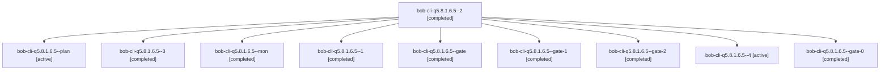

# Session: bob-cli-q5.8.1.6.5

[Agent Hoods](../README.md) / [bbugyi200](../users/bbugyi200/README.md) / [athena](../users/bbugyi200/machines/athena/README.md) / [bob-cli-q5](../users/bbugyi200/machines/athena/hoods/bob-cli-q5/README.md) / bob-cli-q5.8.1.6.5

Owner: `bbugyi200.athena` · Hood: `bob-cli-q5` · Members: 10 · Bead: [bob-cli-q5.8.1.6.5](https://github.com/bobs-org/bob-cli--beads/blob/main/pages/bob-cli-q5/bob-cli-q5.8.1.6.5.md)

## Lineage

The diagram is an optional enhancement; the ordered table below contains the same lineage in accessible text.

| Role | Agent | State | Model / provider | Timing | Commits | Prompt | Chat |
|---|---|---|---|---|---:|---|---|
| 2 | bob-cli-q5.8.1.6.5--2 | completed | muse-spark-1.3-contributor / muse | 2026-11-27T10:52:59.140491+00:00 → 2026-11-27T11:10:04.773797+00:00 | 0 | [Prompt](../agents/bbugyi200.athena.bob-cli-q5.8.1.6.5--2/prompt.md) | [Chat](../agents/bbugyi200.athena.bob-cli-q5.8.1.6.5--2/chat.md) |
| plan | bob-cli-q5.8.1.6.5--plan | active | opus / claude | 2026-11-27T11:44:59.222016+00:00 → 2026-11-27T11:58:56.786056+00:00 | 0 | [Prompt](../agents/bbugyi200.athena.bob-cli-q5.8.1.6.5--plan/prompt.md) | [Chat](../agents/bbugyi200.athena.bob-cli-q5.8.1.6.5--plan/chat.md) |
| 3 | bob-cli-q5.8.1.6.5--3 | completed | muse-spark-1.3-contributor / muse | 2026-11-27T11:15:34.177458+00:00 → 2026-11-27T11:22:18.981574+00:00 | 0 | [Prompt](../agents/bbugyi200.athena.bob-cli-q5.8.1.6.5--3/prompt.md) | [Chat](../agents/bbugyi200.athena.bob-cli-q5.8.1.6.5--3/chat.md) |
| mon | bob-cli-q5.8.1.6.5--mon | completed | opus / claude | 2026-11-27T11:58:49.645302+00:00 → 2026-11-27T12:01:34.077415+00:00 | 0 | — | [Chat](../agents/bbugyi200.athena.bob-cli-q5.8.1.6.5--mon/chat.md) |
| 1 | bob-cli-q5.8.1.6.5--1 | completed | muse-spark-1.3-contributor / muse | 2026-11-27T10:36:58.396944+00:00 → 2026-11-27T10:41:31.725287+00:00 | 0 | [Prompt](../agents/bbugyi200.athena.bob-cli-q5.8.1.6.5--1/prompt.md) | [Chat](../agents/bbugyi200.athena.bob-cli-q5.8.1.6.5--1/chat.md) |
| gate | bob-cli-q5.8.1.6.5--gate | completed | opus / claude | 2026-11-27T11:58:35.879128+00:00 → 2026-11-27T11:58:50.773889+00:00 | 0 | — | [Chat](../agents/bbugyi200.athena.bob-cli-q5.8.1.6.5--gate/chat.md) |
| gate-1 | bob-cli-q5.8.1.6.5--gate-1 | completed | muse-spark-1.3-contributor / muse | 2026-11-27T11:14:21.299552+00:00 → 2026-11-27T11:14:55.081165+00:00 | 0 | — | [Chat](../agents/bbugyi200.athena.bob-cli-q5.8.1.6.5--gate-1/chat.md) |
| gate-2 | bob-cli-q5.8.1.6.5--gate-2 | completed | muse-spark-1.3-contributor / muse | 2026-11-27T11:24:55.105358+00:00 → 2026-11-27T11:25:31.449201+00:00 | 0 | — | [Chat](../agents/bbugyi200.athena.bob-cli-q5.8.1.6.5--gate-2/chat.md) |
| 4 | bob-cli-q5.8.1.6.5--4 | active | muse-spark-1.3-contributor / muse | 2026-11-27T11:26:12.242178+00:00 | 0 | [Prompt](../agents/bbugyi200.athena.bob-cli-q5.8.1.6.5--4/prompt.md) | — |
| gate-0 | bob-cli-q5.8.1.6.5--gate-0 | completed | muse-spark-1.3-contributor / muse | 2026-11-27T10:52:01.100455+00:00 → 2026-11-27T10:52:20.664469+00:00 | 0 | — | [Chat](../agents/bbugyi200.athena.bob-cli-q5.8.1.6.5--gate-0/chat.md) |

## Neighbors

| Agent | Relation | State |
|---|---|---|
| [bob-cli-q5.8](bbugyi200.athena.bob-cli-q5.8.md) (session · 3) | ancestor | active 1, completed 2 |
| [bob-cli-q5.8.1.6.5.1.1](../agents/bbugyi200.athena.bob-cli-q5.8.1.6.5.1.1/README.md) | descendant | active |
| [bob-cli-q5.8.1.6.5.1.2](../agents/bbugyi200.athena.bob-cli-q5.8.1.6.5.1.2/README.md) | descendant | waiting |
| [bob-cli-q5.8.1.6.5.1.3](../agents/bbugyi200.athena.bob-cli-q5.8.1.6.5.1.3/README.md) | descendant | waiting |
| [bob-cli-q5.8.1.6.5.1.4](../agents/bbugyi200.athena.bob-cli-q5.8.1.6.5.1.4/README.md) | descendant | waiting |
| [bob-cli-q5.8.1.6.5.1.land](../agents/bbugyi200.athena.bob-cli-q5.8.1.6.5.1.land/README.md) | descendant | waiting |
| [bob-cli-q5.8.1.6.1](bbugyi200.athena.bob-cli-q5.8.1.6.1.md) (session · 13) | bob-cli-q5.8.1.6 hood | completed 10, failed 3 |
| [bob-cli-q5.8.1.6.2](../agents/bbugyi200.athena.bob-cli-q5.8.1.6.2/README.md) | bob-cli-q5.8.1.6 hood | completed |
| [bob-cli-q5.8.1.6.3](bbugyi200.athena.bob-cli-q5.8.1.6.3.md) (session · 7) | bob-cli-q5.8.1.6 hood | completed 5, failed 2 |
| [bob-cli-q5.8.1.6.4](bbugyi200.athena.bob-cli-q5.8.1.6.4.md) (session · 5) | bob-cli-q5.8.1.6 hood | completed 4, failed 1 |
| [bob-cli-q5.8.1.6.land](../agents/bbugyi200.athena.bob-cli-q5.8.1.6.land/README.md) | bob-cli-q5.8.1.6 hood | waiting |
| [bob-cli-q5.8.1.1](bbugyi200.athena.bob-cli-q5.8.1.1.md) (session · 8) | bob-cli-q5.8.1 hood | completed 4, failed 4 |
| [bob-cli-q5.8.1.2](../agents/bbugyi200.athena.bob-cli-q5.8.1.2/README.md) | bob-cli-q5.8.1 hood | completed |
| [bob-cli-q5.8.1.3](bbugyi200.athena.bob-cli-q5.8.1.3.md) (session · 5) | bob-cli-q5.8.1 hood | completed 3, failed 2 |
| [bob-cli-q5.8.1.4](bbugyi200.athena.bob-cli-q5.8.1.4.md) (session · 15) | bob-cli-q5.8.1 hood | completed 12, failed 3 |
| [bob-cli-q5.8.1.5](../agents/bbugyi200.athena.bob-cli-q5.8.1.5/README.md) | bob-cli-q5.8.1 hood | completed |
| [bob-cli-q5.8.1.land](bbugyi200.athena.bob-cli-q5.8.1.land.md) (session · 3) | bob-cli-q5.8.1 hood | active 1, completed 2 |
| [bob-cli-q5.1](bbugyi200.athena.bob-cli-q5.1.md) (session · 3) | bob-cli-q5 hood | active 1, completed 2 |
| [bob-cli-q5.1.1.1](../agents/bbugyi200.athena.bob-cli-q5.1.1.1/README.md) | bob-cli-q5 hood | completed |
| [bob-cli-q5.1.1.2](../agents/bbugyi200.athena.bob-cli-q5.1.1.2/README.md) | bob-cli-q5 hood | completed |
| [bob-cli-q5.1.1.3](bbugyi200.athena.bob-cli-q5.1.1.3.md) (session · 11) | bob-cli-q5 hood | completed 7, failed 4 |
| [bob-cli-q5.1.1.4](../agents/bbugyi200.athena.bob-cli-q5.1.1.4/README.md) | bob-cli-q5 hood | completed |
| [bob-cli-q5.1.1.5](../agents/bbugyi200.athena.bob-cli-q5.1.1.5/README.md) | bob-cli-q5 hood | completed |
| [bob-cli-q5.1.1.land](bbugyi200.athena.bob-cli-q5.1.1.land.md) (session · 3) | bob-cli-q5 hood | completed 3 |
| [bob-cli-q5.2](bbugyi200.athena.bob-cli-q5.2.md) (session · 3) | bob-cli-q5 hood | active 1, completed 2 |
| [bob-cli-q5.2.1.1](bbugyi200.athena.bob-cli-q5.2.1.1.md) (session · 5) | bob-cli-q5 hood | completed 3, failed 2 |
| [bob-cli-q5.2.1.2](bbugyi200.athena.bob-cli-q5.2.1.2.md) (session · 5) | bob-cli-q5 hood | completed 4, failed 1 |
| [bob-cli-q5.2.1.2](../agents/bbugyi200.athena.bob-cli-q5.2.1.2/README.md) | bob-cli-q5 hood | failed |
| [bob-cli-q5.2.1.3](../agents/bbugyi200.athena.bob-cli-q5.2.1.3/README.md) | bob-cli-q5 hood | completed |
| [bob-cli-q5.2.1.4](../agents/bbugyi200.athena.bob-cli-q5.2.1.4/README.md) | bob-cli-q5 hood | completed |
| [bob-cli-q5.2.1.land](bbugyi200.athena.bob-cli-q5.2.1.land.md) (session · 3) | bob-cli-q5 hood | completed 3 |
| [bob-cli-q5.3](bbugyi200.athena.bob-cli-q5.3.md) (session · 3) | bob-cli-q5 hood | active 1, completed 2 |
| [bob-cli-q5.3.1.1](../agents/bbugyi200.athena.bob-cli-q5.3.1.1/README.md) | bob-cli-q5 hood | completed |
| [bob-cli-q5.3.1.2](../agents/bbugyi200.athena.bob-cli-q5.3.1.2/README.md) | bob-cli-q5 hood | completed |
| [bob-cli-q5.3.1.3](bbugyi200.athena.bob-cli-q5.3.1.3.md) (session · 7) | bob-cli-q5 hood | completed 6, failed 1 |
| [bob-cli-q5.3.1.land](bbugyi200.athena.bob-cli-q5.3.1.land.md) (session · 3) | bob-cli-q5 hood | completed 3 |
| [bob-cli-q5.4](bbugyi200.athena.bob-cli-q5.4.md) (session · 3) | bob-cli-q5 hood | active 1, completed 2 |
| [bob-cli-q5.4.1.1](bbugyi200.athena.bob-cli-q5.4.1.1.md) (session · 3) | bob-cli-q5 hood | completed 2, failed 1 |
| [bob-cli-q5.4.1.2](../agents/bbugyi200.athena.bob-cli-q5.4.1.2/README.md) | bob-cli-q5 hood | completed |
| [bob-cli-q5.4.1.3](../agents/bbugyi200.athena.bob-cli-q5.4.1.3/README.md) | bob-cli-q5 hood | completed |
| [bob-cli-q5.4.1.4](bbugyi200.athena.bob-cli-q5.4.1.4.md) (session · 13) | bob-cli-q5 hood | completed 10, failed 3 |
| [bob-cli-q5.4.1.5](../agents/bbugyi200.athena.bob-cli-q5.4.1.5/README.md) | bob-cli-q5 hood | completed |
| [bob-cli-q5.4.1.land](bbugyi200.athena.bob-cli-q5.4.1.land.md) (session · 7) | bob-cli-q5 hood | active 1, completed 5, failed 1 |
| [bob-cli-q5.5](bbugyi200.athena.bob-cli-q5.5.md) (session · 3) | bob-cli-q5 hood | active 1, completed 2 |
| [bob-cli-q5.5.1.1](../agents/bbugyi200.athena.bob-cli-q5.5.1.1/README.md) | bob-cli-q5 hood | completed |
| [bob-cli-q5.5.1.2](../agents/bbugyi200.athena.bob-cli-q5.5.1.2/README.md) | bob-cli-q5 hood | completed |
| [bob-cli-q5.5.1.3](../agents/bbugyi200.athena.bob-cli-q5.5.1.3/README.md) | bob-cli-q5 hood | completed |
| [bob-cli-q5.5.1.4](../agents/bbugyi200.athena.bob-cli-q5.5.1.4/README.md) | bob-cli-q5 hood | completed |
| [bob-cli-q5.5.1.5](bbugyi200.athena.bob-cli-q5.5.1.5.md) (session · 3) | bob-cli-q5 hood | completed 3 |
| [bob-cli-q5.5.1.6](../agents/bbugyi200.athena.bob-cli-q5.5.1.6/README.md) | bob-cli-q5 hood | completed |
| [bob-cli-q5.5.1.land](bbugyi200.athena.bob-cli-q5.5.1.land.md) (session · 23) | bob-cli-q5 hood | completed 13, failed 10 |
| [bob-cli-q5.6](bbugyi200.athena.bob-cli-q5.6.md) (session · 3) | bob-cli-q5 hood | active 1, completed 2 |
| [bob-cli-q5.6.1.1](../agents/bbugyi200.athena.bob-cli-q5.6.1.1/README.md) | bob-cli-q5 hood | completed |
| [bob-cli-q5.6.1.2](../agents/bbugyi200.athena.bob-cli-q5.6.1.2/README.md) | bob-cli-q5 hood | completed |
| [bob-cli-q5.6.1.3](../agents/bbugyi200.athena.bob-cli-q5.6.1.3/README.md) | bob-cli-q5 hood | completed |
| [bob-cli-q5.6.1.4](../agents/bbugyi200.athena.bob-cli-q5.6.1.4/README.md) | bob-cli-q5 hood | completed |
| [bob-cli-q5.6.1.land](../agents/bbugyi200.athena.bob-cli-q5.6.1.land/README.md) | bob-cli-q5 hood | active |
| [bob-cli-q5.7](bbugyi200.athena.bob-cli-q5.7.md) (session · 3) | bob-cli-q5 hood | active 1, completed 2 |
| [bob-cli-q5.7.1.1](../agents/bbugyi200.athena.bob-cli-q5.7.1.1/README.md) | bob-cli-q5 hood | completed |
| [bob-cli-q5.7.1.2](bbugyi200.athena.bob-cli-q5.7.1.2.md) (session · 3) | bob-cli-q5 hood | completed 2, failed 1 |
| [bob-cli-q5.7.1.3](bbugyi200.athena.bob-cli-q5.7.1.3.md) (session · 3) | bob-cli-q5 hood | completed 3 |
| [bob-cli-q5.7.1.land](bbugyi200.athena.bob-cli-q5.7.1.land.md) (session · 11) | bob-cli-q5 hood | completed 9, failed 2 |
| [bob-cli-q5.9](../agents/bbugyi200.athena.bob-cli-q5.9/README.md) | bob-cli-q5 hood | waiting |
| [bob-cli-q5.land](../agents/bbugyi200.athena.bob-cli-q5.land/README.md) | bob-cli-q5 hood | waiting |
