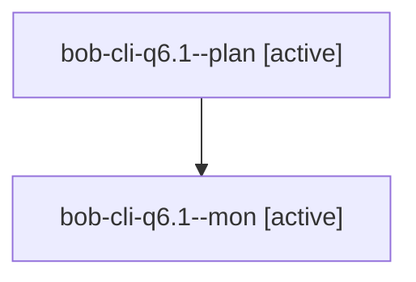

# Session: bob-cli-q6.1

[Agent Hoods](../README.md) / [bbugyi200](../users/bbugyi200/README.md) / [athena](../users/bbugyi200/machines/athena/README.md) / [bob-cli-q6](../users/bbugyi200/machines/athena/hoods/bob-cli-q6/README.md) / bob-cli-q6.1

Owner: `bbugyi200.athena` · Hood: `bob-cli-q6` · Members: 2 · Bead: [bob-cli-q6.1](https://github.com/bobs-org/bob-cli--beads/blob/main/pages/bob-cli-q6/bob-cli-q6.1.md)

## Lineage

The diagram is an optional enhancement; the ordered table below contains the same lineage in accessible text.

| Role | Agent | State | Model / provider | Timing | Commits | Prompt | Chat |
|---|---|---|---|---|---:|---|---|
| plan | bob-cli-q6.1--plan | active | gpt-6-luna / codex | 2026-11-25T17:53:27.467381+00:00 | 0 | [Prompt](../agents/bbugyi200.athena.bob-cli-q6.1--plan/prompt.md) | — |
| mon | bob-cli-q6.1--mon | active | gpt-6-luna / codex | 2026-11-25T18:26:44.614908+00:00 | 0 | — | — |

## Neighbors

| Agent | Relation | State |
|---|---|---|
| [bob-cli-q6.2](../agents/bbugyi200.athena.bob-cli-q6.2/README.md) | bob-cli-q6 hood | waiting |
| [bob-cli-q6.3](../agents/bbugyi200.athena.bob-cli-q6.3/README.md) | bob-cli-q6 hood | waiting |
| [bob-cli-q6.4](../agents/bbugyi200.athena.bob-cli-q6.4/README.md) | bob-cli-q6 hood | waiting |
| [bob-cli-q6.5](../agents/bbugyi200.athena.bob-cli-q6.5/README.md) | bob-cli-q6 hood | waiting |
| [bob-cli-q6.6](../agents/bbugyi200.athena.bob-cli-q6.6/README.md) | bob-cli-q6 hood | waiting |
| [bob-cli-q6.land](../agents/bbugyi200.athena.bob-cli-q6.land/README.md) | bob-cli-q6 hood | waiting |
