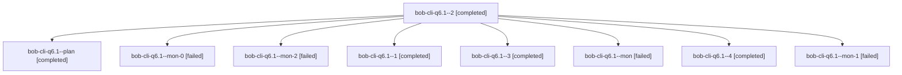

# Session: bob-cli-q6.1

[Agent Hoods](../README.md) / [bbugyi200](../users/bbugyi200/README.md) / [athena](../users/bbugyi200/machines/athena/README.md) / [bob-cli-q6](../users/bbugyi200/machines/athena/hoods/bob-cli-q6/README.md) / bob-cli-q6.1

Owner: `bbugyi200.athena` · Hood: `bob-cli-q6` · Members: 9 · Bead: [bob-cli-q6.1](https://github.com/bobs-org/bob-cli--beads/blob/main/pages/bob-cli-q6/bob-cli-q6.1.md)

## Lineage

The diagram is an optional enhancement; the ordered table below contains the same lineage in accessible text.

| Role | Agent | State | Model / provider | Timing | Commits | Prompt | Chat |
|---|---|---|---|---|---:|---|---|
| 2 | bob-cli-q6.1--2 | completed | gpt-6-luna / codex | 2026-11-25T19:47:34.772740+00:00 → 2026-11-25T19:57:12.594110+00:00 | 0 | [Prompt](../agents/bbugyi200.athena.bob-cli-q6.1--2/prompt.md) | [Chat](../agents/bbugyi200.athena.bob-cli-q6.1--2/chat.md) |
| plan | bob-cli-q6.1--plan | completed | gpt-6-luna / codex | 2026-11-25T17:53:27.467381+00:00 → 2026-11-25T19:34:25.114798+00:00 | 0 | [Prompt](../agents/bbugyi200.athena.bob-cli-q6.1--plan/prompt.md) | [Chat](../agents/bbugyi200.athena.bob-cli-q6.1--plan/chat.md) |
| mon-0 | bob-cli-q6.1--mon-0 | failed | gpt-6-luna / codex | 2026-11-25T19:41:56.565617+00:00 → 2026-11-25T19:47:35.046437+00:00 | 0 | — | [Chat](../agents/bbugyi200.athena.bob-cli-q6.1--mon-0/chat.md) |
| mon-2 | bob-cli-q6.1--mon-2 | failed | gpt-6-luna / codex | 2026-11-25T20:33:38.371735+00:00 → 2026-11-25T20:43:16.084764+00:00 | 0 | — | [Chat](../agents/bbugyi200.athena.bob-cli-q6.1--mon-2/chat.md) |
| 1 | bob-cli-q6.1--1 | completed | gpt-6-luna / codex | 2026-11-25T19:37:48.242460+00:00 → 2026-11-25T19:42:56.799444+00:00 | 0 | [Prompt](../agents/bbugyi200.athena.bob-cli-q6.1--1/prompt.md) | [Chat](../agents/bbugyi200.athena.bob-cli-q6.1--1/chat.md) |
| 3 | bob-cli-q6.1--3 | completed | gpt-6-luna / codex | 2026-11-25T19:58:43.079549+00:00 → 2026-11-25T20:35:09.509953+00:00 | 0 | [Prompt](../agents/bbugyi200.athena.bob-cli-q6.1--3/prompt.md) | [Chat](../agents/bbugyi200.athena.bob-cli-q6.1--3/chat.md) |
| mon | bob-cli-q6.1--mon | failed | gpt-6-luna / codex | 2026-11-25T18:26:44.614908+00:00 → 2026-11-25T19:37:48.281359+00:00 | 0 | — | [Chat](../agents/bbugyi200.athena.bob-cli-q6.1--mon/chat.md) |
| 4 | bob-cli-q6.1--4 | completed | gpt-6-luna / codex | 2026-11-25T20:43:15.878630+00:00 → 2026-11-25T21:06:18.352911+00:00 | 0 | [Prompt](../agents/bbugyi200.athena.bob-cli-q6.1--4/prompt.md) | [Chat](../agents/bbugyi200.athena.bob-cli-q6.1--4/chat.md) |
| mon-1 | bob-cli-q6.1--mon-1 | failed | gpt-6-luna / codex | 2026-11-25T19:56:22.277621+00:00 → 2026-11-25T19:58:43.355774+00:00 | 0 | — | [Chat](../agents/bbugyi200.athena.bob-cli-q6.1--mon-1/chat.md) |

## Neighbors

| Agent | Relation | State |
|---|---|---|
| [bob-cli-q6.2](../agents/bbugyi200.athena.bob-cli-q6.2/README.md) | bob-cli-q6 hood | completed |
| [bob-cli-q6.3](../agents/bbugyi200.athena.bob-cli-q6.3/README.md) | bob-cli-q6 hood | completed |
| [bob-cli-q6.4](bbugyi200.athena.bob-cli-q6.4.md) (session · 21) | bob-cli-q6 hood | completed 11, failed 10 |
| [bob-cli-q6.5](../agents/bbugyi200.athena.bob-cli-q6.5/README.md) | bob-cli-q6 hood | completed |
| [bob-cli-q6.6](../agents/bbugyi200.athena.bob-cli-q6.6/README.md) | bob-cli-q6 hood | waiting |
| [bob-cli-q6.land](../agents/bbugyi200.athena.bob-cli-q6.land/README.md) | bob-cli-q6 hood | waiting |
