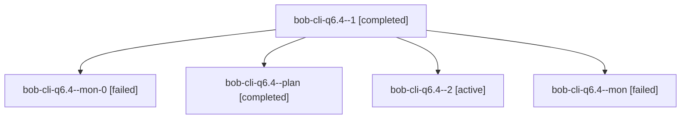

# Session: bob-cli-q6.4

[Agent Hoods](../README.md) / [bbugyi200](../users/bbugyi200/README.md) / [athena](../users/bbugyi200/machines/athena/README.md) / [bob-cli-q6](../users/bbugyi200/machines/athena/hoods/bob-cli-q6/README.md) / bob-cli-q6.4

Owner: `bbugyi200.athena` · Hood: `bob-cli-q6` · Members: 5 · Bead: [bob-cli-q6.4](https://github.com/bobs-org/bob-cli--beads/blob/main/pages/bob-cli-q6/bob-cli-q6.4.md)

## Lineage



The diagram is an optional enhancement; the ordered table below contains the same lineage in accessible text.

| Role | Agent | State | Model / provider | Timing | Commits | Prompt | Chat |
|---|---|---|---|---|---:|---|---|
| <a id="member-1"></a>1 | bob-cli-q6.4--1 | completed | gpt-6-luna / codex | 2026-11-25T23:34:19.725770+00:00 → 2026-11-25T23:55:47.154299+00:00 | 0 | [Prompt](../agents/bbugyi200.athena.bob-cli-q6.4--1/prompt.md) | [Chat](../agents/bbugyi200.athena.bob-cli-q6.4--1/chat.md) |
| <a id="member-mon-0"></a>mon-0 | bob-cli-q6.4--mon-0 | failed | gpt-6-luna / codex | 2026-11-25T23:53:27.488053+00:00 → 2026-11-25T23:56:45.017341+00:00 | 0 | — | [Chat](../agents/bbugyi200.athena.bob-cli-q6.4--mon-0/chat.md) |
| <a id="member-plan"></a>plan | bob-cli-q6.4--plan | completed | gpt-6-luna / codex | 2026-11-25T22:16:52.691634+00:00 → 2026-11-25T23:29:46.330665+00:00 | [1](../agents/bbugyi200.athena.bob-cli-q6.4--plan/README.md#commits) | [Prompt](../agents/bbugyi200.athena.bob-cli-q6.4--plan/prompt.md) | [Chat](../agents/bbugyi200.athena.bob-cli-q6.4--plan/chat.md) |
| <a id="member-2"></a>2 | bob-cli-q6.4--2 | active | gpt-6-luna / codex | 2026-11-25T23:56:44.885878+00:00 | 0 | [Prompt](../agents/bbugyi200.athena.bob-cli-q6.4--2/prompt.md) | — |
| <a id="member-mon"></a>mon | bob-cli-q6.4--mon | failed | gpt-6-luna / codex | 2026-11-25T23:08:23.926480+00:00 → 2026-11-25T23:34:12.282433+00:00 | 0 | — | [Chat](../agents/bbugyi200.athena.bob-cli-q6.4--mon/chat.md) |

## Commits

| Role | Repo | Commit | Subject | Committed |
|---|---|---|---|---|
| plan | bob-cli | [`1ca74ec`](https://github.com/bobs-org/bob-cli/commit/1ca74ece68165cc6fc07af59fe4e2bedf7519f4f) | docs(bank): document evidence-gated Properties | 2026-11-25 18:24:50 EST |

## Variables

| Role | Variable | Value |
|---|---|---|
| 1 | `artifacts` | \[{bead: bob-cli-q6.4, kind: file, label: First q6.4 Obsidian takeover report, path: /home/bryan/.sase/artifacts/agents/gh\_bobs-org\_\_bob-cli/20261125183312/bob-cli-q6-4-frontmatter-takeover-first-fail… |

#### artifacts

**Role:** `1`

```yaml
- bead: bob-cli-q6.4
  kind: file
  label: First q6.4 Obsidian takeover report
  path: /home/bryan/.sase/artifacts/agents/gh_bobs-org__bob-cli/20261125183312/bob-cli-q6-4-frontmatter-takeover-first-failure-cdf793a2558d.json
  ref: file:explicit:8cb18931c93e107b0e3fe289
  source_path: /tmp/bob-cli-q6-4-frontmatter-takeover-first-failure.json
- bead: bob-cli-q6.4
  kind: file
  label: First q6.4 Obsidian screenshot set
  path: /home/bryan/.sase/artifacts/agents/gh_bobs-org__bob-cli/20261125183312/bob-cli-q6-4-frontmatter-takeover-first-screenshots.tar-af0c6a4ba03e.gz
  ref: file:explicit:1b2923bd61f38ece409aac18
  source_path: /tmp/bob-cli-q6-4-frontmatter-takeover-first-screenshots.tar.gz
- bead: bob-cli-q6.4
  kind: file
  label: First q6.4 Obsidian run log
  path: /home/bryan/.sase/artifacts/agents/gh_bobs-org__bob-cli/20261125183312/bob-cli-q6-4-frontmatter-takeover-first-685f79da6e35.log
  ref: file:explicit:584357fd5217b2cf25553314
  source_path: /tmp/bob-cli-q6-4-frontmatter-takeover-first.log
```

Values are truncated for display; see each member's agent meta.json for the full values.

## Neighbors

| Agent | Relation | State |
|---|---|---|
| [bob-cli-q6.1](bbugyi200.athena.bob-cli-q6.1.md) (session · 9) | bob-cli-q6 hood | completed 5, failed 4 |
| [bob-cli-q6.2](../agents/bbugyi200.athena.bob-cli-q6.2/README.md) | bob-cli-q6 hood | completed |
| [bob-cli-q6.3](../agents/bbugyi200.athena.bob-cli-q6.3/README.md) | bob-cli-q6 hood | completed |
| [bob-cli-q6.5](../agents/bbugyi200.athena.bob-cli-q6.5/README.md) | bob-cli-q6 hood | completed |
| [bob-cli-q6.6](../agents/bbugyi200.athena.bob-cli-q6.6/README.md) | bob-cli-q6 hood | waiting |
| [bob-cli-q6.land](../agents/bbugyi200.athena.bob-cli-q6.land/README.md) | bob-cli-q6 hood | waiting |
