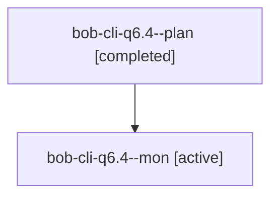

# Session: bob-cli-q6.4

[Agent Hoods](../README.md) / [bbugyi200](../users/bbugyi200/README.md) / [athena](../users/bbugyi200/machines/athena/README.md) / [bob-cli-q6](../users/bbugyi200/machines/athena/hoods/bob-cli-q6/README.md) / bob-cli-q6.4

Owner: `bbugyi200.athena` · Hood: `bob-cli-q6` · Members: 2 · Bead: [bob-cli-q6.4](https://github.com/bobs-org/bob-cli--beads/blob/main/pages/bob-cli-q6/bob-cli-q6.4.md)

## Lineage

The diagram is an optional enhancement; the ordered table below contains the same lineage in accessible text.

| Role | Agent | State | Model / provider | Timing | Commits | Prompt | Chat |
|---|---|---|---|---|---:|---|---|
| plan | bob-cli-q6.4--plan | completed | gpt-6-luna / codex | 2026-11-25T22:16:52.691634+00:00 → 2026-11-25T23:29:46.330665+00:00 | [1](../agents/bbugyi200.athena.bob-cli-q6.4--plan/README.md#commits) | [Prompt](../agents/bbugyi200.athena.bob-cli-q6.4--plan/prompt.md) | [Chat](../agents/bbugyi200.athena.bob-cli-q6.4--plan/chat.md) |
| mon | bob-cli-q6.4--mon | active | gpt-6-luna / codex | 2026-11-25T23:08:23.926480+00:00 | 0 | — | — |

## Commits

| Role | Repo | Commit | Subject | Committed |
|---|---|---|---|---|
| plan | bob-cli | [`1ca74ec`](https://github.com/bobs-org/bob-cli/commit/1ca74ece68165cc6fc07af59fe4e2bedf7519f4f) | docs(bank): document evidence-gated Properties | 2026-11-25 18:24:50 EST |

## Neighbors

| Agent | Relation | State |
|---|---|---|
| [bob-cli-q6.1](bbugyi200.athena.bob-cli-q6.1.md) (session · 9) | bob-cli-q6 hood | completed 5, failed 4 |
| [bob-cli-q6.2](../agents/bbugyi200.athena.bob-cli-q6.2/README.md) | bob-cli-q6 hood | completed |
| [bob-cli-q6.3](../agents/bbugyi200.athena.bob-cli-q6.3/README.md) | bob-cli-q6 hood | completed |
| [bob-cli-q6.5](../agents/bbugyi200.athena.bob-cli-q6.5/README.md) | bob-cli-q6 hood | completed |
| [bob-cli-q6.6](../agents/bbugyi200.athena.bob-cli-q6.6/README.md) | bob-cli-q6 hood | waiting |
| [bob-cli-q6.land](../agents/bbugyi200.athena.bob-cli-q6.land/README.md) | bob-cli-q6 hood | waiting |
