# Session: bob-cli-q6.4

[Agent Hoods](../README.md) / [bbugyi200](../users/bbugyi200/README.md) / [athena](../users/bbugyi200/machines/athena/README.md) / [bob-cli-q6](../users/bbugyi200/machines/athena/hoods/bob-cli-q6/README.md) / bob-cli-q6.4

Owner: `bbugyi200.athena` · Hood: `bob-cli-q6` · Members: 21 · Bead: [bob-cli-q6.4](https://github.com/bobs-org/bob-cli--beads/blob/main/pages/bob-cli-q6/bob-cli-q6.4.md)

## Lineage

```mermaid
flowchart TD
  n0["bob-cli-q6.4--mon-2 [failed]"]
  n1["bob-cli-q6.4--4 [completed]"]
  n0 --> n1
  n2["bob-cli-q6.4--1 [completed]"]
  n0 --> n2
  n3["bob-cli-q6.4--mon-0 [failed]"]
  n0 --> n3
  n4["bob-cli-q6.4--plan [completed]"]
  n0 --> n4
  n5["bob-cli-q6.4--7 [completed]"]
  n0 --> n5
  n6["bob-cli-q6.4--a [completed]"]
  n0 --> n6
  n7["bob-cli-q6.4--mon-1 [failed]"]
  n0 --> n7
  n8["bob-cli-q6.4--5 [completed]"]
  n0 --> n8
  n9["bob-cli-q6.4--mon-3 [failed]"]
  n0 --> n9
  n10["bob-cli-q6.4--6 [completed]"]
  n0 --> n10
  n11["bob-cli-q6.4--2 [completed]"]
  n0 --> n11
  n12["bob-cli-q6.4--mon-6 [failed]"]
  n0 --> n12
  n13["bob-cli-q6.4--9 [completed]"]
  n0 --> n13
  n14["bob-cli-q6.4--mon-7 [failed]"]
  n0 --> n14
  n15["bob-cli-q6.4--8 [completed]"]
  n0 --> n15
  n16["bob-cli-q6.4--mon [failed]"]
  n0 --> n16
  n17["bob-cli-q6.4--mon-8 [failed]"]
  n0 --> n17
  n18["bob-cli-q6.4--mon-5 [failed]"]
  n0 --> n18
  n19["bob-cli-q6.4--3 [completed]"]
  n0 --> n19
  n20["bob-cli-q6.4--mon-4 [failed]"]
  n0 --> n20
```



The diagram is an optional enhancement; the ordered table below contains the same lineage in accessible text.

| Role | Agent | State | Model / provider | Timing | Commits | Prompt | Chat |
|---|---|---|---|---|---:|---|---|
| <a id="member-mon-2"></a>mon-2 | bob-cli-q6.4--mon-2 | failed | gpt-6-luna / codex | 2026-11-26T00:12:17.823352+00:00 → 2026-11-26T00:17:41.789419+00:00 | 0 | — | [Chat](../agents/bbugyi200.athena.bob-cli-q6.4--mon-2/chat.md) |
| <a id="member-4"></a>4 | bob-cli-q6.4--4 | completed | gpt-6-luna / codex | 2026-11-26T00:17:41.289231+00:00 → 2026-11-26T00:29:44.384989+00:00 | 0 | [Prompt](../agents/bbugyi200.athena.bob-cli-q6.4--4/prompt.md) | [Chat](../agents/bbugyi200.athena.bob-cli-q6.4--4/chat.md) |
| <a id="member-1"></a>1 | bob-cli-q6.4--1 | completed | gpt-6-luna / codex | 2026-11-25T23:34:19.725770+00:00 → 2026-11-25T23:55:47.154299+00:00 | 0 | [Prompt](../agents/bbugyi200.athena.bob-cli-q6.4--1/prompt.md) | [Chat](../agents/bbugyi200.athena.bob-cli-q6.4--1/chat.md) |
| <a id="member-mon-0"></a>mon-0 | bob-cli-q6.4--mon-0 | failed | gpt-6-luna / codex | 2026-11-25T23:53:27.488053+00:00 → 2026-11-25T23:56:45.017341+00:00 | 0 | — | [Chat](../agents/bbugyi200.athena.bob-cli-q6.4--mon-0/chat.md) |
| <a id="member-plan"></a>plan | bob-cli-q6.4--plan | completed | gpt-6-luna / codex | 2026-11-25T22:16:52.691634+00:00 → 2026-11-25T23:29:46.330665+00:00 | [1](../agents/bbugyi200.athena.bob-cli-q6.4--plan/README.md#commits) | [Prompt](../agents/bbugyi200.athena.bob-cli-q6.4--plan/prompt.md) | [Chat](../agents/bbugyi200.athena.bob-cli-q6.4--plan/chat.md) |
| <a id="member-7"></a>7 | bob-cli-q6.4--7 | completed | gpt-6-luna / codex | 2026-11-26T01:23:25.771364+00:00 → 2026-11-26T01:42:43.789392+00:00 | 0 | [Prompt](../agents/bbugyi200.athena.bob-cli-q6.4--7/prompt.md) | [Chat](../agents/bbugyi200.athena.bob-cli-q6.4--7/chat.md) |
| <a id="member-a"></a>a | bob-cli-q6.4--a | completed | gpt-6-luna / codex | 2026-11-26T02:33:57.807971+00:00 → 2026-11-26T02:40:33.886262+00:00 | 0 | [Prompt](../agents/bbugyi200.athena.bob-cli-q6.4--a/prompt.md) | [Chat](../agents/bbugyi200.athena.bob-cli-q6.4--a/chat.md) |
| <a id="member-mon-1"></a>mon-1 | bob-cli-q6.4--mon-1 | failed | gpt-6-luna / codex | 2026-11-26T00:01:18.578542+00:00 → 2026-11-26T00:07:15.860710+00:00 | 0 | — | [Chat](../agents/bbugyi200.athena.bob-cli-q6.4--mon-1/chat.md) |
| <a id="member-5"></a>5 | bob-cli-q6.4--5 | completed | gpt-6-luna / codex | 2026-11-26T00:38:01.074214+00:00 → 2026-11-26T00:54:38.010311+00:00 | 0 | [Prompt](../agents/bbugyi200.athena.bob-cli-q6.4--5/prompt.md) | [Chat](../agents/bbugyi200.athena.bob-cli-q6.4--5/chat.md) |
| <a id="member-mon-3"></a>mon-3 | bob-cli-q6.4--mon-3 | failed | gpt-6-luna / codex | 2026-11-26T00:27:52.617194+00:00 → 2026-11-26T00:38:01.187831+00:00 | 0 | — | [Chat](../agents/bbugyi200.athena.bob-cli-q6.4--mon-3/chat.md) |
| <a id="member-6"></a>6 | bob-cli-q6.4--6 | completed | gpt-6-luna / codex | 2026-11-26T00:58:42.237123+00:00 → 2026-11-26T01:16:34.527383+00:00 | 0 | [Prompt](../agents/bbugyi200.athena.bob-cli-q6.4--6/prompt.md) | [Chat](../agents/bbugyi200.athena.bob-cli-q6.4--6/chat.md) |
| <a id="member-2"></a>2 | bob-cli-q6.4--2 | completed | gpt-6-luna / codex | 2026-11-25T23:56:44.885878+00:00 → 2026-11-26T00:02:04.179962+00:00 | 0 | [Prompt](../agents/bbugyi200.athena.bob-cli-q6.4--2/prompt.md) | [Chat](../agents/bbugyi200.athena.bob-cli-q6.4--2/chat.md) |
| <a id="member-mon-6"></a>mon-6 | bob-cli-q6.4--mon-6 | failed | gpt-6-luna / codex | 2026-11-26T01:41:09.921678+00:00 → 2026-11-26T01:52:49.594989+00:00 | 0 | — | [Chat](../agents/bbugyi200.athena.bob-cli-q6.4--mon-6/chat.md) |
| <a id="member-9"></a>9 | bob-cli-q6.4--9 | completed | gpt-6-luna / codex | 2026-11-26T02:15:36.936187+00:00 → 2026-11-26T02:25:02.362530+00:00 | 0 | [Prompt](../agents/bbugyi200.athena.bob-cli-q6.4--9/prompt.md) | [Chat](../agents/bbugyi200.athena.bob-cli-q6.4--9/chat.md) |
| <a id="member-mon-7"></a>mon-7 | bob-cli-q6.4--mon-7 | failed | gpt-6-luna / codex | 2026-11-26T02:06:14.003828+00:00 → 2026-11-26T02:15:37.070613+00:00 | 0 | — | [Chat](../agents/bbugyi200.athena.bob-cli-q6.4--mon-7/chat.md) |
| <a id="member-8"></a>8 | bob-cli-q6.4--8 | completed | gpt-6-luna / codex | 2026-11-26T01:52:49.245038+00:00 → 2026-11-26T02:07:31.476899+00:00 | 0 | [Prompt](../agents/bbugyi200.athena.bob-cli-q6.4--8/prompt.md) | [Chat](../agents/bbugyi200.athena.bob-cli-q6.4--8/chat.md) |
| <a id="member-mon"></a>mon | bob-cli-q6.4--mon | failed | gpt-6-luna / codex | 2026-11-25T23:08:23.926480+00:00 → 2026-11-25T23:34:12.282433+00:00 | 0 | — | [Chat](../agents/bbugyi200.athena.bob-cli-q6.4--mon/chat.md) |
| <a id="member-mon-8"></a>mon-8 | bob-cli-q6.4--mon-8 | failed | gpt-6-luna / codex | 2026-11-26T02:22:37.836029+00:00 → 2026-11-26T02:33:32.131583+00:00 | 0 | — | [Chat](../agents/bbugyi200.athena.bob-cli-q6.4--mon-8/chat.md) |
| <a id="member-mon-5"></a>mon-5 | bob-cli-q6.4--mon-5 | failed | gpt-6-luna / codex | 2026-11-26T01:14:55.497326+00:00 → 2026-11-26T01:23:26.290327+00:00 | 0 | — | [Chat](../agents/bbugyi200.athena.bob-cli-q6.4--mon-5/chat.md) |
| <a id="member-3"></a>3 | bob-cli-q6.4--3 | completed | gpt-6-luna / codex | 2026-11-26T00:07:15.762044+00:00 → 2026-11-26T00:12:58.142209+00:00 | 0 | [Prompt](../agents/bbugyi200.athena.bob-cli-q6.4--3/prompt.md) | [Chat](../agents/bbugyi200.athena.bob-cli-q6.4--3/chat.md) |
| <a id="member-mon-4"></a>mon-4 | bob-cli-q6.4--mon-4 | failed | gpt-6-luna / codex | 2026-11-26T00:53:44.357046+00:00 → 2026-11-26T00:58:42.363294+00:00 | 0 | — | [Chat](../agents/bbugyi200.athena.bob-cli-q6.4--mon-4/chat.md) |

## Commits

| Role | Repo | Commit | Subject | Committed |
|---|---|---|---|---|
| plan | — | `1ca74ec` | docs(bank): document evidence-gated Properties | 2026-11-25 18:24:50 EST |

## Variables

| Role | Variable | Value |
|---|---|---|
| 1 | `artifacts` | \[{bead: bob-cli-q6.4, kind: file, label: First q6.4 Obsidian takeover report, path: /home/bryan/.sase/artifacts/agents/gh\_bobs-org\_\_bob-cli/20261125183312/bob-cli-q6-4-frontmatter-takeover-first-fail… |

#### artifacts

**Role:** `1`

```yaml
- bead: bob-cli-q6.4
  kind: file
  label: First q6.4 Obsidian takeover report
  path: /home/bryan/.sase/artifacts/agents/gh_bobs-org__bob-cli/20261125183312/bob-cli-q6-4-frontmatter-takeover-first-failure-cdf793a2558d.json
  ref: file:explicit:8cb18931c93e107b0e3fe289
  source_path: /tmp/bob-cli-q6-4-frontmatter-takeover-first-failure.json
- bead: bob-cli-q6.4
  kind: file
  label: First q6.4 Obsidian screenshot set
  path: /home/bryan/.sase/artifacts/agents/gh_bobs-org__bob-cli/20261125183312/bob-cli-q6-4-frontmatter-takeover-first-screenshots.tar-af0c6a4ba03e.gz
  ref: file:explicit:1b2923bd61f38ece409aac18
  source_path: /tmp/bob-cli-q6-4-frontmatter-takeover-first-screenshots.tar.gz
- bead: bob-cli-q6.4
  kind: file
  label: First q6.4 Obsidian run log
  path: /home/bryan/.sase/artifacts/agents/gh_bobs-org__bob-cli/20261125183312/bob-cli-q6-4-frontmatter-takeover-first-685f79da6e35.log
  ref: file:explicit:584357fd5217b2cf25553314
  source_path: /tmp/bob-cli-q6-4-frontmatter-takeover-first.log
```

Values are truncated for display; see each member's agent meta.json for the full values.

## Neighbors

| Agent | Relation | State |
|---|---|---|
| [bob-cli-q6.1](bbugyi200.athena.bob-cli-q6.1.md) (session · 9) | bob-cli-q6 hood | completed 5, failed 4 |
| [bob-cli-q6.2](../agents/bbugyi200.athena.bob-cli-q6.2/README.md) | bob-cli-q6 hood | completed |
| [bob-cli-q6.3](../agents/bbugyi200.athena.bob-cli-q6.3/README.md) | bob-cli-q6 hood | completed |
| [bob-cli-q6.5](../agents/bbugyi200.athena.bob-cli-q6.5/README.md) | bob-cli-q6 hood | completed |
| [bob-cli-q6.6](../agents/bbugyi200.athena.bob-cli-q6.6/README.md) | bob-cli-q6 hood | dismissed |
| [bob-cli-q6.land](../agents/bbugyi200.athena.bob-cli-q6.land/README.md) | bob-cli-q6 hood | dismissed |
