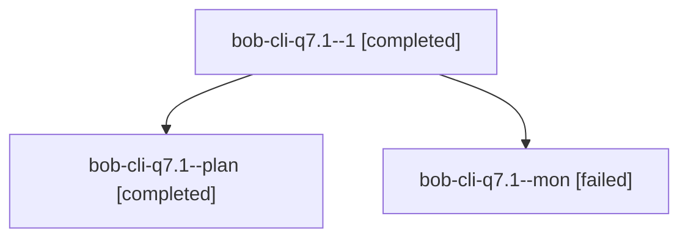

# Session: bob-cli-q7.1

[Agent Hoods](../README.md) / [bbugyi200](../users/bbugyi200/README.md) / [athena](../users/bbugyi200/machines/athena/README.md) / [bob-cli-q7](../users/bbugyi200/machines/athena/hoods/bob-cli-q7/README.md) / bob-cli-q7.1

Owner: `bbugyi200.athena` · Hood: `bob-cli-q7` · Members: 3 · Bead: [bob-cli-q7.1](https://github.com/bobs-org/bob-cli--beads/blob/main/pages/bob-cli-q7/bob-cli-q7.1.md)

## Lineage

The diagram is an optional enhancement; the ordered table below contains the same lineage in accessible text.

| Role | Agent | State | Model / provider | Timing | Commits | Prompt | Chat |
|---|---|---|---|---|---:|---|---|
| 1 | bob-cli-q7.1--1 | completed | grok-4.6 / grok | 2026-11-25T21:43:10.328834+00:00 → 2026-11-25T22:11:38.495310+00:00 | [1](../agents/bbugyi200.athena.bob-cli-q7.1--1/README.md#commits) | [Prompt](../agents/bbugyi200.athena.bob-cli-q7.1--1/prompt.md) | [Chat](../agents/bbugyi200.athena.bob-cli-q7.1--1/chat.md) |
| plan | bob-cli-q7.1--plan | completed | grok-4.6 / grok | 2026-11-25T20:28:51.340174+00:00 → 2026-11-25T21:33:31.053570+00:00 | 0 | [Prompt](../agents/bbugyi200.athena.bob-cli-q7.1--plan/prompt.md) | [Chat](../agents/bbugyi200.athena.bob-cli-q7.1--plan/chat.md) |
| mon | bob-cli-q7.1--mon | failed | grok-4.6 / grok | 2026-11-25T21:30:48.768657+00:00 → 2026-11-25T21:43:10.684635+00:00 | 0 | — | [Chat](../agents/bbugyi200.athena.bob-cli-q7.1--mon/chat.md) |

## Commits

| Role | Repo | Commit | Subject | Committed |
|---|---|---|---|---|
| 1 | bob-cli | [`4d93012`](https://github.com/bobs-org/bob-cli/commit/4d93012907c8d8048e2a6498450f4a803763c66a) | feat(capture): treat whole-draft @route^id as read-only Go To | 2026-11-25 17:10:47 EST |

## Neighbors

| Agent | Relation | State |
|---|---|---|
| [bob-cli-q7.2](../agents/bbugyi200.athena.bob-cli-q7.2/README.md) | bob-cli-q7 hood | waiting |
| [bob-cli-q7.3](../agents/bbugyi200.athena.bob-cli-q7.3/README.md) | bob-cli-q7 hood | completed |
| [bob-cli-q7.4](bbugyi200.athena.bob-cli-q7.4.md) (session · 2) | bob-cli-q7 hood | active 1, completed 1 |
| [bob-cli-q7.5](../agents/bbugyi200.athena.bob-cli-q7.5/README.md) | bob-cli-q7 hood | waiting |
| [bob-cli-q7.6](../agents/bbugyi200.athena.bob-cli-q7.6/README.md) | bob-cli-q7 hood | waiting |
| [bob-cli-q7.land](../agents/bbugyi200.athena.bob-cli-q7.land/README.md) | bob-cli-q7 hood | waiting |
