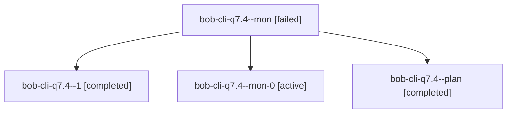

# Session: bob-cli-q7.4

[Agent Hoods](../README.md) / [bbugyi200](../users/bbugyi200/README.md) / [athena](../users/bbugyi200/machines/athena/README.md) / [bob-cli-q7](../users/bbugyi200/machines/athena/hoods/bob-cli-q7/README.md) / bob-cli-q7.4

Owner: `bbugyi200.athena` · Hood: `bob-cli-q7` · Members: 4 · Bead: [bob-cli-q7.4](https://github.com/bobs-org/bob-cli--beads/blob/main/pages/bob-cli-q7/bob-cli-q7.4.md)

## Lineage

The diagram is an optional enhancement; the ordered table below contains the same lineage in accessible text.

| Role | Agent | State | Model / provider | Timing | Commits | Prompt | Chat |
|---|---|---|---|---|---:|---|---|
| mon | bob-cli-q7.4--mon | failed | gpt-6-luna / codex | 2026-11-25T23:02:45.301381+00:00 → 2026-11-25T23:26:42.461935+00:00 | 0 | — | [Chat](../agents/bbugyi200.athena.bob-cli-q7.4--mon/chat.md) |
| 1 | bob-cli-q7.4--1 | completed | gpt-6-luna / codex | 2026-11-25T23:26:42.230930+00:00 → 2026-11-25T23:36:13.430603+00:00 | 0 | [Prompt](../agents/bbugyi200.athena.bob-cli-q7.4--1/prompt.md) | [Chat](../agents/bbugyi200.athena.bob-cli-q7.4--1/chat.md) |
| mon-0 | bob-cli-q7.4--mon-0 | active | gpt-6-luna / codex | 2026-11-25T23:34:50.810843+00:00 | 0 | — | — |
| plan | bob-cli-q7.4--plan | completed | gpt-6-luna / codex | 2026-11-25T22:12:01.669549+00:00 → 2026-11-25T23:04:44.613629+00:00 | 0 | [Prompt](../agents/bbugyi200.athena.bob-cli-q7.4--plan/prompt.md) | [Chat](../agents/bbugyi200.athena.bob-cli-q7.4--plan/chat.md) |

## Neighbors

| Agent | Relation | State |
|---|---|---|
| [bob-cli-q7.1](bbugyi200.athena.bob-cli-q7.1.md) (session · 3) | bob-cli-q7 hood | completed 2, failed 1 |
| [bob-cli-q7.2](../agents/bbugyi200.athena.bob-cli-q7.2/README.md) | bob-cli-q7 hood | completed |
| [bob-cli-q7.3](../agents/bbugyi200.athena.bob-cli-q7.3/README.md) | bob-cli-q7 hood | completed |
| [bob-cli-q7.5](../agents/bbugyi200.athena.bob-cli-q7.5/README.md) | bob-cli-q7 hood | waiting |
| [bob-cli-q7.6](../agents/bbugyi200.athena.bob-cli-q7.6/README.md) | bob-cli-q7 hood | waiting |
| [bob-cli-q7.land](../agents/bbugyi200.athena.bob-cli-q7.land/README.md) | bob-cli-q7 hood | waiting |
