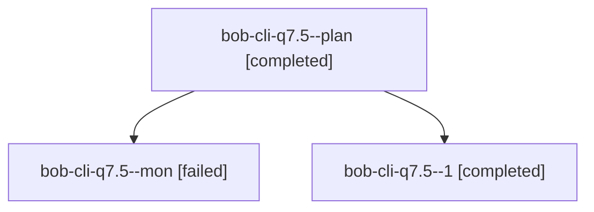

# Session: bob-cli-q7.5

[Agent Hoods](../README.md) / [bbugyi200](../users/bbugyi200/README.md) / [athena](../users/bbugyi200/machines/athena/README.md) / [bob-cli-q7](../users/bbugyi200/machines/athena/hoods/bob-cli-q7/README.md) / bob-cli-q7.5

Owner: `bbugyi200.athena` · Hood: `bob-cli-q7` · Members: 3 · Bead: [bob-cli-q7.5](https://github.com/bobs-org/bob-cli--beads/blob/main/pages/bob-cli-q7/bob-cli-q7.5.md)

## Lineage

The diagram is an optional enhancement; the ordered table below contains the same lineage in accessible text.

| Role | Agent | State | Model / provider | Timing | Commits | Prompt | Chat |
|---|---|---|---|---|---:|---|---|
| plan | bob-cli-q7.5--plan | completed | muse-spark-1.3-contributor / muse | 2026-11-26T00:48:14.469678+00:00 → 2026-11-26T03:32:13.957529+00:00 | 0 | [Prompt](../agents/bbugyi200.athena.bob-cli-q7.5--plan/prompt.md) | [Chat](../agents/bbugyi200.athena.bob-cli-q7.5--plan/chat.md) |
| mon | bob-cli-q7.5--mon | failed | muse-spark-1.3-contributor / muse | 2026-11-26T03:22:50.230501+00:00 → 2026-11-26T03:34:31.724969+00:00 | 0 | — | [Chat](../agents/bbugyi200.athena.bob-cli-q7.5--mon/chat.md) |
| 1 | bob-cli-q7.5--1 | completed | muse-spark-1.3-contributor / muse | 2026-11-26T03:34:31.390979+00:00 → 2026-11-26T03:39:34.391563+00:00 | 0 | [Prompt](../agents/bbugyi200.athena.bob-cli-q7.5--1/prompt.md) | [Chat](../agents/bbugyi200.athena.bob-cli-q7.5--1/chat.md) |

## Neighbors

| Agent | Relation | State |
|---|---|---|
| [bob-cli-q7.1](bbugyi200.athena.bob-cli-q7.1.md) (session · 3) | bob-cli-q7 hood | completed 2, failed 1 |
| [bob-cli-q7.2](../agents/bbugyi200.athena.bob-cli-q7.2/README.md) | bob-cli-q7 hood | completed |
| [bob-cli-q7.3](../agents/bbugyi200.athena.bob-cli-q7.3/README.md) | bob-cli-q7 hood | completed |
| [bob-cli-q7.4](bbugyi200.athena.bob-cli-q7.4.md) (session · 7) | bob-cli-q7 hood | completed 5, failed 2 |
| [bob-cli-q7.6](bbugyi200.athena.bob-cli-q7.6.md) (session · 3) | bob-cli-q7 hood | completed 3 |
| [bob-cli-q7.6](../agents/bbugyi200.athena.bob-cli-q7.6/README.md) | bob-cli-q7 hood | failed |
| [bob-cli-q7.land](../agents/bbugyi200.athena.bob-cli-q7.land/README.md) | bob-cli-q7 hood | waiting |
