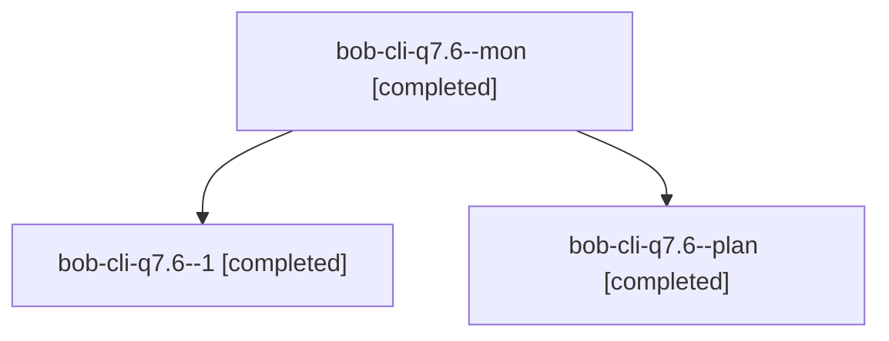

# Session: bob-cli-q7.6

[Agent Hoods](../README.md) / [bbugyi200](../users/bbugyi200/README.md) / [athena](../users/bbugyi200/machines/athena/README.md) / [bob-cli-q7](../users/bbugyi200/machines/athena/hoods/bob-cli-q7/README.md) / bob-cli-q7.6

Owner: `bbugyi200.athena` · Hood: `bob-cli-q7` · Members: 3 · Bead: [bob-cli-q7.6](https://github.com/bobs-org/bob-cli--beads/blob/main/pages/bob-cli-q7/bob-cli-q7.6.md)

## Lineage

The diagram is an optional enhancement; the ordered table below contains the same lineage in accessible text.

| Role | Agent | State | Model / provider | Timing | Commits | Prompt | Chat |
|---|---|---|---|---|---:|---|---|
| mon | bob-cli-q7.6--mon | completed | gpt-6-astra / codex | 2026-11-26T08:30:03.685042+00:00 → 2026-11-26T08:36:11.962132+00:00 | 0 | — | [Chat](../agents/bbugyi200.athena.bob-cli-q7.6--mon/chat.md) |
| 1 | bob-cli-q7.6--1 | completed | gpt-6-astra / codex | 2026-11-26T08:36:11.838354+00:00 → 2026-11-26T08:39:53.196663+00:00 | [1](../agents/bbugyi200.athena.bob-cli-q7.6--1/README.md#commits) | [Prompt](../agents/bbugyi200.athena.bob-cli-q7.6--1/prompt.md) | [Chat](../agents/bbugyi200.athena.bob-cli-q7.6--1/chat.md) |
| plan | bob-cli-q7.6--plan | completed | gpt-6-astra / codex | 2026-11-26T08:21:01.339843+00:00 → 2026-11-26T08:31:00.797924+00:00 | 0 | [Prompt](../agents/bbugyi200.athena.bob-cli-q7.6--plan/prompt.md) | [Chat](../agents/bbugyi200.athena.bob-cli-q7.6--plan/chat.md) |

## Commits

| Role | Repo | Commit | Subject | Committed |
|---|---|---|---|---|
| 1 | bob-cli | [`8ee8d03`](https://github.com/bobs-org/bob-cli/commit/8ee8d03ca7e50f33cdf07f7b1d408a399e4da4bc) | docs(capture): reconcile caret Go To contract and Mac links | 2026-11-26 03:38:51 EST |

## Neighbors

| Agent | Relation | State |
|---|---|---|
| [bob-cli-q7.1](bbugyi200.athena.bob-cli-q7.1.md) (session · 3) | bob-cli-q7 hood | completed 2, failed 1 |
| [bob-cli-q7.2](../agents/bbugyi200.athena.bob-cli-q7.2/README.md) | bob-cli-q7 hood | completed |
| [bob-cli-q7.3](../agents/bbugyi200.athena.bob-cli-q7.3/README.md) | bob-cli-q7 hood | completed |
| [bob-cli-q7.4](bbugyi200.athena.bob-cli-q7.4.md) (session · 7) | bob-cli-q7 hood | completed 5, failed 2 |
| [bob-cli-q7.5](bbugyi200.athena.bob-cli-q7.5.md) (session · 3) | bob-cli-q7 hood | completed 2, failed 1 |
| [bob-cli-q7.land](../agents/bbugyi200.athena.bob-cli-q7.land/README.md) | bob-cli-q7 hood | waiting |
