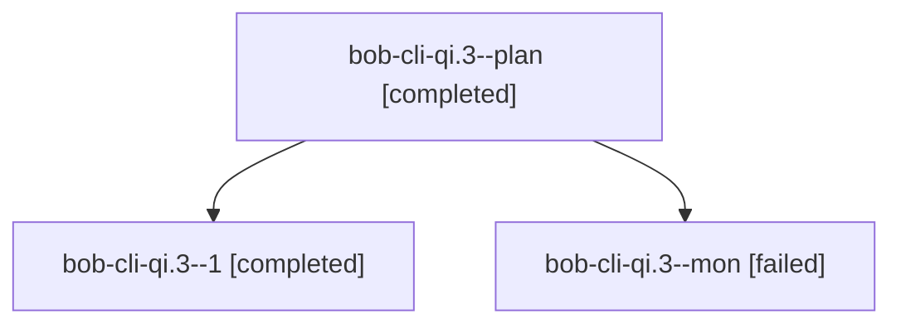

# Session: bob-cli-qi.3

[Agent Hoods](../README.md) / [bbugyi200](../users/bbugyi200/README.md) / [athena](../users/bbugyi200/machines/athena/README.md) / [bob-cli-qi](../users/bbugyi200/machines/athena/hoods/bob-cli-qi/README.md) / bob-cli-qi.3

Owner: `bbugyi200.athena` · Hood: `bob-cli-qi` · Members: 3 · Bead: [bob-cli-qi.3](https://github.com/bobs-org/bob-cli--beads/blob/main/pages/bob-cli-qi/bob-cli-qi.3.md)

## Lineage

The diagram is an optional enhancement; the ordered table below contains the same lineage in accessible text.

| Role | Agent | State | Model / provider | Timing | Commits | Prompt | Chat |
|---|---|---|---|---|---:|---|---|
| plan | bob-cli-qi.3--plan | completed | gpt-6-luna / codex | 2026-11-26T15:08:46.289951+00:00 → 2026-11-26T15:40:59.526915+00:00 | 0 | [Prompt](../agents/bbugyi200.athena.bob-cli-qi.3--plan/prompt.md) | [Chat](../agents/bbugyi200.athena.bob-cli-qi.3--plan/chat.md) |
| 1 | bob-cli-qi.3--1 | completed | gpt-6-luna / codex | 2026-11-26T15:42:34.504848+00:00 → 2026-11-26T15:53:20.332248+00:00 | 0 | [Prompt](../agents/bbugyi200.athena.bob-cli-qi.3--1/prompt.md) | [Chat](../agents/bbugyi200.athena.bob-cli-qi.3--1/chat.md) |
| mon | bob-cli-qi.3--mon | failed | gpt-6-luna / codex | 2026-11-26T15:39:28.362877+00:00 → 2026-11-26T15:42:34.862341+00:00 | 0 | — | [Chat](../agents/bbugyi200.athena.bob-cli-qi.3--mon/chat.md) |

## Neighbors

| Agent | Relation | State |
|---|---|---|
| [bob-cli-qi.1](../agents/bbugyi200.athena.bob-cli-qi.1/README.md) | bob-cli-qi hood | completed |
| [bob-cli-qi.2](../agents/bbugyi200.athena.bob-cli-qi.2/README.md) | bob-cli-qi hood | completed |
| [bob-cli-qi.4](bbugyi200.athena.bob-cli-qi.4.md) (session · 3) | bob-cli-qi hood | completed 3 |
| [bob-cli-qi.5](../agents/bbugyi200.athena.bob-cli-qi.5/README.md) | bob-cli-qi hood | completed |
| [bob-cli-qi.6](bbugyi200.athena.bob-cli-qi.6.md) (session · 11) | bob-cli-qi hood | completed 9, failed 2 |
| [bob-cli-qi.land](bbugyi200.athena.bob-cli-qi.land.md) (session · 9) | bob-cli-qi hood | active 1, completed 7, failed 1 |
| [bob-cli-qi.land](../agents/bbugyi200.athena.bob-cli-qi.land/README.md) | bob-cli-qi hood | completed |
