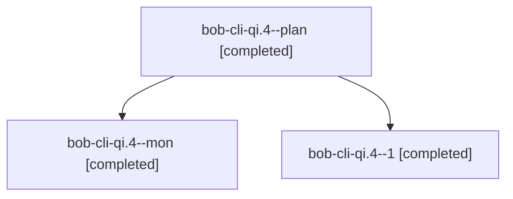

# Session: bob-cli-qi.4

[Agent Hoods](../README.md) / [bbugyi200](../users/bbugyi200/README.md) / [athena](../users/bbugyi200/machines/athena/README.md) / [bob-cli-qi](../users/bbugyi200/machines/athena/hoods/bob-cli-qi/README.md) / bob-cli-qi.4

Owner: `bbugyi200.athena` · Hood: `bob-cli-qi` · Members: 3 · Bead: [bob-cli-qi.4](https://github.com/bobs-org/bob-cli--beads/blob/main/pages/bob-cli-qi/bob-cli-qi.4.md)

## Lineage



The diagram is an optional enhancement; the ordered table below contains the same lineage in accessible text.

| Role | Agent | State | Model / provider | Timing | Commits | Prompt | Chat |
|---|---|---|---|---|---:|---|---|
| <a id="member-plan"></a>plan | bob-cli-qi.4--plan | completed | muse-spark-1.3-contributor / muse | 2026-11-26T15:53:47.686572+00:00 → 2026-11-26T17:52:36.298444+00:00 | 0 | [Prompt](../agents/bbugyi200.athena.bob-cli-qi.4--plan/prompt.md) | [Chat](../agents/bbugyi200.athena.bob-cli-qi.4--plan/chat.md) |
| <a id="member-mon"></a>mon | bob-cli-qi.4--mon | completed | muse-spark-1.3-contributor / muse | 2026-11-26T16:08:35.811596+00:00 → 2026-11-26T17:57:54.251554+00:00 | 0 | — | [Chat](../agents/bbugyi200.athena.bob-cli-qi.4--mon/chat.md) |
| <a id="member-1"></a>1 | bob-cli-qi.4--1 | completed | muse-spark-1.3-contributor / muse | 2026-11-26T17:57:53.819624+00:00 → 2026-11-26T17:59:30.533045+00:00 | 0 | [Prompt](../agents/bbugyi200.athena.bob-cli-qi.4--1/prompt.md) | [Chat](../agents/bbugyi200.athena.bob-cli-qi.4--1/chat.md) |

## Variables

| Role | Variable | Value |
|---|---|---|
| plan | `artifacts` | \[{bead: bob-cli-qi.4, kind: file, label: qi.4 takeover-report.json, path: /home/bryan/.sase/artifacts/agents/gh\_bobs-org\_\_bob-cli/20261126100725/takeover-report-f5d3cd032a67.json, ref: file:explicit:… |

#### artifacts

**Role:** `plan`

```yaml
- bead: bob-cli-qi.4
  kind: file
  label: qi.4 takeover-report.json
  path: /home/bryan/.sase/artifacts/agents/gh_bobs-org__bob-cli/20261126100725/takeover-report-f5d3cd032a67.json
  ref: file:explicit:290bf602385934c8b83ee465
  source_path: /tmp/bob-cli-qi4/takeover-report.json
- bead: bob-cli-qi.4
  kind: file
  label: qi.4 takeover.log
  path: /home/bryan/.sase/artifacts/agents/gh_bobs-org__bob-cli/20261126100725/takeover-14c87d1eefce.log
  ref: file:explicit:9bc0eacb4d944023db5b3888
  source_path: /tmp/bob-cli-qi4/takeover.log
- bead: bob-cli-qi.4
  kind: file
  label: qi.4 takeover-shots.tar.gz
  path: /home/bryan/.sase/artifacts/agents/gh_bobs-org__bob-cli/20261126100725/takeover-shots.tar-64f50c8624ae.gz
  ref: file:explicit:cdd6ba05e0b402a23c048298
  source_path: /tmp/bob-cli-qi4/takeover-shots.tar.gz
- bead: bob-cli-qi.4
  kind: file
  label: qi.4 homecards-report.json
  path: /home/bryan/.sase/artifacts/agents/gh_bobs-org__bob-cli/20261126100725/homecards-report-b6b7fcb47c46.json
  ref: file:explicit:dce3a74989f86e48da93715d
  source_path: /tmp/bob-cli-qi4/homecards-report.json
- bead: bob-cli-qi.4
  kind: file
  label: qi.4 homecards.log
  path: /home/bryan/.sase/artifacts/agents/gh_bobs-org__bob-cli/20261126100725/homecards-3d1fd6c82d67.log
  ref: file:explicit:2a125acea859ceb79722a65c
  source_path: /tmp/bob-cli-qi4/homecards.log
- bead: bob-cli-qi.4
  kind: file
  label: qi.4 homecards-shots.tar.gz
  path: /home/bryan/.sase/artifacts/agents/gh_bobs-org__bob-cli/20261126100725/homecards-shots.tar-7de5d2636253.gz
  ref: file:explicit:c4c6acced7cb004fabf26e32
  source_path: /tmp/bob-cli-qi4/homecards-shots.tar.gz
```

Values are truncated for display; see each member's agent meta.json for the full values.

## Neighbors

| Agent | Relation | State |
|---|---|---|
| [bob-cli-qi.1](../agents/bbugyi200.athena.bob-cli-qi.1/README.md) | bob-cli-qi hood | completed |
| [bob-cli-qi.2](../agents/bbugyi200.athena.bob-cli-qi.2/README.md) | bob-cli-qi hood | completed |
| [bob-cli-qi.3](bbugyi200.athena.bob-cli-qi.3.md) (session · 3) | bob-cli-qi hood | completed 2, failed 1 |
| [bob-cli-qi.5](../agents/bbugyi200.athena.bob-cli-qi.5/README.md) | bob-cli-qi hood | completed |
| [bob-cli-qi.6](bbugyi200.athena.bob-cli-qi.6.md) (session · 11) | bob-cli-qi hood | completed 9, failed 2 |
| [bob-cli-qi.land](bbugyi200.athena.bob-cli-qi.land.md) (session · 4) | bob-cli-qi hood | active 1, completed 3 |
| [bob-cli-qi.land](../agents/bbugyi200.athena.bob-cli-qi.land/README.md) | bob-cli-qi hood | completed |
