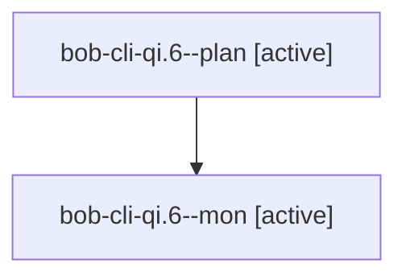

# Session: bob-cli-qi.6

[Agent Hoods](../README.md) / [bbugyi200](../users/bbugyi200/README.md) / [athena](../users/bbugyi200/machines/athena/README.md) / [bob-cli-qi](../users/bbugyi200/machines/athena/hoods/bob-cli-qi/README.md) / bob-cli-qi.6

Owner: `bbugyi200.athena` · Hood: `bob-cli-qi` · Members: 2 · Bead: [bob-cli-qi.6](https://github.com/bobs-org/bob-cli--beads/blob/main/pages/bob-cli-qi/bob-cli-qi.6.md)

## Lineage

The diagram is an optional enhancement; the ordered table below contains the same lineage in accessible text.

| Role | Agent | State | Model / provider | Timing | Commits | Prompt | Chat |
|---|---|---|---|---|---:|---|---|
| plan | bob-cli-qi.6--plan | active | gpt-6-luna / codex | 2026-11-26T17:59:54.004642+00:00 | [2](../agents/bbugyi200.athena.bob-cli-qi.6--plan/README.md#commits) | [Prompt](../agents/bbugyi200.athena.bob-cli-qi.6--plan/prompt.md) | — |
| mon | bob-cli-qi.6--mon | active | gpt-6-luna / codex | 2026-11-26T18:45:22.198008+00:00 | 0 | — | — |

## Commits

| Role | Repo | Commit | Subject | Committed |
|---|---|---|---|---|
| plan | bob-cli | [`c261c6a`](https://github.com/bobs-org/bob-cli/commit/c261c6a35dc69dc5ace384d29417f7d40a48525d) | feat(capture): file notes from existing-task links | 2026-11-26 13:46:36 EST |
| plan | bob-cli | [`c89ba1d`](https://github.com/bobs-org/bob-cli/commit/c89ba1d4c49775b1840c065f0f31d262e60930ac) | docs(bank): establish path-canonical single-owner hub | 2026-11-26 13:57:29 EST |

## Neighbors

| Agent | Relation | State |
|---|---|---|
| [bob-cli-qi.1](../agents/bbugyi200.athena.bob-cli-qi.1/README.md) | bob-cli-qi hood | completed |
| [bob-cli-qi.2](../agents/bbugyi200.athena.bob-cli-qi.2/README.md) | bob-cli-qi hood | completed |
| [bob-cli-qi.3](bbugyi200.athena.bob-cli-qi.3.md) (session · 3) | bob-cli-qi hood | completed 2, failed 1 |
| [bob-cli-qi.4](bbugyi200.athena.bob-cli-qi.4.md) (session · 3) | bob-cli-qi hood | completed 3 |
| [bob-cli-qi.5](../agents/bbugyi200.athena.bob-cli-qi.5/README.md) | bob-cli-qi hood | completed |
| [bob-cli-qi.land](../agents/bbugyi200.athena.bob-cli-qi.land/README.md) | bob-cli-qi hood | waiting |
