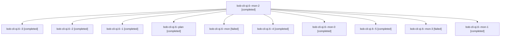

# Session: bob-cli-qi.6

[Agent Hoods](../README.md) / [bbugyi200](../users/bbugyi200/README.md) / [athena](../users/bbugyi200/machines/athena/README.md) / [bob-cli-qi](../users/bbugyi200/machines/athena/hoods/bob-cli-qi/README.md) / bob-cli-qi.6

Owner: `bbugyi200.athena` · Hood: `bob-cli-qi` · Members: 11 · Bead: [bob-cli-qi.6](https://github.com/bobs-org/bob-cli--beads/blob/main/pages/bob-cli-qi/bob-cli-qi.6.md)

## Lineage

The diagram is an optional enhancement; the ordered table below contains the same lineage in accessible text.

| Role | Agent | State | Model / provider | Timing | Commits | Prompt | Chat |
|---|---|---|---|---|---:|---|---|
| mon-2 | bob-cli-qi.6--mon-2 | completed | gpt-6-luna / codex | 2026-11-26T19:46:56.285373+00:00 → 2026-11-26T19:50:36.822299+00:00 | 0 | — | [Chat](../agents/bbugyi200.athena.bob-cli-qi.6--mon-2/chat.md) |
| 3 | bob-cli-qi.6--3 | completed | gpt-6-luna / codex | 2026-11-26T19:44:31.059737+00:00 → 2026-11-26T19:47:40.398284+00:00 | 0 | [Prompt](../agents/bbugyi200.athena.bob-cli-qi.6--3/prompt.md) | [Chat](../agents/bbugyi200.athena.bob-cli-qi.6--3/chat.md) |
| 2 | bob-cli-qi.6--2 | completed | gpt-6-luna / codex | 2026-11-26T19:31:12.304481+00:00 → 2026-11-26T19:39:43.941575+00:00 | 0 | [Prompt](../agents/bbugyi200.athena.bob-cli-qi.6--2/prompt.md) | [Chat](../agents/bbugyi200.athena.bob-cli-qi.6--2/chat.md) |
| 1 | bob-cli-qi.6--1 | completed | gpt-6-luna / codex | 2026-11-26T19:26:02.731067+00:00 → 2026-11-26T19:28:28.240948+00:00 | 0 | [Prompt](../agents/bbugyi200.athena.bob-cli-qi.6--1/prompt.md) | [Chat](../agents/bbugyi200.athena.bob-cli-qi.6--1/chat.md) |
| plan | bob-cli-qi.6--plan | completed | gpt-6-luna / codex | 2026-11-26T17:59:54.004642+00:00 → 2026-11-26T19:22:13.617710+00:00 | [2](../agents/bbugyi200.athena.bob-cli-qi.6--plan/README.md#commits) | [Prompt](../agents/bbugyi200.athena.bob-cli-qi.6--plan/prompt.md) | [Chat](../agents/bbugyi200.athena.bob-cli-qi.6--plan/chat.md) |
| mon | bob-cli-qi.6--mon | failed | gpt-6-luna / codex | 2026-11-26T18:45:22.198008+00:00 → 2026-11-26T19:26:03.137195+00:00 | 0 | — | [Chat](../agents/bbugyi200.athena.bob-cli-qi.6--mon/chat.md) |
| 4 | bob-cli-qi.6--4 | completed | gpt-6-luna / codex | 2026-11-26T19:50:39.337427+00:00 → 2026-11-26T19:53:19.944062+00:00 | 0 | [Prompt](../agents/bbugyi200.athena.bob-cli-qi.6--4/prompt.md) | [Chat](../agents/bbugyi200.athena.bob-cli-qi.6--4/chat.md) |
| mon-0 | bob-cli-qi.6--mon-0 | completed | gpt-6-luna / codex | 2026-11-26T19:27:52.657727+00:00 → 2026-11-26T19:31:12.580686+00:00 | 0 | — | [Chat](../agents/bbugyi200.athena.bob-cli-qi.6--mon-0/chat.md) |
| 5 | bob-cli-qi.6--5 | completed | gpt-6-luna / codex | 2026-11-26T19:55:13.582042+00:00 → 2026-11-26T20:01:00.486455+00:00 | 0 | [Prompt](../agents/bbugyi200.athena.bob-cli-qi.6--5/prompt.md) | [Chat](../agents/bbugyi200.athena.bob-cli-qi.6--5/chat.md) |
| mon-3 | bob-cli-qi.6--mon-3 | failed | gpt-6-luna / codex | 2026-11-26T19:52:33.383906+00:00 → 2026-11-26T19:55:13.643742+00:00 | 0 | — | [Chat](../agents/bbugyi200.athena.bob-cli-qi.6--mon-3/chat.md) |
| mon-1 | bob-cli-qi.6--mon-1 | completed | gpt-6-luna / codex | 2026-11-26T19:39:00.784835+00:00 → 2026-11-26T19:43:37.164212+00:00 | 0 | — | [Chat](../agents/bbugyi200.athena.bob-cli-qi.6--mon-1/chat.md) |

## Commits

| Role | Repo | Commit | Subject | Committed |
|---|---|---|---|---|
| plan | bob-cli | [`c261c6a`](https://github.com/bobs-org/bob-cli/commit/c261c6a35dc69dc5ace384d29417f7d40a48525d) | feat(capture): file notes from existing-task links | 2026-11-26 13:46:36 EST |
| plan | bob-cli | [`c89ba1d`](https://github.com/bobs-org/bob-cli/commit/c89ba1d4c49775b1840c065f0f31d262e60930ac) | docs(bank): establish path-canonical single-owner hub | 2026-11-26 13:57:29 EST |

## Neighbors

| Agent | Relation | State |
|---|---|---|
| [bob-cli-qi.1](../agents/bbugyi200.athena.bob-cli-qi.1/README.md) | bob-cli-qi hood | completed |
| [bob-cli-qi.2](../agents/bbugyi200.athena.bob-cli-qi.2/README.md) | bob-cli-qi hood | completed |
| [bob-cli-qi.3](bbugyi200.athena.bob-cli-qi.3.md) (session · 3) | bob-cli-qi hood | completed 2, failed 1 |
| [bob-cli-qi.4](bbugyi200.athena.bob-cli-qi.4.md) (session · 3) | bob-cli-qi hood | completed 3 |
| [bob-cli-qi.5](../agents/bbugyi200.athena.bob-cli-qi.5/README.md) | bob-cli-qi hood | completed |
| [bob-cli-qi.land](bbugyi200.athena.bob-cli-qi.land.md) (session · 32) | bob-cli-qi hood | active 1, completed 22, failed 9 |
| [bob-cli-qi.land](../agents/bbugyi200.athena.bob-cli-qi.land/README.md) | bob-cli-qi hood | completed |
