# Session: bob-cli-qi.land

[Agent Hoods](../README.md) / [bbugyi200](../users/bbugyi200/README.md) / [athena](../users/bbugyi200/machines/athena/README.md) / [bob-cli-qi](../users/bbugyi200/machines/athena/hoods/bob-cli-qi/README.md) / bob-cli-qi.land

Owner: `bbugyi200.athena` · Hood: `bob-cli-qi` · Members: 32 · Bead: [bob-cli-qi](https://github.com/bobs-org/bob-cli--beads/blob/main/pages/bob-cli-qi/README.md)

## Lineage

```mermaid
flowchart TD
  n0["bob-cli-qi.land--b [completed]"]
  n1["bob-cli-qi.land--mon [failed]"]
  n0 --> n1
  n2["bob-cli-qi.land--a [completed]"]
  n0 --> n2
  n3["bob-cli-qi.land--7 [completed]"]
  n0 --> n3
  n4["bob-cli-qi.land--4 [completed]"]
  n0 --> n4
  n5["bob-cli-qi.land--mon-b [failed]"]
  n0 --> n5
  n6["bob-cli-qi.land--d [completed]"]
  n0 --> n6
  n7["bob-cli-qi.land--gate [completed]"]
  n0 --> n7
  n8["bob-cli-qi.land--mon-3 [completed]"]
  n0 --> n8
  n9["bob-cli-qi.land--5 [completed]"]
  n0 --> n9
  n10["bob-cli-qi.land--8 [completed]"]
  n0 --> n10
  n11["bob-cli-qi.land--code [completed]"]
  n0 --> n11
  n12["bob-cli-qi.land--9 [completed]"]
  n0 --> n12
  n13["bob-cli-qi.land--2 [completed]"]
  n0 --> n13
  n14["bob-cli-qi.land--mon-7 [completed]"]
  n0 --> n14
  n15["bob-cli-qi.land--mon-5 [failed]"]
  n0 --> n15
  n16["bob-cli-qi.land--mon-8 [completed]"]
  n0 --> n16
  n17["bob-cli-qi.land--mon-4 [failed]"]
  n0 --> n17
  n18["bob-cli-qi.land--mon-6 [failed]"]
  n0 --> n18
  n19["bob-cli-qi.land--mon-2 [failed]"]
  n0 --> n19
  n20["bob-cli-qi.land--mon-0 [completed]"]
  n0 --> n20
  n21["bob-cli-qi.land--mon-a [failed]"]
  n0 --> n21
  n22["bob-cli-qi.land--6 [completed]"]
  n0 --> n22
  n23["bob-cli-qi.land--c [completed]"]
  n0 --> n23
  n24["bob-cli-qi.land--mon-c [failed]"]
  n0 --> n24
  n25["bob-cli-qi.land--mon-9 [failed]"]
  n0 --> n25
  n26["bob-cli-qi.land--1 [completed]"]
  n0 --> n26
  n27["bob-cli-qi.land--3 [completed]"]
  n0 --> n27
  n28["bob-cli-qi.land--mon-d [active]"]
  n0 --> n28
  n29["bob-cli-qi.land--e [completed]"]
  n0 --> n29
  n30["bob-cli-qi.land--plan [completed]"]
  n0 --> n30
  n31["bob-cli-qi.land--mon-1 [completed]"]
  n0 --> n31
```



The diagram is an optional enhancement; the ordered table below contains the same lineage in accessible text.

| Role | Agent | State | Model / provider | Timing | Commits | Prompt | Chat |
|---|---|---|---|---|---:|---|---|
| <a id="member-b"></a>b | bob-cli-qi.land--b | completed | gpt-6-luna / codex | 2026-11-27T01:00:43.396411+00:00 → 2026-11-27T01:07:49.345086+00:00 | 0 | [Prompt](../agents/bbugyi200.athena.bob-cli-qi.land--b/prompt.md) | [Chat](../agents/bbugyi200.athena.bob-cli-qi.land--b/chat.md) |
| <a id="member-mon"></a>mon | bob-cli-qi.land--mon | failed | gpt-6-luna / codex | 2026-11-26T21:29:05.772277+00:00 → 2026-11-26T21:35:52.046822+00:00 | 0 | — | [Chat](../agents/bbugyi200.athena.bob-cli-qi.land--mon/chat.md) |
| <a id="member-a"></a>a | bob-cli-qi.land--a | completed | gpt-6-luna / codex | 2026-11-27T00:49:39.883859+00:00 → 2026-11-27T00:59:03.745484+00:00 | 0 | [Prompt](../agents/bbugyi200.athena.bob-cli-qi.land--a/prompt.md) | [Chat](../agents/bbugyi200.athena.bob-cli-qi.land--a/chat.md) |
| <a id="member-7"></a>7 | bob-cli-qi.land--7 | completed | gpt-6-luna / codex | 2026-11-27T00:10:40.836329+00:00 → 2026-11-27T00:32:30.260816+00:00 | 0 | [Prompt](../agents/bbugyi200.athena.bob-cli-qi.land--7/prompt.md) | [Chat](../agents/bbugyi200.athena.bob-cli-qi.land--7/chat.md) |
| <a id="member-4"></a>4 | bob-cli-qi.land--4 | completed | gpt-6-luna / codex | 2026-11-26T22:25:42.396678+00:00 → 2026-11-26T23:07:30.572534+00:00 | 0 | [Prompt](../agents/bbugyi200.athena.bob-cli-qi.land--4/prompt.md) | [Chat](../agents/bbugyi200.athena.bob-cli-qi.land--4/chat.md) |
| <a id="member-mon-b"></a>mon-b | bob-cli-qi.land--mon-b | failed | gpt-6-luna / codex | 2026-11-27T01:15:55.972397+00:00 → 2026-11-27T01:26:21.540123+00:00 | 0 | — | [Chat](../agents/bbugyi200.athena.bob-cli-qi.land--mon-b/chat.md) |
| <a id="member-d"></a>d | bob-cli-qi.land--d | completed | gpt-6-luna / codex | 2026-11-27T01:26:21.163493+00:00 → 2026-11-27T01:48:04.144706+00:00 | 0 | [Prompt](../agents/bbugyi200.athena.bob-cli-qi.land--d/prompt.md) | [Chat](../agents/bbugyi200.athena.bob-cli-qi.land--d/chat.md) |
| <a id="member-gate"></a>gate | bob-cli-qi.land--gate | completed | opus / claude | 2026-11-26T21:22:21.569909+00:00 → 2026-11-26T21:22:30.797267+00:00 | 0 | — | [Chat](../agents/bbugyi200.athena.bob-cli-qi.land--gate/chat.md) |
| <a id="member-mon-3"></a>mon-3 | bob-cli-qi.land--mon-3 | completed | gpt-6-luna / codex | 2026-11-26T22:53:47.811466+00:00 → 2026-11-26T23:08:46.953034+00:00 | 0 | — | [Chat](../agents/bbugyi200.athena.bob-cli-qi.land--mon-3/chat.md) |
| <a id="member-5"></a>5 | bob-cli-qi.land--5 | completed | gpt-6-luna / codex | 2026-11-26T23:08:46.563245+00:00 → 2026-11-26T23:20:44.465655+00:00 | 0 | [Prompt](../agents/bbugyi200.athena.bob-cli-qi.land--5/prompt.md) | [Chat](../agents/bbugyi200.athena.bob-cli-qi.land--5/chat.md) |
| <a id="member-8"></a>8 | bob-cli-qi.land--8 | completed | gpt-6-luna / codex | 2026-11-27T00:34:43.715950+00:00 → 2026-11-27T00:43:41.823816+00:00 | 0 | [Prompt](../agents/bbugyi200.athena.bob-cli-qi.land--8/prompt.md) | [Chat](../agents/bbugyi200.athena.bob-cli-qi.land--8/chat.md) |
| <a id="member-code"></a>code | bob-cli-qi.land--code | completed | gpt-6-luna / codex | 2026-11-26T21:23:37.207737+00:00 → 2026-11-26T21:30:00.589107+00:00 | 0 | — | [Chat](../agents/bbugyi200.athena.bob-cli-qi.land--code/chat.md) |
| <a id="member-9"></a>9 | bob-cli-qi.land--9 | completed | gpt-6-luna / codex | 2026-11-27T00:45:26.191816+00:00 → 2026-11-27T00:47:06.573595+00:00 | 0 | [Prompt](../agents/bbugyi200.athena.bob-cli-qi.land--9/prompt.md) | [Chat](../agents/bbugyi200.athena.bob-cli-qi.land--9/chat.md) |
| <a id="member-2"></a>2 | bob-cli-qi.land--2 | completed | gpt-6-luna / codex | 2026-11-26T21:48:05.980699+00:00 → 2026-11-26T22:12:23.464014+00:00 | 0 | [Prompt](../agents/bbugyi200.athena.bob-cli-qi.land--2/prompt.md) | [Chat](../agents/bbugyi200.athena.bob-cli-qi.land--2/chat.md) |
| <a id="member-mon-7"></a>mon-7 | bob-cli-qi.land--mon-7 | completed | gpt-6-luna / codex | 2026-11-27T00:42:08.632817+00:00 → 2026-11-27T00:45:26.535270+00:00 | 0 | — | [Chat](../agents/bbugyi200.athena.bob-cli-qi.land--mon-7/chat.md) |
| <a id="member-mon-5"></a>mon-5 | bob-cli-qi.land--mon-5 | failed | gpt-6-luna / codex | 2026-11-26T23:59:04.711628+00:00 → 2026-11-27T00:10:32.262030+00:00 | 0 | — | [Chat](../agents/bbugyi200.athena.bob-cli-qi.land--mon-5/chat.md) |
| <a id="member-mon-8"></a>mon-8 | bob-cli-qi.land--mon-8 | completed | gpt-6-luna / codex | 2026-11-27T00:46:35.396440+00:00 → 2026-11-27T00:49:40.109695+00:00 | 0 | — | [Chat](../agents/bbugyi200.athena.bob-cli-qi.land--mon-8/chat.md) |
| <a id="member-mon-4"></a>mon-4 | bob-cli-qi.land--mon-4 | failed | gpt-6-luna / codex | 2026-11-26T23:19:46.972279+00:00 → 2026-11-26T23:25:28.656752+00:00 | 0 | — | [Chat](../agents/bbugyi200.athena.bob-cli-qi.land--mon-4/chat.md) |
| <a id="member-mon-6"></a>mon-6 | bob-cli-qi.land--mon-6 | failed | gpt-6-luna / codex | 2026-11-27T00:29:27.967724+00:00 → 2026-11-27T00:34:43.766412+00:00 | 0 | — | [Chat](../agents/bbugyi200.athena.bob-cli-qi.land--mon-6/chat.md) |
| <a id="member-mon-2"></a>mon-2 | bob-cli-qi.land--mon-2 | failed | gpt-6-luna / codex | 2026-11-26T22:18:06.666526+00:00 → 2026-11-26T22:25:42.625028+00:00 | 0 | — | [Chat](../agents/bbugyi200.athena.bob-cli-qi.land--mon-2/chat.md) |
| <a id="member-mon-0"></a>mon-0 | bob-cli-qi.land--mon-0 | completed | gpt-6-luna / codex | 2026-11-26T21:41:00.063388+00:00 → 2026-11-26T21:48:06.321431+00:00 | 0 | — | [Chat](../agents/bbugyi200.athena.bob-cli-qi.land--mon-0/chat.md) |
| <a id="member-mon-a"></a>mon-a | bob-cli-qi.land--mon-a | failed | gpt-6-luna / codex | 2026-11-27T01:06:58.433294+00:00 → 2026-11-27T01:11:00.147205+00:00 | 0 | — | [Chat](../agents/bbugyi200.athena.bob-cli-qi.land--mon-a/chat.md) |
| <a id="member-6"></a>6 | bob-cli-qi.land--6 | completed | gpt-6-luna / codex | 2026-11-26T23:25:28.188237+00:00 → 2026-11-27T00:01:07.307239+00:00 | 0 | [Prompt](../agents/bbugyi200.athena.bob-cli-qi.land--6/prompt.md) | [Chat](../agents/bbugyi200.athena.bob-cli-qi.land--6/chat.md) |
| <a id="member-c"></a>c | bob-cli-qi.land--c | completed | gpt-6-luna / codex | 2026-11-27T01:11:00.044223+00:00 → 2026-11-27T01:17:03.579733+00:00 | 0 | [Prompt](../agents/bbugyi200.athena.bob-cli-qi.land--c/prompt.md) | [Chat](../agents/bbugyi200.athena.bob-cli-qi.land--c/chat.md) |
| <a id="member-mon-c"></a>mon-c | bob-cli-qi.land--mon-c | failed | gpt-6-luna / codex | 2026-11-27T01:46:08.635295+00:00 → 2026-11-27T01:56:56.092705+00:00 | 0 | — | [Chat](../agents/bbugyi200.athena.bob-cli-qi.land--mon-c/chat.md) |
| <a id="member-mon-9"></a>mon-9 | bob-cli-qi.land--mon-9 | failed | gpt-6-luna / codex | 2026-11-27T00:58:15.928961+00:00 → 2026-11-27T01:00:43.722146+00:00 | 0 | — | [Chat](../agents/bbugyi200.athena.bob-cli-qi.land--mon-9/chat.md) |
| <a id="member-1"></a>1 | bob-cli-qi.land--1 | completed | gpt-6-luna / codex | 2026-11-26T21:35:51.546250+00:00 → 2026-11-26T21:41:36.859435+00:00 | 0 | [Prompt](../agents/bbugyi200.athena.bob-cli-qi.land--1/prompt.md) | [Chat](../agents/bbugyi200.athena.bob-cli-qi.land--1/chat.md) |
| <a id="member-3"></a>3 | bob-cli-qi.land--3 | completed | gpt-6-luna / codex | 2026-11-26T22:14:34.418365+00:00 → 2026-11-26T22:18:49.200058+00:00 | 0 | [Prompt](../agents/bbugyi200.athena.bob-cli-qi.land--3/prompt.md) | [Chat](../agents/bbugyi200.athena.bob-cli-qi.land--3/chat.md) |
| <a id="member-mon-d"></a>mon-d | bob-cli-qi.land--mon-d | active | gpt-6-luna / codex | 2026-11-27T02:21:25.066873+00:00 | 0 | — | — |
| <a id="member-e"></a>e | bob-cli-qi.land--e | completed | gpt-6-luna / codex | 2026-11-27T01:56:55.860352+00:00 → 2026-11-27T02:26:58.910214+00:00 | 0 | [Prompt](../agents/bbugyi200.athena.bob-cli-qi.land--e/prompt.md) | [Chat](../agents/bbugyi200.athena.bob-cli-qi.land--e/chat.md) |
| <a id="member-plan"></a>plan | bob-cli-qi.land--plan | completed | opus / claude | 2026-11-26T20:02:21.365366+00:00 → 2026-11-26T21:30:00.589107+00:00 | [1](../agents/bbugyi200.athena.bob-cli-qi.land--plan/README.md#commits) | [Prompt](../agents/bbugyi200.athena.bob-cli-qi.land--plan/prompt.md) | [Chat](../agents/bbugyi200.athena.bob-cli-qi.land--plan/chat.md) |
| <a id="member-mon-1"></a>mon-1 | bob-cli-qi.land--mon-1 | completed | gpt-6-luna / codex | 2026-11-26T22:07:55.923236+00:00 → 2026-11-26T22:14:34.560159+00:00 | 0 | — | [Chat](../agents/bbugyi200.athena.bob-cli-qi.land--mon-1/chat.md) |

## Commits

| Role | Repo | Commit | Subject | Committed |
|---|---|---|---|---|
| plan | bob-cli | [`33fe342`](https://github.com/bobs-org/bob-cli/commit/33fe3425b51207b39215bb2a8553224b3302bea7) | test(props): assert the bank hub update preview by its card-owned row | 2026-11-26 16:21:07 EST |

## Variables

| Role | Variable | Value |
|---|---|---|
| plan | `artifacts` | \[{bead: bob-cli-qi, kind: file, label: qi-land-takeover-master.json, path: /home/bryan/.sase/artifacts/agents/gh\_bobs-org\_\_bob-cli/20261126100728/takeover-master-59ebf725fbed.json, ref: file:explicit… |

#### artifacts

**Role:** `plan`

```yaml
- bead: bob-cli-qi
  kind: file
  label: qi-land-takeover-master.json
  path: /home/bryan/.sase/artifacts/agents/gh_bobs-org__bob-cli/20261126100728/takeover-master-59ebf725fbed.json
  ref: file:explicit:660cabc9cf32530dcf480887
  source_path: /tmp/qi-land/takeover-master.json
- bead: bob-cli-qi
  kind: markdown
  label: qi-land-commands.md
  path: /home/bryan/.sase/artifacts/agents/gh_bobs-org__bob-cli/20261126100728/commands-6dc6d01ff383.md
  ref: file:explicit:4be78da0fdc26952391a664f
  source_path: /tmp/qi-land/commands.md
- bead: bob-cli-qi
  kind: file
  label: qi-land-evidence.tgz
  path: /home/bryan/.sase/artifacts/agents/gh_bobs-org__bob-cli/20261126100728/qi-land-evidence-2340eb400900.tgz
  ref: file:explicit:d254ed707483200bbaaca14f
  source_path: /tmp/qi-land/qi-land-evidence.tgz
```

Values are truncated for display; see each member's agent meta.json for the full values.

## Neighbors

| Agent | Relation | State |
|---|---|---|
| [bob-cli-qi.1](../agents/bbugyi200.athena.bob-cli-qi.1/README.md) | bob-cli-qi hood | completed |
| [bob-cli-qi.2](../agents/bbugyi200.athena.bob-cli-qi.2/README.md) | bob-cli-qi hood | completed |
| [bob-cli-qi.3](bbugyi200.athena.bob-cli-qi.3.md) (session · 3) | bob-cli-qi hood | completed 2, failed 1 |
| [bob-cli-qi.4](bbugyi200.athena.bob-cli-qi.4.md) (session · 3) | bob-cli-qi hood | completed 3 |
| [bob-cli-qi.5](../agents/bbugyi200.athena.bob-cli-qi.5/README.md) | bob-cli-qi hood | completed |
| [bob-cli-qi.6](bbugyi200.athena.bob-cli-qi.6.md) (session · 11) | bob-cli-qi hood | completed 9, failed 2 |
