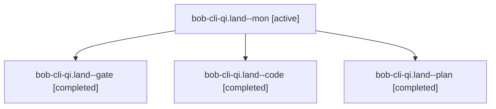

# Session: bob-cli-qi.land

[Agent Hoods](../README.md) / [bbugyi200](../users/bbugyi200/README.md) / [athena](../users/bbugyi200/machines/athena/README.md) / [bob-cli-qi](../users/bbugyi200/machines/athena/hoods/bob-cli-qi/README.md) / bob-cli-qi.land

Owner: `bbugyi200.athena` · Hood: `bob-cli-qi` · Members: 4 · Bead: [bob-cli-qi](https://github.com/bobs-org/bob-cli--beads/blob/main/pages/bob-cli-qi/README.md)

## Lineage



The diagram is an optional enhancement; the ordered table below contains the same lineage in accessible text.

| Role | Agent | State | Model / provider | Timing | Commits | Prompt | Chat |
|---|---|---|---|---|---:|---|---|
| <a id="member-mon"></a>mon | bob-cli-qi.land--mon | active | gpt-6-luna / codex | 2026-11-26T21:29:05.772277+00:00 | 0 | — | — |
| <a id="member-gate"></a>gate | bob-cli-qi.land--gate | completed | opus / claude | 2026-11-26T21:22:21.569909+00:00 → 2026-11-26T21:22:30.797267+00:00 | 0 | — | [Chat](../agents/bbugyi200.athena.bob-cli-qi.land--gate/chat.md) |
| <a id="member-code"></a>code | bob-cli-qi.land--code | completed | gpt-6-luna / codex | 2026-11-26T21:23:37.207737+00:00 → 2026-11-26T21:30:00.589107+00:00 | 0 | — | [Chat](../agents/bbugyi200.athena.bob-cli-qi.land--code/chat.md) |
| <a id="member-plan"></a>plan | bob-cli-qi.land--plan | completed | opus / claude | 2026-11-26T20:02:21.365366+00:00 → 2026-11-26T21:30:00.589107+00:00 | [1](../agents/bbugyi200.athena.bob-cli-qi.land--plan/README.md#commits) | [Prompt](../agents/bbugyi200.athena.bob-cli-qi.land--plan/prompt.md) | [Chat](../agents/bbugyi200.athena.bob-cli-qi.land--plan/chat.md) |

## Commits

| Role | Repo | Commit | Subject | Committed |
|---|---|---|---|---|
| plan | bob-cli | [`33fe342`](https://github.com/bobs-org/bob-cli/commit/33fe3425b51207b39215bb2a8553224b3302bea7) | test(props): assert the bank hub update preview by its card-owned row | 2026-11-26 16:21:07 EST |

## Variables

| Role | Variable | Value |
|---|---|---|
| plan | `artifacts` | \[{bead: bob-cli-qi, kind: file, label: qi-land-takeover-master.json, path: /home/bryan/.sase/artifacts/agents/gh\_bobs-org\_\_bob-cli/20261126100728/takeover-master-59ebf725fbed.json, ref: file:explicit… |

#### artifacts

**Role:** `plan`

```yaml
- bead: bob-cli-qi
  kind: file
  label: qi-land-takeover-master.json
  path: /home/bryan/.sase/artifacts/agents/gh_bobs-org__bob-cli/20261126100728/takeover-master-59ebf725fbed.json
  ref: file:explicit:660cabc9cf32530dcf480887
  source_path: /tmp/qi-land/takeover-master.json
- bead: bob-cli-qi
  kind: markdown
  label: qi-land-commands.md
  path: /home/bryan/.sase/artifacts/agents/gh_bobs-org__bob-cli/20261126100728/commands-6dc6d01ff383.md
  ref: file:explicit:4be78da0fdc26952391a664f
  source_path: /tmp/qi-land/commands.md
- bead: bob-cli-qi
  kind: file
  label: qi-land-evidence.tgz
  path: /home/bryan/.sase/artifacts/agents/gh_bobs-org__bob-cli/20261126100728/qi-land-evidence-2340eb400900.tgz
  ref: file:explicit:d254ed707483200bbaaca14f
  source_path: /tmp/qi-land/qi-land-evidence.tgz
```

Values are truncated for display; see each member's agent meta.json for the full values.

## Neighbors

| Agent | Relation | State |
|---|---|---|
| [bob-cli-qi.1](../agents/bbugyi200.athena.bob-cli-qi.1/README.md) | bob-cli-qi hood | completed |
| [bob-cli-qi.2](../agents/bbugyi200.athena.bob-cli-qi.2/README.md) | bob-cli-qi hood | completed |
| [bob-cli-qi.3](bbugyi200.athena.bob-cli-qi.3.md) (session · 3) | bob-cli-qi hood | completed 2, failed 1 |
| [bob-cli-qi.4](bbugyi200.athena.bob-cli-qi.4.md) (session · 3) | bob-cli-qi hood | completed 3 |
| [bob-cli-qi.5](../agents/bbugyi200.athena.bob-cli-qi.5/README.md) | bob-cli-qi hood | completed |
| [bob-cli-qi.6](bbugyi200.athena.bob-cli-qi.6.md) (session · 11) | bob-cli-qi hood | completed 9, failed 2 |
