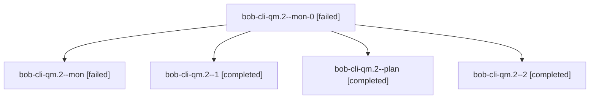

# Session: bob-cli-qm.2

[Agent Hoods](../README.md) / [bbugyi200](../users/bbugyi200/README.md) / [athena](../users/bbugyi200/machines/athena/README.md) / [bob-cli-qm](../users/bbugyi200/machines/athena/hoods/bob-cli-qm/README.md) / bob-cli-qm.2

Owner: `bbugyi200.athena` · Hood: `bob-cli-qm` · Members: 5 · Bead: [bob-cli-qm.2](https://github.com/bobs-org/bob-cli--beads/blob/main/pages/bob-cli-qm/bob-cli-qm.2.md)

## Lineage

The diagram is an optional enhancement; the ordered table below contains the same lineage in accessible text.

| Role | Agent | State | Model / provider | Timing | Commits | Prompt | Chat |
|---|---|---|---|---|---:|---|---|
| mon-0 | bob-cli-qm.2--mon-0 | failed | gpt-6-luna / codex | 2026-11-26T18:49:11.575960+00:00 → 2026-11-26T18:52:51.395226+00:00 | 0 | — | [Chat](../agents/bbugyi200.athena.bob-cli-qm.2--mon-0/chat.md) |
| mon | bob-cli-qm.2--mon | failed | gpt-6-luna / codex | 2026-11-26T18:43:06.619726+00:00 → 2026-11-26T18:47:31.364212+00:00 | 0 | — | [Chat](../agents/bbugyi200.athena.bob-cli-qm.2--mon/chat.md) |
| 1 | bob-cli-qm.2--1 | completed | gpt-6-luna / codex | 2026-11-26T18:47:30.915243+00:00 → 2026-11-26T18:50:31.011691+00:00 | 0 | [Prompt](../agents/bbugyi200.athena.bob-cli-qm.2--1/prompt.md) | [Chat](../agents/bbugyi200.athena.bob-cli-qm.2--1/chat.md) |
| plan | bob-cli-qm.2--plan | completed | gpt-6-luna / codex | 2026-11-26T18:09:45.640066+00:00 → 2026-11-26T18:44:46.559584+00:00 | 0 | [Prompt](../agents/bbugyi200.athena.bob-cli-qm.2--plan/prompt.md) | [Chat](../agents/bbugyi200.athena.bob-cli-qm.2--plan/chat.md) |
| 2 | bob-cli-qm.2--2 | completed | gpt-6-luna / codex | 2026-11-26T18:53:28.480203+00:00 → 2026-11-26T19:14:58.552159+00:00 | 0 | [Prompt](../agents/bbugyi200.athena.bob-cli-qm.2--2/prompt.md) | [Chat](../agents/bbugyi200.athena.bob-cli-qm.2--2/chat.md) |

## Neighbors

| Agent | Relation | State |
|---|---|---|
| [bob-cli-qm.1](../agents/bbugyi200.athena.bob-cli-qm.1/README.md) | bob-cli-qm hood | completed |
| [bob-cli-qm.3](bbugyi200.athena.bob-cli-qm.3.md) (session · 9) | bob-cli-qm hood | completed 9 |
| [bob-cli-qm.4](../agents/bbugyi200.athena.bob-cli-qm.4/README.md) | bob-cli-qm hood | completed |
| [bob-cli-qm.5](bbugyi200.athena.bob-cli-qm.5.md) (session · 5) | bob-cli-qm hood | active 1, completed 3, failed 1 |
| [bob-cli-qm.6](../agents/bbugyi200.athena.bob-cli-qm.6/README.md) | bob-cli-qm hood | waiting |
| [bob-cli-qm.7](../agents/bbugyi200.athena.bob-cli-qm.7/README.md) | bob-cli-qm hood | waiting |
| [bob-cli-qm.land](../agents/bbugyi200.athena.bob-cli-qm.land/README.md) | bob-cli-qm hood | waiting |
