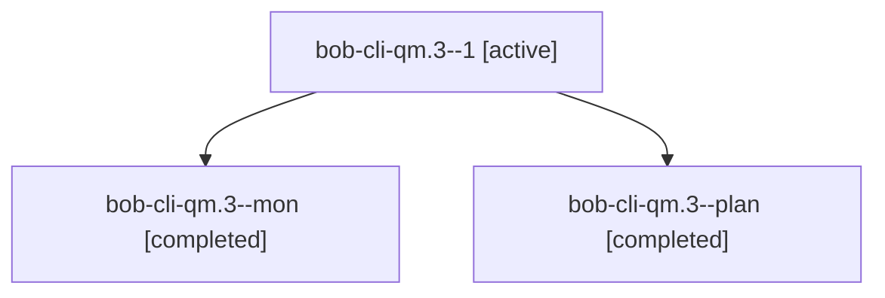

# Session: bob-cli-qm.3

[Agent Hoods](../README.md) / [bbugyi200](../users/bbugyi200/README.md) / [athena](../users/bbugyi200/machines/athena/README.md) / [bob-cli-qm](../users/bbugyi200/machines/athena/hoods/bob-cli-qm/README.md) / bob-cli-qm.3

Owner: `bbugyi200.athena` · Hood: `bob-cli-qm` · Members: 3 · Bead: [bob-cli-qm.3](https://github.com/bobs-org/bob-cli--beads/blob/main/pages/bob-cli-qm/bob-cli-qm.3.md)

## Lineage

The diagram is an optional enhancement; the ordered table below contains the same lineage in accessible text.

| Role | Agent | State | Model / provider | Timing | Commits | Prompt | Chat |
|---|---|---|---|---|---:|---|---|
| 1 | bob-cli-qm.3--1 | active | gpt-6-luna / codex | 2026-11-26T18:45:18.196691+00:00 | 0 | [Prompt](../agents/bbugyi200.athena.bob-cli-qm.3--1/prompt.md) | — |
| mon | bob-cli-qm.3--mon | completed | gpt-6-luna / codex | 2026-11-26T18:41:25.671132+00:00 → 2026-11-26T18:45:18.651156+00:00 | 0 | — | [Chat](../agents/bbugyi200.athena.bob-cli-qm.3--mon/chat.md) |
| plan | bob-cli-qm.3--plan | completed | gpt-6-luna / codex | 2026-11-26T18:09:51.160756+00:00 → 2026-11-26T18:42:40.128621+00:00 | 0 | [Prompt](../agents/bbugyi200.athena.bob-cli-qm.3--plan/prompt.md) | [Chat](../agents/bbugyi200.athena.bob-cli-qm.3--plan/chat.md) |

## Neighbors

| Agent | Relation | State |
|---|---|---|
| [bob-cli-qm.1](../agents/bbugyi200.athena.bob-cli-qm.1/README.md) | bob-cli-qm hood | completed |
| [bob-cli-qm.2](bbugyi200.athena.bob-cli-qm.2.md) (session · 4) | bob-cli-qm hood | active 1, completed 2, failed 1 |
| [bob-cli-qm.4](../agents/bbugyi200.athena.bob-cli-qm.4/README.md) | bob-cli-qm hood | waiting |
| [bob-cli-qm.5](../agents/bbugyi200.athena.bob-cli-qm.5/README.md) | bob-cli-qm hood | waiting |
| [bob-cli-qm.6](../agents/bbugyi200.athena.bob-cli-qm.6/README.md) | bob-cli-qm hood | waiting |
| [bob-cli-qm.7](../agents/bbugyi200.athena.bob-cli-qm.7/README.md) | bob-cli-qm hood | waiting |
| [bob-cli-qm.land](../agents/bbugyi200.athena.bob-cli-qm.land/README.md) | bob-cli-qm hood | waiting |
