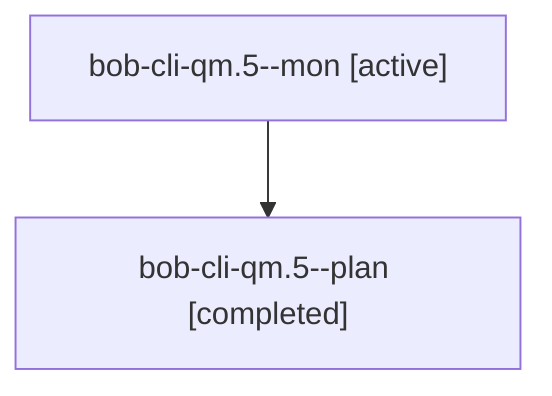

# Session: bob-cli-qm.5

[Agent Hoods](../README.md) / [bbugyi200](../users/bbugyi200/README.md) / [athena](../users/bbugyi200/machines/athena/README.md) / [bob-cli-qm](../users/bbugyi200/machines/athena/hoods/bob-cli-qm/README.md) / bob-cli-qm.5

Owner: `bbugyi200.athena` · Hood: `bob-cli-qm` · Members: 2 · Bead: [bob-cli-qm.5](https://github.com/bobs-org/bob-cli--beads/blob/main/pages/bob-cli-qm/bob-cli-qm.5.md)

## Lineage

The diagram is an optional enhancement; the ordered table below contains the same lineage in accessible text.

| Role | Agent | State | Model / provider | Timing | Commits | Prompt | Chat |
|---|---|---|---|---|---:|---|---|
| mon | bob-cli-qm.5--mon | active | gpt-6-luna / codex | 2026-11-26T19:35:52.782747+00:00 | 0 | — | — |
| plan | bob-cli-qm.5--plan | completed | gpt-6-luna / codex | 2026-11-26T19:30:04.018830+00:00 → 2026-11-26T19:36:59.571585+00:00 | 0 | [Prompt](../agents/bbugyi200.athena.bob-cli-qm.5--plan/prompt.md) | [Chat](../agents/bbugyi200.athena.bob-cli-qm.5--plan/chat.md) |

## Neighbors

| Agent | Relation | State |
|---|---|---|
| [bob-cli-qm.1](../agents/bbugyi200.athena.bob-cli-qm.1/README.md) | bob-cli-qm hood | completed |
| [bob-cli-qm.2](bbugyi200.athena.bob-cli-qm.2.md) (session · 5) | bob-cli-qm hood | completed 3, failed 2 |
| [bob-cli-qm.3](bbugyi200.athena.bob-cli-qm.3.md) (session · 9) | bob-cli-qm hood | completed 9 |
| [bob-cli-qm.4](../agents/bbugyi200.athena.bob-cli-qm.4/README.md) | bob-cli-qm hood | completed |
| [bob-cli-qm.6](../agents/bbugyi200.athena.bob-cli-qm.6/README.md) | bob-cli-qm hood | waiting |
| [bob-cli-qm.7](../agents/bbugyi200.athena.bob-cli-qm.7/README.md) | bob-cli-qm hood | waiting |
| [bob-cli-qm.land](../agents/bbugyi200.athena.bob-cli-qm.land/README.md) | bob-cli-qm hood | waiting |
