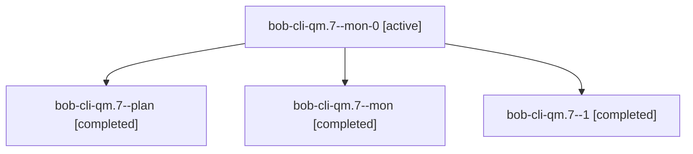

# Session: bob-cli-qm.7

[Agent Hoods](../README.md) / [bbugyi200](../users/bbugyi200/README.md) / [athena](../users/bbugyi200/machines/athena/README.md) / [bob-cli-qm](../users/bbugyi200/machines/athena/hoods/bob-cli-qm/README.md) / bob-cli-qm.7

Owner: `bbugyi200.athena` · Hood: `bob-cli-qm` · Members: 4 · Bead: [bob-cli-qm.7](https://github.com/bobs-org/bob-cli--beads/blob/main/pages/bob-cli-qm/bob-cli-qm.7.md)

## Lineage

The diagram is an optional enhancement; the ordered table below contains the same lineage in accessible text.

| Role | Agent | State | Model / provider | Timing | Commits | Prompt | Chat |
|---|---|---|---|---|---:|---|---|
| mon-0 | bob-cli-qm.7--mon-0 | active | opus / claude | 2026-11-27T12:04:08.913054+00:00 | 0 | — | — |
| plan | bob-cli-qm.7--plan | completed | opus / claude | 2026-11-27T11:08:59.137022+00:00 → 2026-11-27T11:19:08.941842+00:00 | 0 | [Prompt](../agents/bbugyi200.athena.bob-cli-qm.7--plan/prompt.md) | [Chat](../agents/bbugyi200.athena.bob-cli-qm.7--plan/chat.md) |
| mon | bob-cli-qm.7--mon | completed | opus / claude | 2026-11-27T11:18:32.740369+00:00 → 2026-11-27T11:50:48.039256+00:00 | 0 | — | [Chat](../agents/bbugyi200.athena.bob-cli-qm.7--mon/chat.md) |
| 1 | bob-cli-qm.7--1 | completed | opus / claude | 2026-11-27T11:50:47.940350+00:00 → 2026-11-27T12:05:31.208983+00:00 | [1](../agents/bbugyi200.athena.bob-cli-qm.7--1/README.md#commits) | [Prompt](../agents/bbugyi200.athena.bob-cli-qm.7--1/prompt.md) | [Chat](../agents/bbugyi200.athena.bob-cli-qm.7--1/chat.md) |

## Commits

| Role | Repo | Commit | Subject | Committed |
|---|---|---|---|---|
| — | bob-cli | [`ebc45fe`](https://github.com/bobs-org/bob-cli/commit/ebc45fece48aa486cdb59bfdbace11a3576a3ec3) | docs(cards): document Notebook and Prose cards | 2026-11-26 18:27:05 EST |
| 1 | bob-cli | [`eef6cc0`](https://github.com/bobs-org/bob-cli/commit/eef6cc07fe4225de1a27d052f3eee55e996b2a1a) | docs(memory): add Prose and Notebook Card glossary strands | 2026-11-27 07:05:01 EST |

## Neighbors

| Agent | Relation | State |
|---|---|---|
| [bob-cli-qm.1](../agents/bbugyi200.athena.bob-cli-qm.1/README.md) | bob-cli-qm hood | completed |
| [bob-cli-qm.2](bbugyi200.athena.bob-cli-qm.2.md) (session · 5) | bob-cli-qm hood | completed 3, failed 2 |
| [bob-cli-qm.3](bbugyi200.athena.bob-cli-qm.3.md) (session · 9) | bob-cli-qm hood | completed 9 |
| [bob-cli-qm.4](../agents/bbugyi200.athena.bob-cli-qm.4/README.md) | bob-cli-qm hood | completed |
| [bob-cli-qm.5](bbugyi200.athena.bob-cli-qm.5.md) (session · 7) | bob-cli-qm hood | completed 6, failed 1 |
| [bob-cli-qm.6](../agents/bbugyi200.athena.bob-cli-qm.6/README.md) | bob-cli-qm hood | completed |
| [bob-cli-qm.land](../agents/bbugyi200.athena.bob-cli-qm.land/README.md) | bob-cli-qm hood | waiting |
