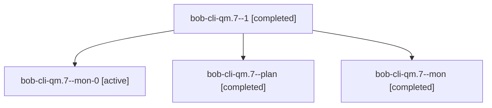

# Session: bob-cli-qm.7

[Agent Hoods](../README.md) / [bbugyi200](../users/bbugyi200/README.md) / [athena](../users/bbugyi200/machines/athena/README.md) / [bob-cli-qm](../users/bbugyi200/machines/athena/hoods/bob-cli-qm/README.md) / bob-cli-qm.7

Owner: `bbugyi200.athena` · Hood: `bob-cli-qm` · Members: 4 · Bead: [bob-cli-qm.7](https://github.com/bobs-org/bob-cli--beads/blob/main/pages/bob-cli-qm/bob-cli-qm.7.md)

## Lineage



The diagram is an optional enhancement; the ordered table below contains the same lineage in accessible text.

| Role | Agent | State | Model / provider | Timing | Commits | Prompt | Chat |
|---|---|---|---|---|---:|---|---|
| <a id="member-1"></a>1 | bob-cli-qm.7--1 | completed | gpt-6-luna / codex | 2026-11-26T23:24:22.831436+00:00 → 2026-11-27T00:32:35.415824+00:00 | [1](../agents/bbugyi200.athena.bob-cli-qm.7--1/README.md#commits) | [Prompt](../agents/bbugyi200.athena.bob-cli-qm.7--1/prompt.md) | [Chat](../agents/bbugyi200.athena.bob-cli-qm.7--1/chat.md) |
| <a id="member-mon-0"></a>mon-0 | bob-cli-qm.7--mon-0 | active | gpt-6-luna / codex | 2026-11-26T23:26:16.835290+00:00 | 0 | — | — |
| <a id="member-plan"></a>plan | bob-cli-qm.7--plan | completed | gpt-6-luna / codex | 2026-11-26T22:53:23.913753+00:00 → 2026-11-26T23:21:44.859264+00:00 | 0 | [Prompt](../agents/bbugyi200.athena.bob-cli-qm.7--plan/prompt.md) | [Chat](../agents/bbugyi200.athena.bob-cli-qm.7--plan/chat.md) |
| <a id="member-mon"></a>mon | bob-cli-qm.7--mon | completed | gpt-6-luna / codex | 2026-11-26T23:20:14.139261+00:00 → 2026-11-26T23:24:23.224384+00:00 | 0 | — | [Chat](../agents/bbugyi200.athena.bob-cli-qm.7--mon/chat.md) |

## Commits

| Role | Repo | Commit | Subject | Committed |
|---|---|---|---|---|
| 1 | bob-cli | [`ebc45fe`](https://github.com/bobs-org/bob-cli/commit/ebc45fece48aa486cdb59bfdbace11a3576a3ec3) | docs(cards): document Notebook and Prose cards | 2026-11-26 18:27:05 EST |

## Variables

| Role | Variable | Value |
|---|---|---|
| 1 | `artifacts` | \[{bead: bob-cli-io, kind: markdown, label: bob-plugins frees-marks 25 ms timing flake evidence, path: /home/bryan/.sase/artifacts/agents/gh\_bobs-org\_\_bob-cli/20261126182338/bob-plugins-frees-marks-fl… |

#### artifacts

**Role:** `1`

```yaml
- bead: bob-cli-io
  kind: markdown
  label: bob-plugins frees-marks 25 ms timing flake evidence
  path: /home/bryan/.sase/artifacts/agents/gh_bobs-org__bob-cli/20261126182338/bob-plugins-frees-marks-flake-evidence-906dc0980d6a.md
  ref: file:explicit:0ced00025da442945197a080
  source_path: /tmp/bob-plugins-frees-marks-flake-evidence.md
- bead: bob-cli-ej
  kind: markdown
  label: bob-plugins task-link live viewport CPU flake evidence
  path: /home/bryan/.sase/artifacts/agents/gh_bobs-org__bob-cli/20261126182338/bob-plugins-task-link-live-flake-evidence-5b836a94343e.md
  ref: file:explicit:84e0f290ca7bb8279a0d9fba
  source_path: /tmp/bob-plugins-task-link-live-flake-evidence.md
```

Values are truncated for display; see each member's agent meta.json for the full values.

## Neighbors

| Agent | Relation | State |
|---|---|---|
| [bob-cli-qm.1](../agents/bbugyi200.athena.bob-cli-qm.1/README.md) | bob-cli-qm hood | completed |
| [bob-cli-qm.2](bbugyi200.athena.bob-cli-qm.2.md) (session · 5) | bob-cli-qm hood | completed 3, failed 2 |
| [bob-cli-qm.3](bbugyi200.athena.bob-cli-qm.3.md) (session · 9) | bob-cli-qm hood | completed 9 |
| [bob-cli-qm.4](../agents/bbugyi200.athena.bob-cli-qm.4/README.md) | bob-cli-qm hood | completed |
| [bob-cli-qm.5](bbugyi200.athena.bob-cli-qm.5.md) (session · 7) | bob-cli-qm hood | completed 6, failed 1 |
| [bob-cli-qm.6](../agents/bbugyi200.athena.bob-cli-qm.6/README.md) | bob-cli-qm hood | completed |
| [bob-cli-qm.land](../agents/bbugyi200.athena.bob-cli-qm.land/README.md) | bob-cli-qm hood | waiting |
