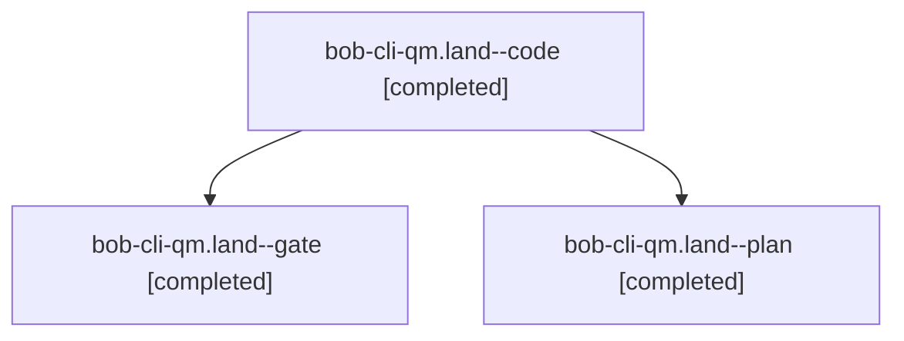

# Session: bob-cli-qm.land

[Agent Hoods](../README.md) / [bbugyi200](../users/bbugyi200/README.md) / [athena](../users/bbugyi200/machines/athena/README.md) / [bob-cli-qm](../users/bbugyi200/machines/athena/hoods/bob-cli-qm/README.md) / bob-cli-qm.land

Owner: `bbugyi200.athena` · Hood: `bob-cli-qm` · Members: 3 · Bead: [bob-cli-qm](https://github.com/bobs-org/bob-cli--beads/blob/main/pages/bob-cli-qm/README.md)

## Lineage



The diagram is an optional enhancement; the ordered table below contains the same lineage in accessible text.

| Role | Agent | State | Model / provider | Timing | Commits | Prompt | Chat |
|---|---|---|---|---|---:|---|---|
| <a id="member-code"></a>code | bob-cli-qm.land--code | completed | muse-spark-1.3-contributor / muse | 2026-11-27T12:35:41.092036+00:00 → 2026-11-27T13:14:52.321123+00:00 | 0 | — | [Chat](../agents/bbugyi200.athena.bob-cli-qm.land--code/chat.md) |
| <a id="member-gate"></a>gate | bob-cli-qm.land--gate | completed | opus / claude | 2026-11-27T12:34:58.767732+00:00 → 2026-11-27T12:35:05.140917+00:00 | 0 | — | [Chat](../agents/bbugyi200.athena.bob-cli-qm.land--gate/chat.md) |
| <a id="member-plan"></a>plan | bob-cli-qm.land--plan | completed | opus / claude | 2026-11-27T12:15:00.274148+00:00 → 2026-11-27T13:14:52.321123+00:00 | 0 | [Prompt](../agents/bbugyi200.athena.bob-cli-qm.land--plan/prompt.md) | [Chat](../agents/bbugyi200.athena.bob-cli-qm.land--plan/chat.md) |

## Variables

| Role | Variable | Value |
|---|---|---|
| code | `artifacts` | \[{bead: bob-cli-qm, kind: file, label: note-cards GO report (40 checks), path: /home/bryan/.sase/artifacts/agents/gh\_bobs-org\_\_bob-cli/20261127073512/qmland-report-9aa916819ce7.json, ref: file:explic… |

#### artifacts

**Role:** `code`

```yaml
- bead: bob-cli-qm
  kind: file
  label: note-cards GO report (40 checks)
  path: /home/bryan/.sase/artifacts/agents/gh_bobs-org__bob-cli/20261127073512/qmland-report-9aa916819ce7.json
  ref: file:explicit:b1a9d69c775e25c93e86c9e9
  source_path: /var/tmp/qmland-report.json
- bead: bob-cli-qm
  kind: file
  label: note-cards GO run log
  path: /home/bryan/.sase/artifacts/agents/gh_bobs-org__bob-cli/20261127073512/qmland-e2e-f7ad1aa0b0e3.log
  ref: file:explicit:ae549d06b84ecde17db11c8b
  source_path: /var/tmp/qmland-e2e.log
- bead: bob-cli-qm
  kind: file
  label: note-cards GO shots tar + SHA256SUMS (18 shots)
  path: /home/bryan/.sase/artifacts/agents/gh_bobs-org__bob-cli/20261127073512/qmland-shots-1d864e753598.tar
  ref: file:explicit:796d9fe246948dac342685b1
  source_path: /var/tmp/qmland-shots.tar
```

Values are truncated for display; see each member's agent meta.json for the full values.

## Neighbors

| Agent | Relation | State |
|---|---|---|
| [bob-cli-qm.1](../agents/bbugyi200.athena.bob-cli-qm.1/README.md) | bob-cli-qm hood | completed |
| [bob-cli-qm.2](bbugyi200.athena.bob-cli-qm.2.md) (session · 5) | bob-cli-qm hood | completed 3, failed 2 |
| [bob-cli-qm.3](bbugyi200.athena.bob-cli-qm.3.md) (session · 9) | bob-cli-qm hood | completed 9 |
| [bob-cli-qm.4](../agents/bbugyi200.athena.bob-cli-qm.4/README.md) | bob-cli-qm hood | completed |
| [bob-cli-qm.5](bbugyi200.athena.bob-cli-qm.5.md) (session · 7) | bob-cli-qm hood | completed 6, failed 1 |
| [bob-cli-qm.6](../agents/bbugyi200.athena.bob-cli-qm.6/README.md) | bob-cli-qm hood | completed |
| [bob-cli-qm.7](bbugyi200.athena.bob-cli-qm.7.md) (session · 5) | bob-cli-qm hood | completed 5 |
