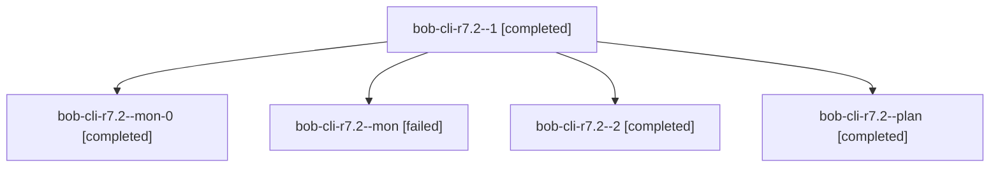

# Session: bob-cli-r7.2

[Agent Hoods](../README.md) / [bbugyi200](../users/bbugyi200/README.md) / [athena](../users/bbugyi200/machines/athena/README.md) / [bob-cli-r7](../users/bbugyi200/machines/athena/hoods/bob-cli-r7/README.md) / bob-cli-r7.2

Owner: `bbugyi200.athena` · Hood: `bob-cli-r7` · Members: 5 · Bead: [bob-cli-r7.2](https://github.com/bobs-org/bob-cli--beads/blob/main/pages/bob-cli-r7/bob-cli-r7.2.md)

## Lineage

The diagram is an optional enhancement; the ordered table below contains the same lineage in accessible text.

| Role | Agent | State | Model / provider | Timing | Commits | Prompt | Chat |
|---|---|---|---|---|---:|---|---|
| 1 | bob-cli-r7.2--1 | completed | grok-4.6 / grok | 2026-11-27T15:52:58.156929+00:00 → 2026-11-27T16:06:18.094028+00:00 | 0 | [Prompt](../agents/bbugyi200.athena.bob-cli-r7.2--1/prompt.md) | [Chat](../agents/bbugyi200.athena.bob-cli-r7.2--1/chat.md) |
| mon-0 | bob-cli-r7.2--mon-0 | completed | grok-4.6 / grok | 2026-11-27T16:05:08.594496+00:00 → 2026-11-27T16:17:11.661755+00:00 | 0 | — | [Chat](../agents/bbugyi200.athena.bob-cli-r7.2--mon-0/chat.md) |
| mon | bob-cli-r7.2--mon | failed | grok-4.6 / grok | 2026-11-27T15:47:22.342493+00:00 → 2026-11-27T15:52:58.270756+00:00 | 0 | — | [Chat](../agents/bbugyi200.athena.bob-cli-r7.2--mon/chat.md) |
| 2 | bob-cli-r7.2--2 | completed | grok-4.6 / grok | 2026-11-27T16:17:49.350277+00:00 → 2026-11-27T16:25:01.297570+00:00 | [1](../agents/bbugyi200.athena.bob-cli-r7.2--2/README.md#commits) | [Prompt](../agents/bbugyi200.athena.bob-cli-r7.2--2/prompt.md) | [Chat](../agents/bbugyi200.athena.bob-cli-r7.2--2/chat.md) |
| plan | bob-cli-r7.2--plan | completed | grok-4.6 / grok | 2026-11-27T15:35:42.204378+00:00 → 2026-11-27T15:48:40.818122+00:00 | 0 | [Prompt](../agents/bbugyi200.athena.bob-cli-r7.2--plan/prompt.md) | [Chat](../agents/bbugyi200.athena.bob-cli-r7.2--plan/chat.md) |

## Commits

| Role | Repo | Commit | Subject | Committed |
|---|---|---|---|---|
| 2 | bob-cli | [`1878531`](https://github.com/bobs-org/bob-cli/commit/187853158344f2978486c3d0164b4fe6f7040fd1) | fix(docs): replace stale gitignored mount copies instead of treating them as authored | 2026-11-27 11:24:24 EST |

## Neighbors

| Agent | Relation | State |
|---|---|---|
| [bob-cli-r7.1](../agents/bbugyi200.athena.bob-cli-r7.1/README.md) | bob-cli-r7 hood | completed |
| [bob-cli-r7.3](../agents/bbugyi200.athena.bob-cli-r7.3/README.md) | bob-cli-r7 hood | completed |
| [bob-cli-r7.4](../agents/bbugyi200.athena.bob-cli-r7.4/README.md) | bob-cli-r7 hood | waiting |
| [bob-cli-r7.land](../agents/bbugyi200.athena.bob-cli-r7.land/README.md) | bob-cli-r7 hood | waiting |
