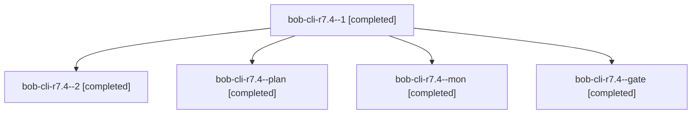

# Session: bob-cli-r7.4

[Agent Hoods](../README.md) / [bbugyi200](../users/bbugyi200/README.md) / [athena](../users/bbugyi200/machines/athena/README.md) / [bob-cli-r7](../users/bbugyi200/machines/athena/hoods/bob-cli-r7/README.md) / bob-cli-r7.4

Owner: `bbugyi200.athena` · Hood: `bob-cli-r7` · Members: 5 · Bead: [bob-cli-r7.4](https://github.com/bobs-org/bob-cli--beads/blob/main/pages/bob-cli-r7/bob-cli-r7.4.md)

## Lineage

The diagram is an optional enhancement; the ordered table below contains the same lineage in accessible text.

| Role | Agent | State | Model / provider | Timing | Commits | Prompt | Chat |
|---|---|---|---|---|---:|---|---|
| 1 | bob-cli-r7.4--1 | completed | gpt-6-luna / codex | 2026-11-27T17:06:28.269032+00:00 → 2026-11-27T17:27:24.891273+00:00 | 0 | [Prompt](../agents/bbugyi200.athena.bob-cli-r7.4--1/prompt.md) | [Chat](../agents/bbugyi200.athena.bob-cli-r7.4--1/chat.md) |
| 2 | bob-cli-r7.4--2 | completed | gpt-6-luna / codex | 2026-11-27T17:28:59.277331+00:00 → 2026-11-27T17:29:40.823972+00:00 | 0 | [Prompt](../agents/bbugyi200.athena.bob-cli-r7.4--2/prompt.md) | [Chat](../agents/bbugyi200.athena.bob-cli-r7.4--2/chat.md) |
| plan | bob-cli-r7.4--plan | completed | gpt-6-luna / codex | 2026-11-27T16:36:21.555338+00:00 → 2026-11-27T17:00:46.189508+00:00 | 0 | [Prompt](../agents/bbugyi200.athena.bob-cli-r7.4--plan/prompt.md) | [Chat](../agents/bbugyi200.athena.bob-cli-r7.4--plan/chat.md) |
| mon | bob-cli-r7.4--mon | completed | gpt-6-luna / codex | 2026-11-27T16:58:55.584085+00:00 → 2026-11-27T17:06:28.636724+00:00 | 0 | — | [Chat](../agents/bbugyi200.athena.bob-cli-r7.4--mon/chat.md) |
| gate | bob-cli-r7.4--gate | completed | gpt-6-luna / codex | 2026-11-27T17:27:41.187163+00:00 → 2026-11-27T17:28:17.820557+00:00 | 0 | — | [Chat](../agents/bbugyi200.athena.bob-cli-r7.4--gate/chat.md) |

## Neighbors

| Agent | Relation | State |
|---|---|---|
| [bob-cli-r7.1](../agents/bbugyi200.athena.bob-cli-r7.1/README.md) | bob-cli-r7 hood | completed |
| [bob-cli-r7.2](bbugyi200.athena.bob-cli-r7.2.md) (session · 5) | bob-cli-r7 hood | completed 4, failed 1 |
| [bob-cli-r7.3](../agents/bbugyi200.athena.bob-cli-r7.3/README.md) | bob-cli-r7 hood | completed |
| [bob-cli-r7.land](bbugyi200.athena.bob-cli-r7.land.md) (session · 3) | bob-cli-r7 hood | active 1, completed 2 |
