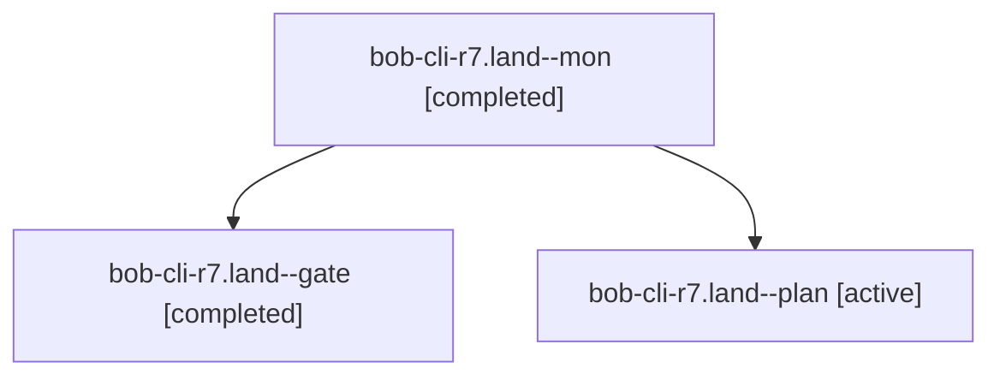

# Session: bob-cli-r7.land

[Agent Hoods](../README.md) / [bbugyi200](../users/bbugyi200/README.md) / [athena](../users/bbugyi200/machines/athena/README.md) / [bob-cli-r7](../users/bbugyi200/machines/athena/hoods/bob-cli-r7/README.md) / bob-cli-r7.land

Owner: `bbugyi200.athena` · Hood: `bob-cli-r7` · Members: 3 · Bead: [bob-cli-r7](https://github.com/bobs-org/bob-cli--beads/blob/main/pages/bob-cli-r7/README.md)

## Lineage

The diagram is an optional enhancement; the ordered table below contains the same lineage in accessible text.

| Role | Agent | State | Model / provider | Timing | Commits | Prompt | Chat |
|---|---|---|---|---|---:|---|---|
| mon | bob-cli-r7.land--mon | completed | opus / claude | 2026-11-27T18:01:07.260535+00:00 → 2026-11-27T18:04:02.911450+00:00 | 0 | — | [Chat](../agents/bbugyi200.athena.bob-cli-r7.land--mon/chat.md) |
| gate | bob-cli-r7.land--gate | completed | opus / claude | 2026-11-27T18:00:54.861737+00:00 → 2026-11-27T18:01:08.414824+00:00 | 0 | — | [Chat](../agents/bbugyi200.athena.bob-cli-r7.land--gate/chat.md) |
| plan | bob-cli-r7.land--plan | active | opus / claude | 2026-11-27T17:30:17.488211+00:00 → 2026-11-27T18:01:14.409707+00:00 | 0 | [Prompt](../agents/bbugyi200.athena.bob-cli-r7.land--plan/prompt.md) | [Chat](../agents/bbugyi200.athena.bob-cli-r7.land--plan/chat.md) |

## Neighbors

| Agent | Relation | State |
|---|---|---|
| [bob-cli-r7.1](../agents/bbugyi200.athena.bob-cli-r7.1/README.md) | bob-cli-r7 hood | completed |
| [bob-cli-r7.2](bbugyi200.athena.bob-cli-r7.2.md) (session · 5) | bob-cli-r7 hood | completed 4, failed 1 |
| [bob-cli-r7.3](../agents/bbugyi200.athena.bob-cli-r7.3/README.md) | bob-cli-r7 hood | completed |
| [bob-cli-r7.4](bbugyi200.athena.bob-cli-r7.4.md) (session · 5) | bob-cli-r7 hood | completed 5 |
