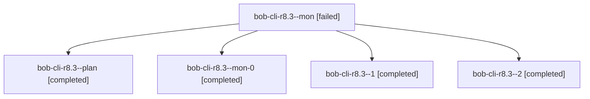

# Session: bob-cli-r8.3

[Agent Hoods](../README.md) / [bbugyi200](../users/bbugyi200/README.md) / [athena](../users/bbugyi200/machines/athena/README.md) / [bob-cli-r8](../users/bbugyi200/machines/athena/hoods/bob-cli-r8/README.md) / bob-cli-r8.3

Owner: `bbugyi200.athena` · Hood: `bob-cli-r8` · Members: 5 · Bead: [bob-cli-r8.3](https://github.com/bobs-org/bob-cli--beads/blob/main/pages/bob-cli-r8/bob-cli-r8.3.md)

## Lineage

The diagram is an optional enhancement; the ordered table below contains the same lineage in accessible text.

| Role | Agent | State | Model / provider | Timing | Commits | Prompt | Chat |
|---|---|---|---|---|---:|---|---|
| mon | bob-cli-r8.3--mon | failed | gpt-6-luna / codex | 2026-11-27T19:11:20.522662+00:00 → 2026-11-27T19:43:23.786714+00:00 | 0 | — | [Chat](../agents/bbugyi200.athena.bob-cli-r8.3--mon/chat.md) |
| plan | bob-cli-r8.3--plan | completed | gpt-6-luna / codex | 2026-11-27T18:44:10.672334+00:00 → 2026-11-27T19:42:06.599018+00:00 | 0 | [Prompt](../agents/bbugyi200.athena.bob-cli-r8.3--plan/prompt.md) | [Chat](../agents/bbugyi200.athena.bob-cli-r8.3--plan/chat.md) |
| mon-0 | bob-cli-r8.3--mon-0 | completed | gpt-6-luna / codex | 2026-11-27T19:51:10.602877+00:00 → 2026-11-27T19:54:40.552905+00:00 | 0 | — | [Chat](../agents/bbugyi200.athena.bob-cli-r8.3--mon-0/chat.md) |
| 1 | bob-cli-r8.3--1 | completed | gpt-6-luna / codex | 2026-11-27T19:43:23.666047+00:00 → 2026-11-27T19:51:52.304856+00:00 | 0 | [Prompt](../agents/bbugyi200.athena.bob-cli-r8.3--1/prompt.md) | [Chat](../agents/bbugyi200.athena.bob-cli-r8.3--1/chat.md) |
| 2 | bob-cli-r8.3--2 | completed | gpt-6-luna / codex | 2026-11-27T19:54:40.202128+00:00 → 2026-11-27T19:59:02.372137+00:00 | 0 | [Prompt](../agents/bbugyi200.athena.bob-cli-r8.3--2/prompt.md) | [Chat](../agents/bbugyi200.athena.bob-cli-r8.3--2/chat.md) |

## Neighbors

| Agent | Relation | State |
|---|---|---|
| [bob-cli-r8.1](../agents/bbugyi200.athena.bob-cli-r8.1/README.md) | bob-cli-r8 hood | completed |
| [bob-cli-r8.2](../agents/bbugyi200.athena.bob-cli-r8.2/README.md) | bob-cli-r8 hood | completed |
| [bob-cli-r8.4](../agents/bbugyi200.athena.bob-cli-r8.4/README.md) | bob-cli-r8 hood | completed |
| [bob-cli-r8.land](../agents/bbugyi200.athena.bob-cli-r8.land/README.md) | bob-cli-r8 hood | waiting |
