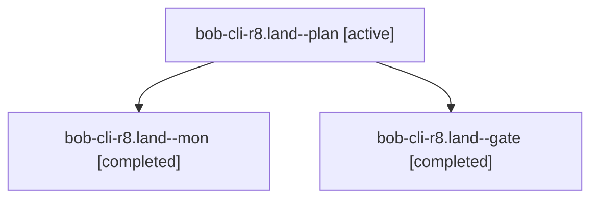

# Session: bob-cli-r8.land

[Agent Hoods](../README.md) / [bbugyi200](../users/bbugyi200/README.md) / [athena](../users/bbugyi200/machines/athena/README.md) / [bob-cli-r8](../users/bbugyi200/machines/athena/hoods/bob-cli-r8/README.md) / bob-cli-r8.land

Owner: `bbugyi200.athena` · Hood: `bob-cli-r8` · Members: 3 · Bead: [bob-cli-r8](https://github.com/bobs-org/bob-cli--beads/blob/main/pages/bob-cli-r8/README.md)

## Lineage

The diagram is an optional enhancement; the ordered table below contains the same lineage in accessible text.

| Role | Agent | State | Model / provider | Timing | Commits | Prompt | Chat |
|---|---|---|---|---|---:|---|---|
| plan | bob-cli-r8.land--plan | active | gpt-6-astra / codex | 2026-11-27T20:14:12.330975+00:00 → 2026-11-27T20:31:15.921586+00:00 | 0 | [Prompt](../agents/bbugyi200.athena.bob-cli-r8.land--plan/prompt.md) | [Chat](../agents/bbugyi200.athena.bob-cli-r8.land--plan/chat.md) |
| mon | bob-cli-r8.land--mon | completed | gpt-6-astra / codex | 2026-11-27T20:31:06.222423+00:00 → 2026-11-27T20:35:00.864297+00:00 | 0 | — | [Chat](../agents/bbugyi200.athena.bob-cli-r8.land--mon/chat.md) |
| gate | bob-cli-r8.land--gate | completed | gpt-6-astra / codex | 2026-11-27T20:30:39.506216+00:00 → 2026-11-27T20:31:08.766236+00:00 | 0 | — | [Chat](../agents/bbugyi200.athena.bob-cli-r8.land--gate/chat.md) |

## Neighbors

| Agent | Relation | State |
|---|---|---|
| [bob-cli-r8.1](../agents/bbugyi200.athena.bob-cli-r8.1/README.md) | bob-cli-r8 hood | completed |
| [bob-cli-r8.2](../agents/bbugyi200.athena.bob-cli-r8.2/README.md) | bob-cli-r8 hood | completed |
| [bob-cli-r8.3](bbugyi200.athena.bob-cli-r8.3.md) (session · 5) | bob-cli-r8 hood | completed 4, failed 1 |
| [bob-cli-r8.4](../agents/bbugyi200.athena.bob-cli-r8.4/README.md) | bob-cli-r8 hood | completed |
