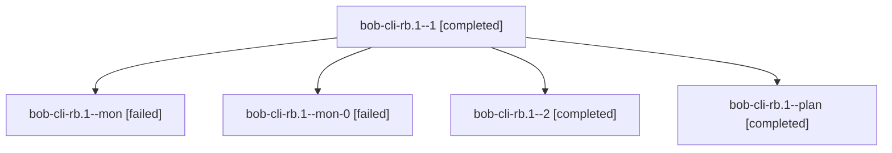

# Session: bob-cli-rb.1

[Agent Hoods](../README.md) / [bbugyi200](../users/bbugyi200/README.md) / [athena](../users/bbugyi200/machines/athena/README.md) / [bob-cli-rb](../users/bbugyi200/machines/athena/hoods/bob-cli-rb/README.md) / bob-cli-rb.1

Owner: `bbugyi200.athena` · Hood: `bob-cli-rb` · Members: 5 · Bead: [bob-cli-rb.1](https://github.com/bobs-org/bob-cli--beads/blob/main/pages/bob-cli-rb/bob-cli-rb.1.md)

## Lineage

The diagram is an optional enhancement; the ordered table below contains the same lineage in accessible text.

| Role | Agent | State | Model / provider | Timing | Commits | Prompt | Chat |
|---|---|---|---|---|---:|---|---|
| 1 | bob-cli-rb.1--1 | completed | gpt-6-luna / codex | 2026-11-27T20:27:13.544182+00:00 → 2026-11-27T20:37:08.876629+00:00 | 0 | [Prompt](../agents/bbugyi200.athena.bob-cli-rb.1--1/prompt.md) | [Chat](../agents/bbugyi200.athena.bob-cli-rb.1--1/chat.md) |
| mon | bob-cli-rb.1--mon | failed | gpt-6-luna / codex | 2026-11-27T20:22:16.739319+00:00 → 2026-11-27T20:27:14.058781+00:00 | 0 | — | [Chat](../agents/bbugyi200.athena.bob-cli-rb.1--mon/chat.md) |
| mon-0 | bob-cli-rb.1--mon-0 | failed | gpt-6-luna / codex | 2026-11-27T20:35:57.208853+00:00 → 2026-11-27T20:41:50.197680+00:00 | 0 | — | [Chat](../agents/bbugyi200.athena.bob-cli-rb.1--mon-0/chat.md) |
| 2 | bob-cli-rb.1--2 | completed | gpt-6-luna / codex | 2026-11-27T20:46:12.870774+00:00 → 2026-11-27T20:52:22.720789+00:00 | [1](../agents/bbugyi200.athena.bob-cli-rb.1--2/README.md#commits) | [Prompt](../agents/bbugyi200.athena.bob-cli-rb.1--2/prompt.md) | [Chat](../agents/bbugyi200.athena.bob-cli-rb.1--2/chat.md) |
| plan | bob-cli-rb.1--plan | completed | gpt-6-luna / codex | 2026-11-27T20:05:25.492873+00:00 → 2026-11-27T20:23:47.763175+00:00 | 0 | [Prompt](../agents/bbugyi200.athena.bob-cli-rb.1--plan/prompt.md) | [Chat](../agents/bbugyi200.athena.bob-cli-rb.1--plan/chat.md) |

## Commits

| Role | Repo | Commit | Subject | Committed |
|---|---|---|---|---|
| 2 | bob-cli | [`421de94`](https://github.com/bobs-org/bob-cli/commit/421de94dc381f1947e24154d181ef44b6829c86c) | feat(types): add configurable capture type leads | 2026-11-27 15:51:41 EST |

## Neighbors

| Agent | Relation | State |
|---|---|---|
| [bob-cli-rb.2](../agents/bbugyi200.athena.bob-cli-rb.2/README.md) | bob-cli-rb hood | completed |
| [bob-cli-rb.3](../agents/bbugyi200.athena.bob-cli-rb.3/README.md) | bob-cli-rb hood | waiting |
| [bob-cli-rb.4](../agents/bbugyi200.athena.bob-cli-rb.4/README.md) | bob-cli-rb hood | waiting |
| [bob-cli-rb.5](../agents/bbugyi200.athena.bob-cli-rb.5/README.md) | bob-cli-rb hood | waiting |
| [bob-cli-rb.land](../agents/bbugyi200.athena.bob-cli-rb.land/README.md) | bob-cli-rb hood | waiting |
