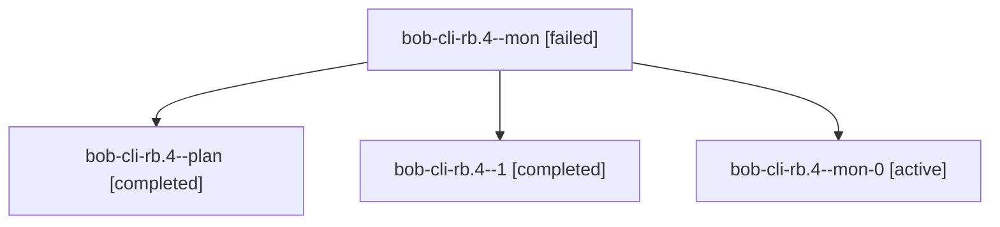

# Session: bob-cli-rb.4

[Agent Hoods](../README.md) / [bbugyi200](../users/bbugyi200/README.md) / [athena](../users/bbugyi200/machines/athena/README.md) / [bob-cli-rb](../users/bbugyi200/machines/athena/hoods/bob-cli-rb/README.md) / bob-cli-rb.4

Owner: `bbugyi200.athena` · Hood: `bob-cli-rb` · Members: 4 · Bead: [bob-cli-rb.4](https://github.com/bobs-org/bob-cli--beads/blob/main/pages/bob-cli-rb/bob-cli-rb.4.md)

## Lineage

The diagram is an optional enhancement; the ordered table below contains the same lineage in accessible text.

| Role | Agent | State | Model / provider | Timing | Commits | Prompt | Chat |
|---|---|---|---|---|---:|---|---|
| mon | bob-cli-rb.4--mon | failed | grok-4.6 / grok | 2026-11-27T23:22:45.664775+00:00 → 2026-11-27T23:44:21.519683+00:00 | 0 | — | [Chat](../agents/bbugyi200.athena.bob-cli-rb.4--mon/chat.md) |
| plan | bob-cli-rb.4--plan | completed | grok-4.6 / grok | 2026-11-27T22:39:25.594668+00:00 → 2026-11-27T23:24:24.520187+00:00 | 0 | [Prompt](../agents/bbugyi200.athena.bob-cli-rb.4--plan/prompt.md) | [Chat](../agents/bbugyi200.athena.bob-cli-rb.4--plan/chat.md) |
| 1 | bob-cli-rb.4--1 | completed | grok-4.6 / grok | 2026-11-27T23:44:21.268418+00:00 → 2026-11-28T00:01:57.372041+00:00 | 0 | [Prompt](../agents/bbugyi200.athena.bob-cli-rb.4--1/prompt.md) | [Chat](../agents/bbugyi200.athena.bob-cli-rb.4--1/chat.md) |
| mon-0 | bob-cli-rb.4--mon-0 | active | grok-4.6 / grok | 2026-11-28T00:00:27.345654+00:00 | 0 | — | — |

## Neighbors

| Agent | Relation | State |
|---|---|---|
| [bob-cli-rb.1](bbugyi200.athena.bob-cli-rb.1.md) (session · 5) | bob-cli-rb hood | completed 3, failed 2 |
| [bob-cli-rb.2](../agents/bbugyi200.athena.bob-cli-rb.2/README.md) | bob-cli-rb hood | completed |
| [bob-cli-rb.3](../agents/bbugyi200.athena.bob-cli-rb.3/README.md) | bob-cli-rb hood | completed |
| [bob-cli-rb.5](../agents/bbugyi200.athena.bob-cli-rb.5/README.md) | bob-cli-rb hood | waiting |
| [bob-cli-rb.land](../agents/bbugyi200.athena.bob-cli-rb.land/README.md) | bob-cli-rb hood | waiting |
