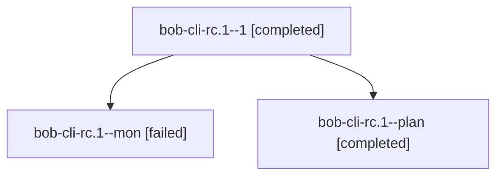

# Session: bob-cli-rc.1

[Agent Hoods](../README.md) / [bbugyi200](../users/bbugyi200/README.md) / [athena](../users/bbugyi200/machines/athena/README.md) / [bob-cli-rc](../users/bbugyi200/machines/athena/hoods/bob-cli-rc/README.md) / bob-cli-rc.1

Owner: `bbugyi200.athena` · Hood: `bob-cli-rc` · Members: 3 · Bead: [bob-cli-rc.1](https://github.com/bobs-org/bob-cli--beads/blob/main/pages/bob-cli-rc/bob-cli-rc.1.md)

## Lineage

The diagram is an optional enhancement; the ordered table below contains the same lineage in accessible text.

| Role | Agent | State | Model / provider | Timing | Commits | Prompt | Chat |
|---|---|---|---|---|---:|---|---|
| 1 | bob-cli-rc.1--1 | completed | gpt-6-luna / codex | 2026-11-27T20:32:42.813553+00:00 → 2026-11-27T20:46:09.861612+00:00 | 0 | [Prompt](../agents/bbugyi200.athena.bob-cli-rc.1--1/prompt.md) | [Chat](../agents/bbugyi200.athena.bob-cli-rc.1--1/chat.md) |
| mon | bob-cli-rc.1--mon | failed | gpt-6-luna / codex | 2026-11-27T20:23:13.915708+00:00 → 2026-11-27T20:32:43.157200+00:00 | 0 | — | [Chat](../agents/bbugyi200.athena.bob-cli-rc.1--mon/chat.md) |
| plan | bob-cli-rc.1--plan | completed | gpt-6-luna / codex | 2026-11-27T20:08:34.377234+00:00 → 2026-11-27T20:24:59.739441+00:00 | 0 | [Prompt](../agents/bbugyi200.athena.bob-cli-rc.1--plan/prompt.md) | [Chat](../agents/bbugyi200.athena.bob-cli-rc.1--plan/chat.md) |

## Neighbors

| Agent | Relation | State |
|---|---|---|
| [bob-cli-rc.2](../agents/bbugyi200.athena.bob-cli-rc.2/README.md) | bob-cli-rc hood | waiting |
| [bob-cli-rc.3](../agents/bbugyi200.athena.bob-cli-rc.3/README.md) | bob-cli-rc hood | waiting |
| [bob-cli-rc.4](../agents/bbugyi200.athena.bob-cli-rc.4/README.md) | bob-cli-rc hood | waiting |
| [bob-cli-rc.land](../agents/bbugyi200.athena.bob-cli-rc.land/README.md) | bob-cli-rc hood | waiting |
