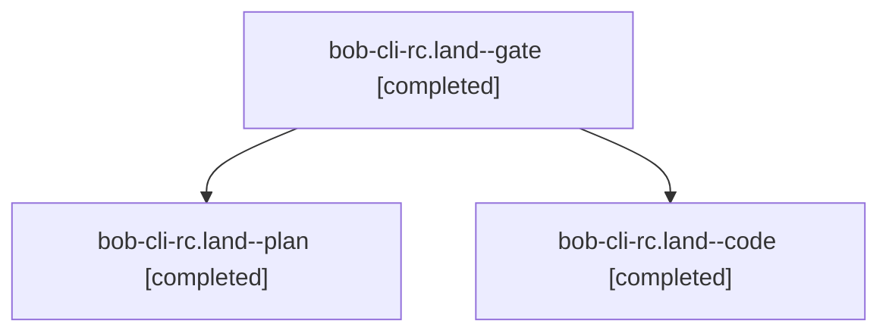

# Session: bob-cli-rc.land

[Agent Hoods](../README.md) / [bbugyi200](../users/bbugyi200/README.md) / [athena](../users/bbugyi200/machines/athena/README.md) / [bob-cli-rc](../users/bbugyi200/machines/athena/hoods/bob-cli-rc/README.md) / bob-cli-rc.land

Owner: `bbugyi200.athena` · Hood: `bob-cli-rc` · Members: 3 · Bead: [bob-cli-rc](https://github.com/bobs-org/bob-cli--beads/blob/main/pages/bob-cli-rc/README.md)

## Lineage



The diagram is an optional enhancement; the ordered table below contains the same lineage in accessible text.

| Role | Agent | State | Model / provider | Timing | Commits | Prompt | Chat |
|---|---|---|---|---|---:|---|---|
| <a id="member-gate"></a>gate | bob-cli-rc.land--gate | completed | gpt-6-astra / codex | 2026-11-27T22:45:30.630772+00:00 → 2026-11-27T22:45:39.160409+00:00 | 0 | — | [Chat](../agents/bbugyi200.athena.bob-cli-rc.land--gate/chat.md) |
| <a id="member-plan"></a>plan | bob-cli-rc.land--plan | completed | gpt-6-astra / codex | 2026-11-27T22:30:47.115472+00:00 → 2026-11-27T23:34:15.113899+00:00 | 0 | [Prompt](../agents/bbugyi200.athena.bob-cli-rc.land--plan/prompt.md) | [Chat](../agents/bbugyi200.athena.bob-cli-rc.land--plan/chat.md) |
| <a id="member-code"></a>code | bob-cli-rc.land--code | completed | grok-4.6 / grok | 2026-11-27T22:46:16.815814+00:00 → 2026-11-27T23:34:15.113899+00:00 | 0 | — | [Chat](../agents/bbugyi200.athena.bob-cli-rc.land--code/chat.md) |

## Variables

| Role | Variable | Value |
|---|---|---|
| code | `artifacts` | \[{bead: bob-cli-rc, kind: file, label: Section Map real-Obsidian e2e report, path: /home/bryan/.sase/artifacts/agents/gh\_bobs-org\_\_bob-cli/20261127174545/report-3706c61f66cc.json, ref: file:explicit:… |
| plan | `artifacts` | \[{bead: bob-cli-rc, kind: file, label: Section Map landing: snooze vector fails, viewport tests pass on clean dca84529, path: /home/bryan/.sase/artifacts/agents/gh\_bobs-org\_\_bob-cli/20261127150742/fo… |

#### artifacts

**Role:** `code`

```yaml
- bead: bob-cli-rc
  kind: file
  label: Section Map real-Obsidian e2e report
  path: /home/bryan/.sase/artifacts/agents/gh_bobs-org__bob-cli/20261127174545/report-3706c61f66cc.json
  ref: file:explicit:c4445cebc9af70a619e38c15
  source_path: /tmp/section-map-e2e-land/report.json
- bead: bob-cli-rc
  kind: file
  label: Section Map real-Obsidian e2e screenshots
  path: /home/bryan/.sase/artifacts/agents/gh_bobs-org__bob-cli/20261127174545/section-map-e2e-land-shots.tar-4680a55337a4.gz
  ref: file:explicit:fcaf37ab1946ab7130326e16
  source_path: /tmp/section-map-e2e-land-shots.tar.gz
- bead: bob-cli-rc
  kind: file
  label: Section Map Chromium preview scenes
  path: /home/bryan/.sase/artifacts/agents/gh_bobs-org__bob-cli/20261127174545/section-map-preview-land.tar-aa6909bed473.gz
  ref: file:explicit:c925b6bd36a6c253ac4e251b
  source_path: /tmp/section-map-preview-land.tar.gz
- bead: bob-cli-rc
  kind: image
  label: Section Map jump card light
  path: /home/bryan/.sase/artifacts/agents/gh_bobs-org__bob-cli/20261127174545/jump-card-light-e79291570455.png
  ref: file:explicit:e0b85a31cdf32d4607e53c2d
  source_path: /tmp/section-map-e2e-land/shots/jump-card-light.png
- bead: bob-cli-rc
  kind: image
  label: Section Map short split keeps current
  path: /home/bryan/.sase/artifacts/agents/gh_bobs-org__bob-cli/20261127174545/short-split-light-0e55c85fd085.png
  ref: file:explicit:f06e06e178b9a9869e5e8205
  source_path: /tmp/section-map-e2e-land/shots/short-split-light.png
- bead: bob-cli-rc
  kind: image
  label: Section Map reduced-motion wrap badge
  path: /home/bryan/.sase/artifacts/agents/gh_bobs-org__bob-cli/20261127174545/wrap-reduced-dark-83aeefc2615e.png
  ref: file:explicit:9e8ff1903ad5408cdcff42fa
  source_path: /tmp/section-map-e2e-land/shots/wrap-reduced-dark.png
```

#### artifacts

**Role:** `plan`

```yaml
- bead: bob-cli-rc
  kind: file
  label: Section Map landing: snooze vector fails, viewport tests pass on clean dca84529
  path: /home/bryan/.sase/artifacts/agents/gh_bobs-org__bob-cli/20261127150742/followup-tests-50266bdc61b1.log
  ref: file:explicit:98f2378ffdb7a714d3749e61
  source_path: /home/bryan/.local/state/sase/workspaces/bobs-org/bob-cli/bob-cli_11/sase/repos/linked/bob-plugins/.git/section-map-land/followup-tests.log
- bead: bob-cli-rc
  kind: file
  label: Section Map short-pane Chromium geometry at dca84529
  path: /home/bryan/.sase/artifacts/agents/gh_bobs-org__bob-cli/20261127150742/geometry-result-b713bb70dedb.txt
  ref: file:explicit:be63725046c23ea0929e0b67
  source_path: /home/bryan/.local/state/sase/workspaces/bobs-org/bob-cli/bob-cli_11/sase/repos/linked/bob-plugins/.git/section-map-land/geometry-result.txt
```

Values are truncated for display; see each member's agent meta.json for the full values.

## Neighbors

| Agent | Relation | State |
|---|---|---|
| [bob-cli-rc.1](bbugyi200.athena.bob-cli-rc.1.md) (session · 3) | bob-cli-rc hood | completed 2, failed 1 |
| [bob-cli-rc.2](../agents/bbugyi200.athena.bob-cli-rc.2/README.md) | bob-cli-rc hood | completed |
| [bob-cli-rc.3](../agents/bbugyi200.athena.bob-cli-rc.3/README.md) | bob-cli-rc hood | completed |
| [bob-cli-rc.4](../agents/bbugyi200.athena.bob-cli-rc.4/README.md) | bob-cli-rc hood | completed |
