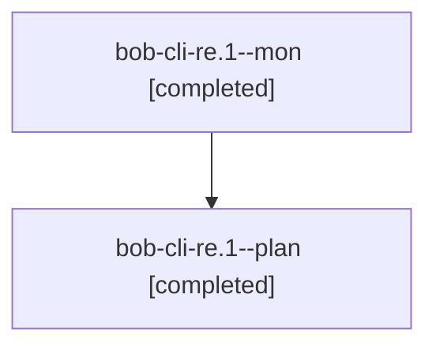

# Session: bob-cli-re.1

[Agent Hoods](../README.md) / [bbugyi200](../users/bbugyi200/README.md) / [athena](../users/bbugyi200/machines/athena/README.md) / [bob-cli-re](../users/bbugyi200/machines/athena/hoods/bob-cli-re/README.md) / bob-cli-re.1

Owner: `bbugyi200.athena` · Hood: `bob-cli-re` · Members: 2 · Bead: [bob-cli-re.1](https://github.com/bobs-org/bob-cli--beads/blob/main/pages/bob-cli-re/bob-cli-re.1.md)

## Lineage

The diagram is an optional enhancement; the ordered table below contains the same lineage in accessible text.

| Role | Agent | State | Model / provider | Timing | Commits | Prompt | Chat |
|---|---|---|---|---|---:|---|---|
| mon | bob-cli-re.1--mon | completed | gpt-6-luna / codex | 2026-11-27T20:52:10.207616+00:00 → 2026-11-27T20:54:31.823285+00:00 | 0 | — | [Chat](../agents/bbugyi200.athena.bob-cli-re.1--mon/chat.md) |
| plan | bob-cli-re.1--plan | completed | gpt-6-luna / codex | 2026-11-27T20:43:32.226298+00:00 → 2026-11-27T20:54:21.129425+00:00 | 0 | [Prompt](../agents/bbugyi200.athena.bob-cli-re.1--plan/prompt.md) | [Chat](../agents/bbugyi200.athena.bob-cli-re.1--plan/chat.md) |

## Neighbors

| Agent | Relation | State |
|---|---|---|
| [bob-cli-re.2](../agents/bbugyi200.athena.bob-cli-re.2/README.md) | bob-cli-re hood | completed |
| [bob-cli-re.3](../agents/bbugyi200.athena.bob-cli-re.3/README.md) | bob-cli-re hood | completed |
| [bob-cli-re.4](../agents/bbugyi200.athena.bob-cli-re.4/README.md) | bob-cli-re hood | completed |
| [bob-cli-re.5](../agents/bbugyi200.athena.bob-cli-re.5/README.md) | bob-cli-re hood | waiting |
| [bob-cli-re.land](../agents/bbugyi200.athena.bob-cli-re.land/README.md) | bob-cli-re hood | waiting |
