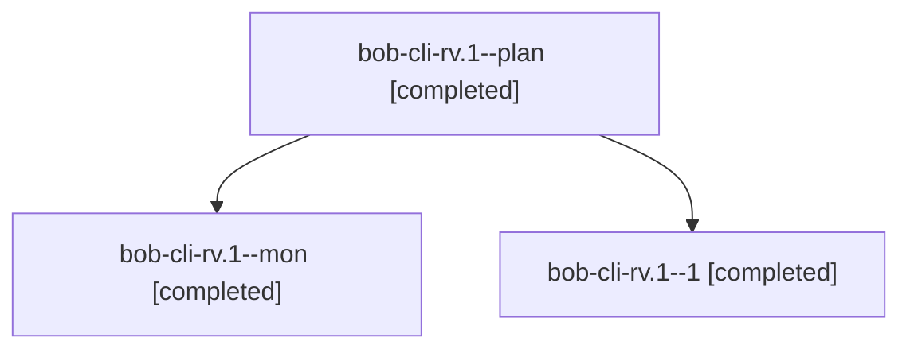

# Session: bob-cli-rv.1

[Agent Hoods](../README.md) / [bbugyi200](../users/bbugyi200/README.md) / [athena](../users/bbugyi200/machines/athena/README.md) / [bob-cli-rv](../users/bbugyi200/machines/athena/hoods/bob-cli-rv/README.md) / bob-cli-rv.1

Owner: `bbugyi200.athena` · Hood: `bob-cli-rv` · Members: 3 · Bead: [bob-cli-rv.1](https://github.com/bobs-org/bob-cli--beads/blob/main/pages/bob-cli-rv/bob-cli-rv.1.md)

## Lineage

The diagram is an optional enhancement; the ordered table below contains the same lineage in accessible text.

| Role | Agent | State | Model / provider | Timing | Commits | Prompt | Chat |
|---|---|---|---|---|---:|---|---|
| plan | bob-cli-rv.1--plan | completed | gpt-6-luna / codex | 2026-11-28T13:24:35.448530+00:00 → 2026-11-28T13:52:04.161091+00:00 | [1](../agents/bbugyi200.athena.bob-cli-rv.1--plan/README.md#commits) | [Prompt](../agents/bbugyi200.athena.bob-cli-rv.1--plan/prompt.md) | [Chat](../agents/bbugyi200.athena.bob-cli-rv.1--plan/chat.md) |
| mon | bob-cli-rv.1--mon | completed | gpt-6-luna / codex | 2026-11-28T13:50:20.135887+00:00 → 2026-11-28T14:01:39.327986+00:00 | 0 | — | [Chat](../agents/bbugyi200.athena.bob-cli-rv.1--mon/chat.md) |
| 1 | bob-cli-rv.1--1 | completed | gpt-6-luna / codex | 2026-11-28T14:01:39.234454+00:00 → 2026-11-28T14:04:24.405533+00:00 | 0 | [Prompt](../agents/bbugyi200.athena.bob-cli-rv.1--1/prompt.md) | [Chat](../agents/bbugyi200.athena.bob-cli-rv.1--1/chat.md) |

## Commits

| Role | Repo | Commit | Subject | Committed |
|---|---|---|---|---|
| plan | bob-cli | [`08165ed`](https://github.com/bobs-org/bob-cli/commit/08165ed9cafa838a079eb5ca18acead319f9fcc8) | feat(logs)!: accept stamped task-log readers | 2026-11-28 08:51:29 EST |

## Neighbors

| Agent | Relation | State |
|---|---|---|
| [bob-cli-rv.2](../agents/bbugyi200.athena.bob-cli-rv.2/README.md) | bob-cli-rv hood | completed |
| [bob-cli-rv.3](bbugyi200.athena.bob-cli-rv.3.md) (session · 3) | bob-cli-rv hood | completed 3 |
| [bob-cli-rv.4](../agents/bbugyi200.athena.bob-cli-rv.4/README.md) | bob-cli-rv hood | completed |
| [bob-cli-rv.5](bbugyi200.athena.bob-cli-rv.5.md) (session · 7) | bob-cli-rv hood | completed 5, failed 2 |
| [bob-cli-rv.6](../agents/bbugyi200.athena.bob-cli-rv.6/README.md) | bob-cli-rv hood | completed |
| [bob-cli-rv.7](bbugyi200.athena.bob-cli-rv.7.md) (session · 3) | bob-cli-rv hood | active 1, completed 1, failed 1 |
| [bob-cli-rv.8](bbugyi200.athena.bob-cli-rv.8.md) (session · 3) | bob-cli-rv hood | completed 3 |
| [bob-cli-rv.9](../agents/bbugyi200.athena.bob-cli-rv.9/README.md) | bob-cli-rv hood | waiting |
| [bob-cli-rv.land](../agents/bbugyi200.athena.bob-cli-rv.land/README.md) | bob-cli-rv hood | waiting |
