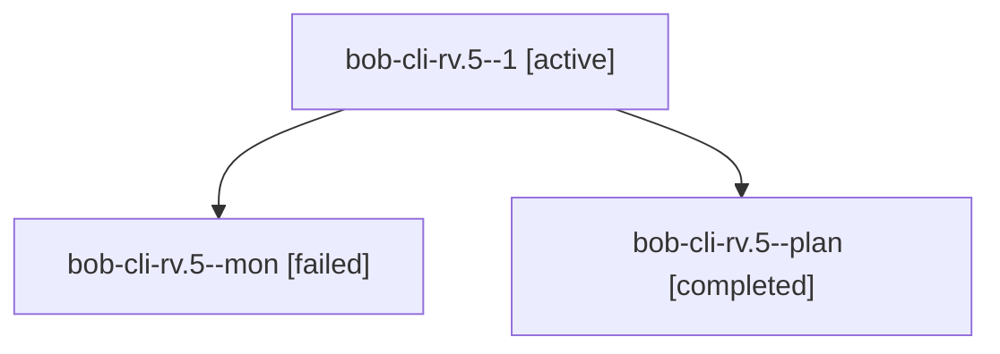

# Session: bob-cli-rv.5

[Agent Hoods](../README.md) / [bbugyi200](../users/bbugyi200/README.md) / [athena](../users/bbugyi200/machines/athena/README.md) / [bob-cli-rv](../users/bbugyi200/machines/athena/hoods/bob-cli-rv/README.md) / bob-cli-rv.5

Owner: `bbugyi200.athena` · Hood: `bob-cli-rv` · Members: 3 · Bead: [bob-cli-rv.5](https://github.com/bobs-org/bob-cli--beads/blob/main/pages/bob-cli-rv/bob-cli-rv.5.md)

## Lineage

The diagram is an optional enhancement; the ordered table below contains the same lineage in accessible text.

| Role | Agent | State | Model / provider | Timing | Commits | Prompt | Chat |
|---|---|---|---|---|---:|---|---|
| 1 | bob-cli-rv.5--1 | active | gpt-6-luna / codex | 2026-11-28T14:55:39.124204+00:00 | 0 | [Prompt](../agents/bbugyi200.athena.bob-cli-rv.5--1/prompt.md) | — |
| mon | bob-cli-rv.5--mon | failed | gpt-6-luna / codex | 2026-11-28T14:46:32.653762+00:00 → 2026-11-28T14:55:39.360794+00:00 | 0 | — | [Chat](../agents/bbugyi200.athena.bob-cli-rv.5--mon/chat.md) |
| plan | bob-cli-rv.5--plan | completed | gpt-6-luna / codex | 2026-11-28T14:04:58.567727+00:00 → 2026-11-28T14:48:20.474291+00:00 | 0 | [Prompt](../agents/bbugyi200.athena.bob-cli-rv.5--plan/prompt.md) | [Chat](../agents/bbugyi200.athena.bob-cli-rv.5--plan/chat.md) |

## Neighbors

| Agent | Relation | State |
|---|---|---|
| [bob-cli-rv.1](bbugyi200.athena.bob-cli-rv.1.md) (session · 3) | bob-cli-rv hood | completed 3 |
| [bob-cli-rv.2](../agents/bbugyi200.athena.bob-cli-rv.2/README.md) | bob-cli-rv hood | completed |
| [bob-cli-rv.3](bbugyi200.athena.bob-cli-rv.3.md) (session · 3) | bob-cli-rv hood | completed 3 |
| [bob-cli-rv.4](../agents/bbugyi200.athena.bob-cli-rv.4/README.md) | bob-cli-rv hood | waiting |
| [bob-cli-rv.6](../agents/bbugyi200.athena.bob-cli-rv.6/README.md) | bob-cli-rv hood | waiting |
| [bob-cli-rv.7](../agents/bbugyi200.athena.bob-cli-rv.7/README.md) | bob-cli-rv hood | waiting |
| [bob-cli-rv.8](../agents/bbugyi200.athena.bob-cli-rv.8/README.md) | bob-cli-rv hood | waiting |
| [bob-cli-rv.9](../agents/bbugyi200.athena.bob-cli-rv.9/README.md) | bob-cli-rv hood | waiting |
| [bob-cli-rv.land](../agents/bbugyi200.athena.bob-cli-rv.land/README.md) | bob-cli-rv hood | waiting |
