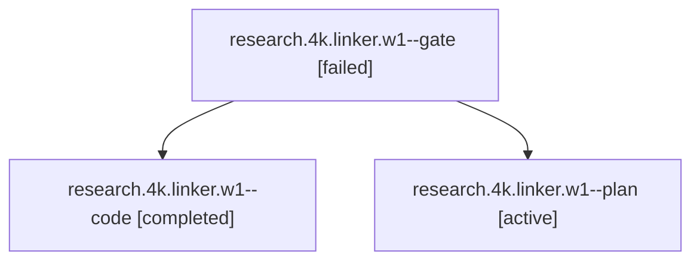

# Session: research.4k.linker.w1

[Agent Hoods](../README.md) / [bbugyi200](../users/bbugyi200/README.md) / [athena](../users/bbugyi200/machines/athena/README.md) / [research](../users/bbugyi200/machines/athena/hoods/research/README.md) / research.4k.linker.w1

Owner: `bbugyi200.athena` · Hood: `research` · Members: 3

## Lineage



The diagram is an optional enhancement; the ordered table below contains the same lineage in accessible text.

| Role | Agent | State | Model / provider | Timing | Commits | Prompt | Chat |
|---|---|---|---|---|---:|---|---|
| <a id="member-gate"></a>gate | research.4k.linker.w1--gate | failed | opus / claude | 2026-10-15T20:45:47.957917+00:00 → 2026-10-15T20:46:36.187065+00:00 | 0 | — | [Chat](../agents/bbugyi200.athena.research.4k.linker.w1--gate/chat.md) |
| <a id="member-code"></a>code | research.4k.linker.w1--code | completed | muse-spark-1.3-contributor / muse | 2026-10-15T20:47:11.964895+00:00 → 2026-10-15T20:57:42.897713+00:00 | 0 | [Prompt](../agents/bbugyi200.athena.research.4k.linker.w1--code/prompt.md) | [Chat](../agents/bbugyi200.athena.research.4k.linker.w1--code/chat.md) |
| <a id="member-plan"></a>plan | research.4k.linker.w1--plan | active | opus / claude | 2026-10-15T20:25:04.140922+00:00 | 0 | [Prompt](../agents/bbugyi200.athena.research.4k.linker.w1--plan/prompt.md) | [Chat](../agents/bbugyi200.athena.research.4k.linker.w1--plan/chat.md) |

## Variables

| Role | Variable | Value |
|---|---|---|
| code | `artifacts` | \[{kind: file, label: retire\_sase\_blog\_0 merge driver (prj=live, release=move, zk=cancel, databricks=refile, post\_blog=gate), path: /home/bryan/.sase/artifacts/agents/gh\_bobs-org\_\_bob-cli/202610151646… |

#### artifacts

**Role:** `code`

```yaml
- kind: file
  label: retire_sase_blog_0 merge driver (prj=live, release=move, zk=cancel, databricks=refile, post_blog=gate)
  path: /home/bryan/.sase/artifacts/agents/gh_bobs-org__bob-cli/20261015164636/retire_sase_blog_merge-692ec76549a4.cjs
  ref: file:explicit:8a3f979248c1b61620fb6abc
  source_path: /tmp/retire_sase_blog_merge.cjs
```

Values are truncated for display; see each member's agent meta.json for the full values.

## Neighbors

| Agent | Relation | State |
|---|---|---|
| [research.4k.linker](../agents/bbugyi200.athena.research.4k.linker/README.md) | ancestor | active |
| [research.4k.linker.w0](../agents/bbugyi200.athena.research.4k.linker.w0/README.md) | research.4k.linker hood | active |
| [research.4k.cdx](../agents/bbugyi200.athena.research.4k.cdx/README.md) | research.4k hood | active |
| [research.4k.cld](../agents/bbugyi200.athena.research.4k.cld/README.md) | research.4k hood | active |
| [research.4k.final](../agents/bbugyi200.athena.research.4k.final/README.md) | research.4k hood | active |
| [research.4k.gem](../agents/bbugyi200.athena.research.4k.gem/README.md) | research.4k hood | active |
| [research.4k.grk](../agents/bbugyi200.athena.research.4k.grk/README.md) | research.4k hood | active |
| [research.4k.image](../agents/bbugyi200.athena.research.4k.image/README.md) | research.4k hood | active |
| [research.0.cdx](../agents/bbugyi200.athena.research.0.cdx/README.md) | research hood | completed |
| [research.0.cld](../agents/bbugyi200.athena.research.0.cld/README.md) | research hood | completed |
| [research.0.final](../agents/bbugyi200.athena.research.0.final/README.md) | research hood | completed |
| [research.0.final.f1](../agents/bbugyi200.athena.research.0.final.f1/README.md) | research hood | completed |
| [research.0.image](../agents/bbugyi200.athena.research.0.image/README.md) | research hood | completed |
| [research.0h.cdx](../agents/bbugyi200.athena.research.0h.cdx/README.md) | research hood | active |
| [research.0h.cld](../agents/bbugyi200.athena.research.0h.cld/README.md) | research hood | active |
| [research.0h.final](../agents/bbugyi200.athena.research.0h.final/README.md) | research hood | active |
| [research.0h.image](../agents/bbugyi200.athena.research.0h.image/README.md) | research hood | active |
| [research.0m.cdx](../agents/bbugyi200.athena.research.0m.cdx/README.md) | research hood | completed |
| [research.0m.cld](../agents/bbugyi200.athena.research.0m.cld/README.md) | research hood | completed |
| [research.0m.final](../agents/bbugyi200.athena.research.0m.final/README.md) | research hood | completed |
| [research.0m.image](../agents/bbugyi200.athena.research.0m.image/README.md) | research hood | completed |
| [research.1a.cdx](../agents/bbugyi200.athena.research.1a.cdx/README.md) | research hood | active |
| [research.1a.cld](../agents/bbugyi200.athena.research.1a.cld/README.md) | research hood | active |
| [research.1a.final](../agents/bbugyi200.athena.research.1a.final/README.md) | research hood | active |
| [research.1a.image](../agents/bbugyi200.athena.research.1a.image/README.md) | research hood | active |
| [research.2o.cdx](../agents/bbugyi200.athena.research.2o.cdx/README.md) | research hood | active |
| [research.2o.final](../agents/bbugyi200.athena.research.2o.final/README.md) | research hood | active |
| [research.2o.gem](../agents/bbugyi200.athena.research.2o.gem/README.md) | research hood | active |
| [research.2o.grk](../agents/bbugyi200.athena.research.2o.grk/README.md) | research hood | active |
| [research.2o.image](../agents/bbugyi200.athena.research.2o.image/README.md) | research hood | active |
| [research.2o.mus](../agents/bbugyi200.athena.research.2o.mus/README.md) | research hood | active |
| [research.31.cdx](../agents/bbugyi200.athena.research.31.cdx/README.md) | research hood | active |
| [research.31.cld](../agents/bbugyi200.athena.research.31.cld/README.md) | research hood | active |
| [research.31.final](../agents/bbugyi200.athena.research.31.final/README.md) | research hood | active |
| [research.31.gem](../agents/bbugyi200.athena.research.31.gem/README.md) | research hood | active |
| [research.31.grk](../agents/bbugyi200.athena.research.31.grk/README.md) | research hood | active |
| [research.31.image](../agents/bbugyi200.athena.research.31.image/README.md) | research hood | active |
| [research.31.linker](../agents/bbugyi200.athena.research.31.linker/README.md) | research hood | active |
| [research.31.mus](../agents/bbugyi200.athena.research.31.mus/README.md) | research hood | active |
| [research.32.cdx](../agents/bbugyi200.athena.research.32.cdx/README.md) | research hood | active |
| [research.32.cld](../agents/bbugyi200.athena.research.32.cld/README.md) | research hood | active |
| [research.32.final](../agents/bbugyi200.athena.research.32.final/README.md) | research hood | active |
| [research.32.gem](../agents/bbugyi200.athena.research.32.gem/README.md) | research hood | active |
| [research.32.grk](../agents/bbugyi200.athena.research.32.grk/README.md) | research hood | active |
| [research.32.image](../agents/bbugyi200.athena.research.32.image/README.md) | research hood | active |
| [research.32.linker](../agents/bbugyi200.athena.research.32.linker/README.md) | research hood | active |
| [research.32.mus](../agents/bbugyi200.athena.research.32.mus/README.md) | research hood | active |
| [research.35.cdx](../agents/bbugyi200.athena.research.35.cdx/README.md) | research hood | active |
| [research.35.cld](../agents/bbugyi200.athena.research.35.cld/README.md) | research hood | active |
| [research.35.final](../agents/bbugyi200.athena.research.35.final/README.md) | research hood | active |
| [research.35.gem](../agents/bbugyi200.athena.research.35.gem/README.md) | research hood | active |
| [research.35.grk](../agents/bbugyi200.athena.research.35.grk/README.md) | research hood | active |
| [research.35.image](../agents/bbugyi200.athena.research.35.image/README.md) | research hood | active |
| [research.35.linker](../agents/bbugyi200.athena.research.35.linker/README.md) | research hood | active |
| [research.35.mus](../agents/bbugyi200.athena.research.35.mus/README.md) | research hood | active |
| [research.39.cdx](../agents/bbugyi200.athena.research.39.cdx/README.md) | research hood | active |
| [research.39.cld](../agents/bbugyi200.athena.research.39.cld/README.md) | research hood | active |
| [research.39.final](../agents/bbugyi200.athena.research.39.final/README.md) | research hood | active |
| … and 287 more in the [hood roster](../users/bbugyi200/machines/athena/hoods/research/README.md) | research hood | — |
