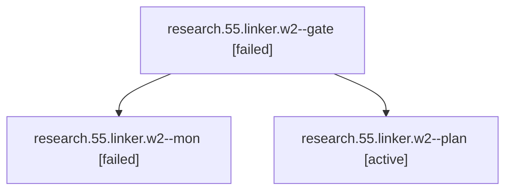

# Session: research.55.linker.w2

[Agent Hoods](../README.md) / [bbugyi200](../users/bbugyi200/README.md) / [athena](../users/bbugyi200/machines/athena/README.md) / [research](../users/bbugyi200/machines/athena/hoods/research/README.md) / research.55.linker.w2

Owner: `bbugyi200.athena` · Hood: `research` · Members: 3

## Lineage

The diagram is an optional enhancement; the ordered table below contains the same lineage in accessible text.

| Role | Agent | State | Model / provider | Timing | Commits | Prompt | Chat |
|---|---|---|---|---|---:|---|---|
| gate | research.55.linker.w2--gate | failed | opus / claude | 2026-10-23T12:23:32.170110+00:00 → 2026-10-23T12:24:10.233726+00:00 | 0 | — | [Chat](../agents/bbugyi200.athena.research.55.linker.w2--gate/chat.md) |
| mon | research.55.linker.w2--mon | failed | opus / claude | 2026-10-23T12:24:07.630989+00:00 → 2026-10-23T12:28:13.740899+00:00 | 0 | — | [Chat](../agents/bbugyi200.athena.research.55.linker.w2--mon/chat.md) |
| plan | research.55.linker.w2--plan | active | opus / claude | 2026-10-23T11:33:55.895549+00:00 | 0 | [Prompt](../agents/bbugyi200.athena.research.55.linker.w2--plan/prompt.md) | [Chat](../agents/bbugyi200.athena.research.55.linker.w2--plan/chat.md) |

## Neighbors

| Agent | Relation | State |
|---|---|---|
| [research.55.linker](../agents/bbugyi200.athena.research.55.linker/README.md) | ancestor | active |
| [research.55.linker.w0](../agents/bbugyi200.athena.research.55.linker.w0/README.md) | research.55.linker hood | active |
| [research.55.linker.w1](../agents/bbugyi200.athena.research.55.linker.w1/README.md) | research.55.linker hood | active |
| [research.55.cdx](../agents/bbugyi200.athena.research.55.cdx/README.md) | research.55 hood | active |
| [research.55.cld](../agents/bbugyi200.athena.research.55.cld/README.md) | research.55 hood | active |
| [research.55.final](../agents/bbugyi200.athena.research.55.final/README.md) | research.55 hood | active |
| [research.55.gem](../agents/bbugyi200.athena.research.55.gem/README.md) | research.55 hood | active |
| [research.55.grk](../agents/bbugyi200.athena.research.55.grk/README.md) | research.55 hood | active |
| [research.55.image](../agents/bbugyi200.athena.research.55.image/README.md) | research.55 hood | active |
| [research.55.mus](../agents/bbugyi200.athena.research.55.mus/README.md) | research.55 hood | active |
| [research.0.cdx](../agents/bbugyi200.athena.research.0.cdx/README.md) | research hood | completed |
| [research.0.cld](../agents/bbugyi200.athena.research.0.cld/README.md) | research hood | completed |
| [research.0.final](../agents/bbugyi200.athena.research.0.final/README.md) | research hood | completed |
| [research.0.final.f1](../agents/bbugyi200.athena.research.0.final.f1/README.md) | research hood | completed |
| [research.0.image](../agents/bbugyi200.athena.research.0.image/README.md) | research hood | completed |
| [research.0h.cdx](../agents/bbugyi200.athena.research.0h.cdx/README.md) | research hood | active |
| [research.0h.cld](../agents/bbugyi200.athena.research.0h.cld/README.md) | research hood | active |
| [research.0h.final](../agents/bbugyi200.athena.research.0h.final/README.md) | research hood | active |
| [research.0h.image](../agents/bbugyi200.athena.research.0h.image/README.md) | research hood | active |
| [research.0m.cdx](../agents/bbugyi200.athena.research.0m.cdx/README.md) | research hood | completed |
| [research.0m.cld](../agents/bbugyi200.athena.research.0m.cld/README.md) | research hood | completed |
| [research.0m.final](../agents/bbugyi200.athena.research.0m.final/README.md) | research hood | completed |
| [research.0m.image](../agents/bbugyi200.athena.research.0m.image/README.md) | research hood | completed |
| [research.1a.cdx](../agents/bbugyi200.athena.research.1a.cdx/README.md) | research hood | active |
| [research.1a.cld](../agents/bbugyi200.athena.research.1a.cld/README.md) | research hood | active |
| [research.1a.final](../agents/bbugyi200.athena.research.1a.final/README.md) | research hood | active |
| [research.1a.image](../agents/bbugyi200.athena.research.1a.image/README.md) | research hood | active |
| [research.2o.cdx](../agents/bbugyi200.athena.research.2o.cdx/README.md) | research hood | active |
| [research.2o.final](../agents/bbugyi200.athena.research.2o.final/README.md) | research hood | active |
| [research.2o.gem](../agents/bbugyi200.athena.research.2o.gem/README.md) | research hood | active |
| [research.2o.grk](../agents/bbugyi200.athena.research.2o.grk/README.md) | research hood | active |
| [research.2o.image](../agents/bbugyi200.athena.research.2o.image/README.md) | research hood | active |
| [research.2o.mus](../agents/bbugyi200.athena.research.2o.mus/README.md) | research hood | active |
| [research.31.cdx](../agents/bbugyi200.athena.research.31.cdx/README.md) | research hood | active |
| [research.31.cld](../agents/bbugyi200.athena.research.31.cld/README.md) | research hood | active |
| [research.31.final](../agents/bbugyi200.athena.research.31.final/README.md) | research hood | active |
| [research.31.gem](../agents/bbugyi200.athena.research.31.gem/README.md) | research hood | active |
| [research.31.grk](../agents/bbugyi200.athena.research.31.grk/README.md) | research hood | active |
| [research.31.image](../agents/bbugyi200.athena.research.31.image/README.md) | research hood | active |
| [research.31.linker](../agents/bbugyi200.athena.research.31.linker/README.md) | research hood | active |
| [research.31.mus](../agents/bbugyi200.athena.research.31.mus/README.md) | research hood | active |
| [research.32.cdx](../agents/bbugyi200.athena.research.32.cdx/README.md) | research hood | active |
| [research.32.cld](../agents/bbugyi200.athena.research.32.cld/README.md) | research hood | active |
| [research.32.final](../agents/bbugyi200.athena.research.32.final/README.md) | research hood | active |
| [research.32.gem](../agents/bbugyi200.athena.research.32.gem/README.md) | research hood | active |
| [research.32.grk](../agents/bbugyi200.athena.research.32.grk/README.md) | research hood | active |
| [research.32.image](../agents/bbugyi200.athena.research.32.image/README.md) | research hood | active |
| [research.32.linker](../agents/bbugyi200.athena.research.32.linker/README.md) | research hood | active |
| [research.32.mus](../agents/bbugyi200.athena.research.32.mus/README.md) | research hood | active |
| [research.35.cdx](../agents/bbugyi200.athena.research.35.cdx/README.md) | research hood | active |
| [research.35.cld](../agents/bbugyi200.athena.research.35.cld/README.md) | research hood | active |
| [research.35.final](../agents/bbugyi200.athena.research.35.final/README.md) | research hood | active |
| [research.35.gem](../agents/bbugyi200.athena.research.35.gem/README.md) | research hood | active |
| [research.35.grk](../agents/bbugyi200.athena.research.35.grk/README.md) | research hood | active |
| [research.35.image](../agents/bbugyi200.athena.research.35.image/README.md) | research hood | active |
| [research.35.linker](../agents/bbugyi200.athena.research.35.linker/README.md) | research hood | active |
| [research.35.mus](../agents/bbugyi200.athena.research.35.mus/README.md) | research hood | active |
| [research.39.cdx](../agents/bbugyi200.athena.research.39.cdx/README.md) | research hood | active |
| [research.39.cld](../agents/bbugyi200.athena.research.39.cld/README.md) | research hood | active |
| [research.39.final](../agents/bbugyi200.athena.research.39.final/README.md) | research hood | active |
| … and 302 more in the [hood roster](../users/bbugyi200/machines/athena/hoods/research/README.md) | research hood | — |
