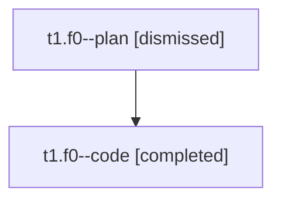

# Session: t1.f0

[Agent Hoods](../README.md) / [bbugyi200](../users/bbugyi200/README.md) / [athena](../users/bbugyi200/machines/athena/README.md) / [t1](../users/bbugyi200/machines/athena/hoods/t1/README.md) / t1.f0

Owner: `bbugyi200.athena` · Hood: `t1` · Members: 2

## Lineage

The diagram is an optional enhancement; the ordered table below contains the same lineage in accessible text.

| Role | Agent | State | Model / provider | Timing | Commits | Prompt | Chat |
|---|---|---|---|---|---:|---|---|
| plan | t1.f0--plan | dismissed | opus / claude | 2026-08-05T14:20:24.249908 → 2026-08-05T15:01:21.892861 | 0 | [Prompt](../agents/bbugyi200.athena.t1.f0--plan/prompt.md) | [Chat](../agents/bbugyi200.athena.t1.f0--plan/chat.md) |
| code | t1.f0--code | completed | sonnet / claude | 2026-08-05T18:34:08.346022+00:00 | [1](../agents/bbugyi200.athena.t1.f0--code/README.md#commits) | — | [Chat](../agents/bbugyi200.athena.t1.f0--code/chat.md) |

## Commits

| Role | Repo | Commit | Subject | Committed |
|---|---|---|---|---|
| code | — | `a53828a` | feat(capture): add p:\<N\> priority token | 2026-08-05 15:00:37 EDT |

## Neighbors

| Agent | Relation | State |
|---|---|---|
| [t1](bbugyi200.athena.t1.md) (session · 2) | ancestor | completed 1, dismissed 1 |
